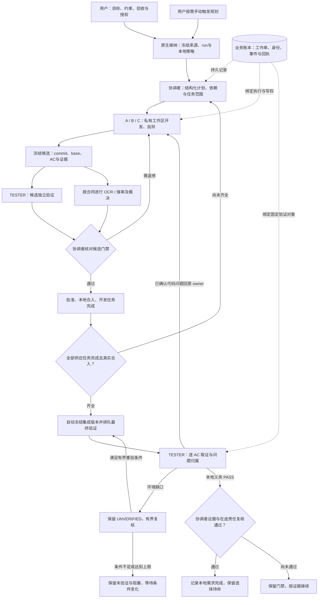
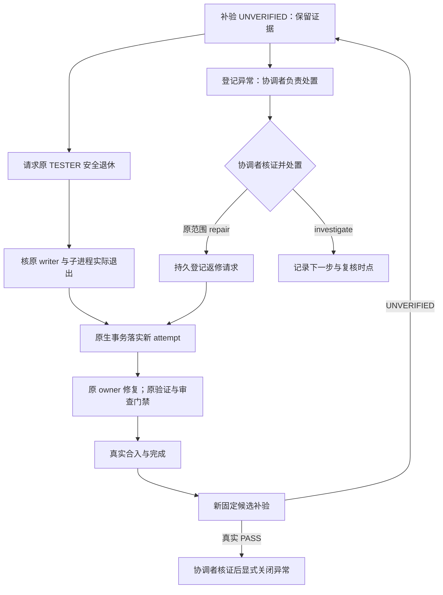

# 角色工作流使用指南：需求接入、开发、最终验收与恢复

**校正日期：2026-10-30，时间统一为 Asia/Shanghai（+08:00）。适用于已启用业务账本的 ACTIVE 模式。裁决材料版 3.31。观察修复：长测试按受控期限派生宽限期；写权诊断异常/恢复各稳定 120 秒后通知。**

日常操作在既有协调者飞书群完成；A、B、C 和 TESTER 群用于查看各自工作及控制本角色。固定五角色复用于不同需求，不需要为每个需求重新建群。规划者仍由用户按需手动触发，不是第六个常驻角色。

你主要负责目标、范围、验收标准和必要的业务裁决。明确的开发请求经原生入口接纳后，本地派单、开发、自测、独立验证、返修、基线刷新、批准、合入及最终验收按有效合同自动接续。内部工作不需要逐任务或逐 attempt 再授权；OCR、付费强审、生产与真实远端副作用分别遵守其授权边界。

**开发叶任务完成，还要经过固定集成版本的独立最终验证和协调者证据复核，才算本地需求验收完成。** 本地完成与 push、真实节点验收、生产/NAS 启用分别记账。

最常用的消息是：

```text
请只读核对当前需求、run_id、本地开发策略、各角色工作、最终验收阶段和下一步。
请区分实际测试结果、观察告警与已完成裁决。
```

```text
开发 <需求ID>：<目标和验收条件>，代码仓 <绝对路径>，需求根 <绝对路径>。
请自动推进并交付；不要部署生产或 push。
```

`<run-id>`、`<task-id>`、`<candidate-id>` 等均为占位符，发送前换成精确值。下文的工具名用于解释后台行为，不要求你手工调用。

本文依据当前实现及实际回执修订。旧报告和包内启动说明用于追溯登记身份、冻结合同和历史事实；其中旧预算、人工逐项授权或手动派发最终验收的步骤，不应覆盖当前有效策略。当前选择和运行结果仍须查询账本。

## 先读这张操作表

| 你要做什么 | 在哪里做 | 可以发送什么 | 怎样确认结果 |
| --- | --- | --- | --- |
| 查看当前进展 | 协调者群 | `请只读核对当前需求、角色、阻塞、最终验收和下一步。` | 有采样时间、账本依据，区分历史检查点与当次核验 |
| 开发新需求 | 协调者群 | `开发 <需求ID>：<目标和验收>，请自动推进并交付。` | 有接纳 run、冻结来源、本地开发策略、审查预算及选择回执 |
| 首次启动已登记包 | 协调者群 | 按包内适配页说明，明确 `开发 <需求ID>，本期任务 <精确列表>，自动推进并交付` | 复用已登记 run，出现接纳、选择、计划及执行证据 |
| 切回已接纳的 run | 协调者群 | `全部权限：切换到 <run-id>` | 选择 APPLIED，旧 owner 安全交接；暂停需另行解除 |
| 暂停整个需求 | 协调者群 | `暂停当前需求` | 控制 APPLIED；在途进程和独立服务另核收口 |
| 恢复暂停的需求 | 协调者群 | `恢复当前需求` | 对应暂停解除；其他门禁仍有效 |
| 复核并继续当前需求 | 协调者群 | `继续当前需求` | 请求已应用，有可执行工作时接续；不解除暂停 |
| 暂停/恢复一个角色 | 协调者群 | `全部权限：暂停 <run-id> 的 A` / `全部权限：恢复 <run-id> 的 A` | 角色控制正确；需求暂停不会因此解除 |
| 取消一个任务 | 协调者群 | `全部权限：取消 <run-id> 的任务 <task-id>` | 任务 CANCELLED，原执行及外部副作用另核 |
| 明确要求候选返修 | 协调者群 | `全部权限：返修 <run-id> 的候选 <candidate-id>` | 旧候选保留，新 attempt 按原合同推进 |
| 回答协调者已提出的选项 | 协调者群 | `按解读B` | 先有原文登记，再有协调者关联及处置回执 |
| 要求隔离 MySQL 补验 | 协调者群 | `<task-id> 迁移 MySQL 双向补验归属 TESTER 隔离 MySQL 会话` | 有请求事件及补验工作单；领取不等于 PASS |

一次只发一个控制动作，核对回执后再发下一条。查询和讨论可正常进行。尚未开发接纳的 `prepared-*` 包，不能仅靠“切换/恢复”代替首次接纳。

## 1. 这套机制如何工作



| 角色 | 当前职责 |
| --- | --- |
| 你 | 确定业务目标、范围、验收、优先级；处理需要业务判断或新增外部授权的问题 |
| 规划/维护助手 | 用户手动触发时调查、澄清、准备合同；处理尚未接入的仓库、资源或运行能力 |
| COORDINATOR | 发布计划、安排依赖、准备受管审查材料、裁决、返修、批准、本地合入和需求级证据复核 |
| A / B / C | 按既有派单在各自受控工作区开发、自测、交付候选及返修，不承担总体调度 |
| TESTER | 对固定候选、补验对象及最终集成版本独立取证，保留真实失败，不修改业务实现或批准合入 |
| OCR / 强审服务 | 审查明确候选并保存结果；服务完成不替代协调者裁决 |

R2 事件派发已启用，原周期 job 保留为恢复入口。事件先保存，再由 Gateway tick 复核准入并启动独立 worker；`PENDING_GATEWAY` 只表示等待接续。角色忙、暂停或依赖不满足时不会另起同角色写入者；周期检查也不等于每次都调用模型。

模型负责业务判断，程序维护身份、工作单、门禁和回执。进程存活、CPU 活跃、聊天中说“完成”或一条成功的工具返回，都不能替代正式交付与完成裁决。

## 2. 你需要认识的几个对象

| 对象 | 含义与用途 |
| --- | --- |
| 需求包 | `doc/prd/<需求名>/` 中的目标、设计、验收和原始材料；索引只负责导航 |
| run | 一次明确范围的执行批次；切换、暂停、恢复时用精确 run_id |
| task / attempt | 开发任务及其尝试代次；返修保留旧记录并增加 attempt |
| work | 角色持久承担的工作单，可以跨技术会话接续；另有补验和最终集成验证等工作类型 |
| execution | 一次真实 worker 执行，绑定原生身份与执行代次；工作单和实际进程并非同一生命周期 |
| candidate | 固定候选，绑定 commit、base、AC 版本与证据；新 head 不能沿用旧通过结论 |
| checkpoint | 已保存的成果、阻塞、未处理事项和下一步；属于其保存时点的事实 |
| 本地开发策略 | 已接纳 run 的本地自动化范围、任务与合入分支；受暂停、取消、完成及撤销约束 |
| completion plan | 需求级最终验证与收口计划；独立于 A/B/C 的开发任务列表 |

**`business.sqlite3` 是运行状态权威。** PRD/设计/验收文档约束业务，已发布任务规格固定本次合同；TODO、报告、群通知是阅读和定位入口。编辑 TODO 不会创建可领取任务，Markdown 勾选也不会写入完成裁决。

查询时至少区分：当前选中 run、某角色 work 所属 run、固定候选/集成 SHA、业务结果及观察/通知状态。它们可能处于不同阶段。

## 3. 有一个新需求要开发，我该怎么做

### 第一步：说明目标、范围和验收

明确需求可直接交协调者接入，不需要你拆 A/B/C 派单：

```text
开发 <需求ID>，请自动推进并交付。
需求根：<已存在的绝对路径>。
代码仓：<已存在的绝对路径>。
业务目标：<用户要得到什么>。
本期范围：<必须完成的内容>。
本期不做：<排除项>。
验收条件：<可观察、可验证的标准>。
环境和约束：<可用资源及生产限制>。

请冻结原文或现有合同，拆分任务、依赖、角色范围、审查要求和停止条件，
完成本地开发、候选验收、合入、最终集成验证和收口。
不要部署生产或 push。
```

需要指定本地合入分支时，再明确写 `验收通过后合入 <目标分支>`。当前原生接纳接口会核对显式目标与仓库当前分支；不匹配时先处理目标身份，不能谎报接纳成功。

未指定分支、也未限制合入时，运行时可选择受管 `workflow/...` 分支并在回执中说明，不必只为机械选择分支再问你一次。`main/master` 需要明确目标；若你要求“先交候选”“暂不合入”“分支稍后由我决定”，则保留该限制，不能自动改成完整合入授权。

复杂需求可先手动触发规划助手，形成 `README / PRD / DESIGN / TODO / ACCEPTANCE / HANDOFF` 或等价材料，再进入开发。普通查询和讨论不自动变成新需求；明确开发、实现或修复的请求可以进入专用接纳，不要求统一的“全部权限”口令。

代码仓、需求根及受控能力必须可核验。没有现成文档时可冻结真实用户原文；这不表示接口能凭空创建任意仓库或接通未登记资源。无法识别的根、仓库或业务歧义应集中澄清，确需维护接入的由维护助手准备。

### 第二步：区分首次接纳、已有登记与仅整理材料

| 现状 | 正确入口 |
| --- | --- |
| 新需求，已有可用目录和仓库 | 协调者用 `accept_requirement` 冻结来源并登记本期范围 |
| 已有待启动 `prepared-*` 包 | 核对 `WORKFLOW-ADAPTER.md` / `REGISTRATION.json`，复用其 run 并冻结要求的全部合同文件 |
| 已经接纳、已有计划的 run | 查询后使用继续、恢复或切换，不重新接纳、重建同名批次 |
| 只整理登记，暂不开发 | 明确交维护助手做登记；登记不选择 run、不派单、不提前消耗 OCR 窗口 |
| 参考项或已有长期方案 | 先明确本期可执行任务与 AC；参考目录本身不是开发 run |

登记目录见 [需求登记与启动规则](prd/WORKFLOW-REGISTRY.md)。其中 2026-10-22 的状态表是历史登记快照，不是实时清单；旧预算和分支授权说明以当前策略及本指南第 8 节核对。

历史包若要求列本批精确任务 ID，应按适配材料列出；不得把历史 DONE/DEFERRED 一并重做。已登记合同文件发生变化，需要审阅并更新登记，不能继续拿旧哈希接纳新内容。已有运行任务的范围调整则走受控变更，不静默改写冻结 AC。

### 第三步：核对接纳与选择回执

明确“自动推进”且原生接纳成功时，接口会请求选择该 run；旧 owner 按安全交接规则收口。不必再重复发一次切换。

若只是切回已经接纳的 run，可发送：

```text
全部权限：切换到 <run-id>
```

选择不会自动恢复暂停。不要在首次接纳新需求之前先说“恢复当前需求”，因为“当前”可能仍指旧需求。

### 第四步：确认真正开工

```text
请只读核对这次接纳/切换：run_id、冻结来源、选择是否生效、计划版本、
本地开发策略的合入分支、OCR 预算与期限，以及已领取的工作和未启动原因。
```

“收到”“已登记”“控制已接受”都不等于开工。应分别看到需求接纳、选择生效、结构化计划，以及有可执行工作时对应的 work/execution。无计划、旧 writer 未退、暂停、资源冲突或能力缺失，应给出具体等待原因。

## 4. 启动后开发、测试与交付怎样推进

### 开发任务的循环

1. **发布计划。** 固定角色、依赖、base、scope、AC、required_checks 和停止条件；最终验证与收口里程碑不伪装成 A/B/C 开发任务。
2. **绑定工作与执行。** 开发者使用私有受控工作区；同仓重叠写范围保守串行，不直接把 IDE 主工作树当作任意共享写区。
3. **开发、自测、保存检查点。** 角色按本单合同推进，无法继续时保存具体阻断和下一步。
4. **冻结候选。** 记录完整 commit、base、AC 与证据，进入 REVIEW；无代码增量的 `head=base` 不能作占位交付。
5. **独立验证与审查。** TESTER 验证固定快照，OCR/强审按合同执行；`RESULT_READY` 仍等待语义裁决。
6. **返修或批准。** 缺陷回原任务，新 head 重新走门禁，原失败通过明确证据闭环。
7. **本地合入和任务完成。** 核对当前候选、分支、base、授权及真实合入回执后记录开发任务完成。

候选独立验证与审查的具体先后顺序以有效任务合同为准。

多路任务先后合入会改变基线。已交付候选通过 `refresh_task_base` 建立新 attempt；尚未交付的开发工作使用 `refresh_development_base` 安全刷新，保存原私有成果。下游领取锚定已审计集成基线；旧测试和批准不能直接搬给新候选。

旧候选验证阻挡返修或刷新时，运行时登记退休请求；TESTER 在安全点让出并退出，原生 writer 和工具子进程核退后收口。历史占位验证单按相同保护退役，保留原结果，不制造 PASS。这属于内部生命周期处理，不需要用户批准“释放旧验证”。

### 需求级最终验收

**全部开发任务完成且真实合入后，程序自动冻结集成 SHA 并建立 TESTER 最终验证工作单，不再等待用户另发派单裁决。** 自动化以有效本地开发策略、冻结需求材料、真实供应候选和合入证据为前提；缺少任一项时应说明门禁，而非假定完成。

TESTER 通过 `verify_integration` 分批取证，再用 `deliver_integration` 提交完整 AC 覆盖、执行类型、证据事件和问题归属。未执行、环境缺口、skip 或失效证据不能证明相应 AC 的 PASS；合同要求隔离 MySQL 时还须真实隔离实例证据，SQLite 或替身不能替代该项。

| 最终验证事实 | 接续方式 |
| --- | --- |
| 已确认代码问题 | 带唯一问题 ID、原 task_id 和真实 FAIL 证据；TESTER 及原 writer 核退后，回原 owner 的新 attempt |
| 只有环境缺口或未验证项 | 保留 UNVERIFIED，核对具体环境；同一固定目标最多 3 个自动验证工作单，已报告后的重试至少间隔 5 分钟 |
| 目标提交、供应候选或冻结材料变化 | 原通过路径失效，安全交接后针对新的有效目标重新验证 |
| 全部 AC 的本地义务 PASS | 协调者复核当前固定版本、原始证据、历史失败处置和未结束责任，再执行 `complete_requirement` |

自动返修保持原角色、scope、AC 和 required_checks；仍经过自测、独立测试、OCR/适用强审、批准及合入。环境问题不直接回派为代码缺陷，不能通过删用例、改统计或无限重跑取得通过。

同一 AC 按义务分阶段，而不是整项交给一个角色。MN 合同冻结每项 `local_validation`（TESTER）、`local_closure`（协调者），另列真实节点及生产的未授权、未完成义务。AC10 本地报告索引先形成，协调者随后审查并生成收口回执，不再互相等待；真实隔离 MySQL 门禁仍保留。旧验收计划追加 `COMPLETION_OBLIGATIONS_FROZEN`，不重写旧报告或把历史 UNVERIFIED 改成 PASS。

逐 AC 的 `coverage` 给出冻结合同摘要、原文场景、断言、环境与真实 JUnit `case_id`；报告索引用事件引用，无需伪造 pytest 成绩。程序核对编号、场景、实际 case 和环境，协调者再逐项 `coverage_review` 核对语义。机械全绿不能代替覆盖审查。

问题记录增加 `blocking/confidence/accepted_scope/ac_ids/disposition/owner`。只有已确认、阻断本地合同且处置为返修的代码问题自动回派；待调查项不自动返修，也不能凭猜测通过。非阻断及范围外事项须给依据，并由协调者带证据逐项处置才能收口；原始 FAIL 永久保留。环境等待同目标最多三轮、间隔至少300秒；恢复后由协调者以新的真实证据调用 `environment_recovered` 重开有界预算，不改旧结果。

最终 PASS 也不等于已经收口。协调者还要核对 TESTER 原生执行退出、待处理验证和外部结果，原 OCR/强审失败仍须按原审查闭环。真正完成以 `REQUIREMENT_COMPLETED` 及其收口回执为准。

### 接续游标、输入页与观察生命周期

`checkpoint` 正文只保存业务事实。`processed_through` 与 `yield_execution` 必须放在 payload 外层；误嵌套会拒绝保存并说明正确结构，回执明确显示实际 processed/issued、work/execution 状态及是否 yield。历史正文里同名字段不能当成已确认水位。处理完整页后用 `ack_events(through)` 或外层 processed_through 确认已发行的连续前缀；未确认时用 `next_after` 续读，历史查询永不确认事件。

重复恢复三次且没有水位或新业务反馈时按60～900秒有界退避，新业务反馈可提前解除；退避不确认未读事件，也不释放未知写者。新输入页最多64 KiB，超大事件保留完整哈希引用；命令仅保存不可变页引用，重复页不再重复写入大正文。`input-pages/` 是审计存储，须与数据库一并备份，不按年龄删除。历史3 GB账本保留；容量警戒为2 GiB，不能把停止新增写放大说成旧库已缩小，在线不做 VACUUM 或删除历史命令。

最终验证排队、报告、返修及本地收口接入统一通知注册表。日间新事件按原出口消费；超过30分钟的此类 PENDING 显式记为过时抑制并保留原事件，避免上线集中补发；UNKNOWN 不盲重发，夜间静默语义保持。

已终结服务改查持久终态回执和源哈希，不再因为临时 systemd unit 被回收就报当前存活故障。结果 INCOMPLETE 仍展示为证据债，缺少终止证明的 UNKNOWN 写者继续保留。健康视图分别展示当前业务权威、写者/在途服务、采集器故障、历史证据债和容量。无活动阈值为显式策略；本次采用1800秒观察阈值，不是业务超时或接管授权，合法长测试仍按已登记任务期限加宽限期观察。

测试完整参数预检先于 request 冻结及 checkout。`INVALID_NOT_STARTED` 可修正后沿用 command_id；PREPARED/STARTED/RESULT_READY 仍严格幂等，已启动或未知结果不得改参重放。

## 5. 日常使用时你需要做什么

通常只需查询进度、回答明确升级的业务问题，以及提供当前确实缺少的外部授权。

```text
请只读核对当前进展：本轮新成果、当前工作、未满足门禁和下一步由谁做。
如果开发任务已完成，请继续说明最终验收和需求收口是否完成。
```

协调者群看全局，A/B/C/TESTER 群看本人状态。查询不领取任务、不确认输入、不解除暂停；回复迟到时先核入口和原生排队，避免重复派同一任务。

协调者已提出明确选项时，可以直接答“按解读B”。原生入口先保存原文和消息身份，`COMMITTED/DUPLICATE` 表示登记；协调者仍需关联原问题、当前实现及处置依据，记录 `USER_DECISION_RESOLVED`。只有登记回执而无处置时，应接续已有答复，不让你重复发全权口令。短答复本身不证明测试通过、失败关闭或新外部授权。

变更业务范围或验收先明确新合同。可以在合法范围内受控扩展回归文件 scope，但不能借此修改原 AC、扩大到其他任务资源或继承旧候选门禁。新增登记清单之外的任务，需要明确接入范围，不能只追加 TODO 就期待自动领取。

内部派单、旧验证安全退出、文档审核、基线刷新和原范围返修，应由后台在有效授权内完成。日志中的 `eNNNN` 是事件定位，不是需要用户批准的对象；旧检查点中的“待授权”也不应凭空新增门禁。

## 6. 怎么切换到另一个需求

对已经接纳的目标 run，在协调者群发送：

```text
全部权限：切换到 <目标run-id>
```

| 回执层次 | 已证明的事实 | 尚不能推断 |
| --- | --- | --- |
| ACCEPTED | 控制请求已持久保存 | 当前选择已经改变 |
| APPLIED / RUN_SELECTED | 选择已写入账本 | 所有角色和外部操作已离开旧需求 |
| 角色已绑定目标 run | 该角色开始按目标范围执行 | 其他角色已交接或目标需求已完成 |

旧活动 run 转入 DRAINING，原工作保留身份做受限收口。接续按角色和工作单处理，不是杀掉全部进程的原子切换；共享资源还要检查冲突。目标 PAUSED 时，选择不解除其暂停。

某角色暂时仍显示旧 run，应核其 work.run_id、writer、drain 状态及未结束独立服务。空闲旧协调 work 可自动收口；有 writer 时先安全释放并核退，不能用旧身份发布新需求计划。原候选、检查点和失败证据保留，切回后按保存事实接续，不保证复用每个旧工作区。

日常切换无需重跑首次 STAGED/P0/T1/T2/M/R 迁移，也无需重启 Gateway。运行机制更新才属于维护发布。

## 7. 暂停、继续、恢复和取消有什么区别

| 动作 | 实际作用 |
| --- | --- |
| 暂停需求 | 将 run 置为 PAUSED，阻止新的普通业务动作；在途进程、操作及独立服务另核收口 |
| 暂停角色 | 暂停该角色；角色池级控制不会因切到另一个需求而自动解除 |
| 暂停任务 | 阻断指定开发任务，保留责任与证据 |
| 继续 | 请求复核并继续已接纳工作，不解除暂停、不补足授权或门禁 |
| 恢复 | 解除指定 run/角色/任务的暂停；其他层控制仍有效 |
| 取消 | 撤销对应执行意图、保留历史；不是可直接恢复的普通暂停 |

控制具体任务可使用：

```text
全部权限：暂停 <run-id> 的任务 <task-id>
```

```text
全部权限：恢复 <run-id> 的任务 <task-id>
```

A/B/C/TESTER 自己的群只能控制本角色允许的暂停、恢复和继续；切 run、跨角色、任务取消、候选返修及审查/合入授权统一在协调者群处理。

原生 `/stop`、`/cancel` 等会话控制与业务控制不同。停止聊天回合不能证明需求已暂停，也不能证明独立 OCR 或远端操作停止；暂停业务后仍须核回执及在途事实。

## 8. OCR、强审查、合入和生产操作怎么授权

### 一次接纳与具体控制的边界

角色群普通回合默认只读。当前原生明确开发、继续、暂停、恢复、补验或裁决原文，可以通过对应专用入口登记，不等于开放任意工具。“全部权限”只针对当前可信原文中的具体动作，下一条普通消息恢复只读，也不取消职责、身份和验收门禁。

已登记的持久策略由后台按范围使用，不需要每回合重授。附件、引用、旧消息或模型自述不能生成新的授权。

| 权限类型 | 当前生命周期与范围 |
| --- | --- |
| 本地开发自动化 | 沿已接纳 run 的任务和分支持续到完成、取消或撤销；暂停时停止接续；没有通用 72 小时续授要求 |
| 自动接纳的需求级 OCR 策略 | 当前新策略入场窗口 72 小时；额度为 `min(100, max(30, 2×本批任务数+2))` 个 action；合法入场后的独立执行期限最多 7200 秒 |
| 已存在或单独授予的 OCR 策略 | 按其原始任务范围、额度、入场期限和冻结执行期限，不因文档或代码更新自动续权、扩额 |
| 强审查 | 按合同和独立有效授权执行；不包含在默认 OCR 或本地开发策略中 |
| push、生产、真实节点/NAS 或其他远端副作用 | 按明确对象、环境、能力和独立授权处理；本地完成不代表已获许可 |

OCR 的 72 小时是新 action 的入场窗口，不是整个本地开发需求的终止时间。额度不足、到期、撤销或所需强审无授权时，说明真实缺口；不能因此反复要求为内部协调续授全权。

### OCR / 强审查

需要额外许可时先核精确候选、已有授权、剩余额度及结果，可发送：

```text
全部权限：授权候选 <candidate-id> 的 OCR，最多1次，有效30分钟
```

```text
全部权限：授权候选 <candidate-id> 的强审，最多1次，有效30分钟
```

单候选授权支持 1–5 次；run/task 策略覆盖声明范围内的后续候选及返修，消耗同一额度，不自动扩成整个角色池许可。撤销可发送 `全部权限：撤销授权 <authorization-id>`；撤销不能撤回已经发生的副作用。

OCR 全局仍只允许一个受管 run 占用。该 run 内按冻结策略准入批次：本地 `waiting≤1` 时最多两批，其他或指标未知时最多一批，每个子进程并发为 1。负载升高暂停后续准入，不杀已启动批次；旧 run 按原冻结策略收尾。

后台用 `service_submit` 保存并冻结审查背景，不需要你手工创建 `background.md`。服务结果可采集后仍须裁决；结果 UNKNOWN 时先对账，不重新启动同一副作用。已有原生 run 丢失启动回执时，只恢复原引用和取证，不重建一轮审查。

部分成功且已核实停止的 OCR，可在身份、背景、规则、配置及剩余授权一致时补审，最多一次。固定截止等根因未修复、已有补审或副作用未知时不能原样重投；已有发现按原授权返修，未覆盖部分保留不完整事实，不能算通过。

### 本地合入与文档处理

有效本地开发策略为当前固定候选派生精确 attempt/base 凭据；新 head 仍须经过独立测试、OCR/适用强审及批准。当前策略分支看原生回执，不能因教程举例就改用某条历史分支。

协调者通过 `role_repo_state` 审阅普通说明/交接文档的真实正文、diff 和哈希，再用 `commit_documentation` 提交审核的精确内容，保留其他在途改动。涉及代码、指令、PRD/AC 或长期合同的修改不能冒充普通文档处理；需要修正文档应落实并复核，不把所有 dirty 都转嫁用户。

合入用受控 `merge`，共享主仓有在途改动时可使用同仓受管 integration worktree，实际位置以回执的 `frozen.integration_worktree` 为准；operations 目录存执行记录。开发日志用 `append_development_log` 追加。内部文档和基线处理不需要逐文件、逐 attempt 再审批。

生产发布须明确环境、固定产物、配置与回退，并有相应受控能力；当前控制接口没有通用 deploy 动作。缺少多仓、网络或远端能力时交维护助手接入，不能通过通用 shell 绕过。

## 9. 看见这些状态应该怎么办

先看状态属于角色、任务、最终验收、执行还是通知，不把不同对象的同名状态混为一谈。

| 状态或显示 | 含义及处理 |
| --- | --- |
| 工作中 / WORKING | 当前有已核实执行；仍须看实际成果，不把存活等同进展 |
| 等待 / WAITING | 有明确前置条件或责任；列清等待对象、责任方及解除条件 |
| 阻塞 / BLOCKED | 有实际故障或缺失条件；按具体原因修复 |
| 暂停 / PAUSED | 有有效控制；恢复对应层，另核在途进程 |
| 待核实 / UNKNOWN | 身份、结果或采集不足；先取证，不当作空闲或自动接管 |
| 空闲 / IDLE | 已核实可领取新工作；仍可能保留已释放槽的待审责任 |
| REVIEW / RESULT_READY | 候选待验收，或服务结果待采集/裁决；都不是 PASS |
| 开发 task 的 COMPLETED | 该开发任务完成；还须看需求级最终验收 |
| 最终验收 READY_FOR_CLOSURE | 最终验证已 PASS，协调者尚须证据复核与收口 |
| 需求级 COMPLETED | 有 `REQUIREMENT_COMPLETED`；外部发布另核 |

最终验收查询还可能显示 `WAITING_DEVELOPMENT`、`VERIFICATION_QUEUED/VERIFYING`、`REPAIR_REQUIRED/REPAIRING`、`WAITING_ENVIRONMENT` 或 `SNAPSHOT_STALE`，分别对应等待开发、排队/执行、需返修/返修中、环境缺口及固定对象失效。`NOT_PLANNED` 应核接纳来源和本地策略，不应直接解释为等待用户再派验收任务。

`work=ENDED` 可能表示业务提交已结束，原生 execution 仍在 DRAINING；必须另核 writer 及工具子树。`execution=ENDED` 后也要结合 `native_outcome`、测试、候选和裁决判断业务结果，不能把回合结束当作验收成功。

`waiting_external` 检查点无新相关事件时会暂缓模型启动；满 15 分钟允许巡检复核。协调者保存等待时记录仓库观察，分支/HEAD 变化或工作区由脏变干净可提前触发；旧检查点无观察记录也有 15 分钟兜底。复核不会自动清等待、解暂停或补授权。

`role_live_progress` 的 `model_admission` / `runtime_capabilities` 显示当前准入和能力；ACTIVE 不能用旧 `role-pool.json.current` 推断停跑。`WRITER_FENCE_PRESENT` 要核已有同角色执行，不直接称死锁。

## 10. 通知和报告怎么看

### 查询与定时报告

协调者正式报告应说明实际交付内容、固定版本的验证结果、为何返修、问题ID、影响及责任角色的接续条件；只有任务编号和状态的七区骨架不满足该要求。程序兜底也读取同一账本水位、经哈希核对的业务材料，保留开发者交付说明与历史检查点的来源，不把旧叙述当作当次核验结果。

时段总结从冻结账本快照按半开窗口 `[开始, 结束)` 取事件，不先截取最早一万条历史。模型已返回内容但格式校验失败时，应记录具体原因及分区；单一事实中分号连接的条件不会使整份总结作废。模型生成、格式通过、通知送达仍分别记账，历史失败通知不自动重发。

| 类型 | 当前呈现及时间规则 |
| --- | --- |
| 协调者人工进度、有意义事件报告、08:00 汇总 | 七区：整体目标与进度、执行者进度、测试者进度、OCR情况和后续计划、强审查情况、风险、下一步计划 |
| 协调者白天每 20 分钟状态短报 | 只列 A/B/C/测试者的六态，不要求七区或长篇解释 |
| A/B/C/TESTER 人工进度、完成及 11:00/15:00/18:00 总结 | 本人四区：当前工作、本次完成、阻塞与依赖、下一步计划 |
| 无新事实且无可执行协调动作的后台 poll | 静默，不发送内部分析、重复检查点或“无动作”解释 |
| 21:00（含）至次日 08:00（不含）主动通知 | 静默落盘；开发、验证和必要后台接续继续，人工主动提问可正常答复 |

以上均为 +08:00，实际排期及启停以 job 配置为准，旧个人空闲报告已停用。报告用中文、加粗分区与重点、单层短条目；缺证据保留待核实，不删区或以英文工作草稿代替结论。单一问题可直接回答，不必套完整进度格式。

当前查询用 `role_live_progress`，仓库详情用 `role_repo_state`，不需要全权或 shell。保存的 checkpoint 标为历史叙述；`services/*/invocation.json` 是提交记录，不能冒充当前门禁。工具失败应说明受影响事实，不代表全部业务失败或需要重启任务。

查询输出使用有界摘要及带 SHA256 的详情引用；某些观察视图限制小于 8 KiB，不代表原始证据只有这些内容。来源时间、业务发生时间、观测时间、报告生成时间和发送时间分别理解。Git dirty 不能证明文件归属，HEAD/暂存区对象 ID 相同也不能证明工作区内容未变。

### 运行观察不是业务验收

| 观察类型 | 触发含义 | 用户应如何判断 |
| --- | --- | --- |
| IN_FLIGHT | 已核实请求开始，回执覆盖完整，仍在观察宽限期 | 属于进行中，不因缺结束时间就认定失败 |
| OPERATION_OBSERVATION_OVERDUE | 尚无已核验结束回执，超过对应观察宽限期 | 普通工具 180 秒、模型 900 秒；受控长测试按其 `timeout_seconds + 180` 秒观察，不自动重试或接管 |
| OPERATION_WAIT_EXPIRED | 显式登记的等待合同到期 | 核合同及实际执行；与普通观察宽限期分开 |
| ACTIVITY_SOURCE_UNVERIFIABLE | 活动采集覆盖、身份或回执存在缺口 | 保留具体缺口，不用别的请求成功抹掉；不直接判模型失败或停工 |
| observer_write_diagnostics_unverified | 写权诊断观察源无法确认，或其补建/核验路径退化 | 核诊断源和底层错误，不等同业务库写入失败或角色失去写权 |

受控长测试的观察宽限期现在从实际 `timeout_seconds` 派生，并保留 180 秒收尾余量；例如 3600 秒测试在 3780 秒前不会因普通 180 秒阈值触发超期提醒。该值仍是观察阈值，不会改变测试强制超时，也不授权重试或接管。工具结束后是否 PASS 仍只看测试证据。

写权诊断源的底层阶段和安全错误类型会随观察结果保留；投影读取、补建、待核验查询或核验写入退化均保留对应阶段，投影层和观察器对同一诊断源只合并为一个 episode。观察器对该源要求异常和恢复各稳定 120 秒后才发送通知，短暂抖动或未核实采样只留在健康快照中。持续异常仍可能产生新的 episode；不能仅凭类型断言“数据库被锁”“权限失效”或“业务失败”。

可直接请求：

```text
请只读核对这条观察编号：原始事件、对应操作和版本、已运行时间、
执行期限/观察宽限期、原生结束回执、恢复事件，以及独立的真实业务结果。
保留原 owner；不要仅凭观察超期接管或重试。
```

### 投递与历史记录

机械观察告警当前每池每小时最多 12 次、同群最多 3 次、间隔至少 300 秒；这是观察队列额度，不是人工答复和正常报告的总额度。单群额度用完时，即使池额度有余，也需等待；因此恢复事件可能晚于发现时间送达。

积压会整理为有成员索引的历史摘要。历史展示的六小时参数不把未解决问题自动恢复；不在当前活动范围也不代表已解决。`SENT` 不重复发送，`UNKNOWN` 先核真实送达，不自动重发；生成、整理、请求投递和真实送达分别有回执。

没收到通知不证明没工作，收到“已恢复”也不证明测试通过、候选批准或需求完成。

## 11. 卡住、重启或需要恢复时

```text
请只读检查当前 run、控制请求、角色暂停、work/execution、最近检查点、
最终验收阶段、未结束服务及下一步。请区分已核退、仍存活和 UNKNOWN，
并说明真正缺少的条件，不重复派发已有工作。
```

| 已核实原因 | 接续方式 |
| --- | --- |
| 控制暂停 | 恢复对应 run/角色/任务，其他门禁继续保留 |
| 业务问题或外部授权缺失 | 说明精确对象、选项、范围及影响，由用户处理真正的裁决 |
| 缺网络、多仓、处理机或测试环境 | 由维护助手接入，不能反复越权尝试 |
| worker 退出或技术会话轮换 | 核原生身份和完整工具子树，再从持久 work/checkpoint 接续 |
| 工具或报告查询失败 | 核入口、源版本、依赖绑定与原生回退，不默认重开业务 |
| 外部动作或送达 UNKNOWN | 先对账真实结果，不清库、不重投副作用 |
| 叶任务完成而最终验收未推进 | 核 completion plan、供应候选/合入、固定 SHA、策略和 TESTER 准入，不再默认等待用户派单 |

`waiting_external` 不应变成无限静默，复核规则见第 9 节；原生事件唤醒仍可能等待 Gateway tick，周期 cron 保留恢复能力。

后台技术会话默认在 48 轮主请求或约 12.8 万输入 token 时保存检查点并让出，业务主循环预算为 64 轮。下一原生会话从同一工作单和 attempt 接续，技术轮换不算交付。长 cron 即使没有线程 Future，也不能仅因超过 30 分钟就清 claim；owner 存活或身份未知时继续保护。

已提交账本事件和检查点不会因最终输出失败而回滚。磁盘更新或 Gateway 热加载也不代表所有旧执行者已立即升级；旧进程安全交接后的新原生回合采用相应代码。维护应核激活回执和真实绑定，普通用户无需手工复制运行时代码。

重启恢复依赖账本、检查点和原始证据；活动 SQLite 要用一致备份，保留 SENT/UNKNOWN、去重及配额记录。历史库不能覆盖已经产生新事实的当前库冒充无损恢复。首次切换与早期更新的恢复材料分别见[首次切换恢复手册](/home/wang/work/.local/workflow-cutover-20261021-1515/RECOVERY.md)和[自动化修复恢复手册](/home/wang/work/.local/workflow-autonomy-repair-20261022/RECOVERY.md)，使用时核版本与适用范围。

## 12. 专项补验与需求完成

### 隔离 MySQL 补验与复验

需要隔离 MySQL 补验时，明确归属 TESTER 的真实用户消息可持久排队，无需反复授权。`verify_supplemental` 使用固定候选、临时无网络 MySQL 8.4 与 Unix socket，不索要生产 URL；结束后清理自身容器。排队、领取或 skip 不等于通过。

原请求的固定测试文件被已合入后代候选在合法 scope 内修复时，可自动派生复验；真实 PASS 才闭环旧失败，跨任务修正也须有原生关联证据。补验和最终集成验证是不同工作单，既有补验责任也须在需求收口时核对。

### 完成与待命

收口应明确：最终集成 SHA/分支、各供应任务候选及合入依据、逐 AC 的独立证据、审查裁决、历史失败处置、未执行项，以及本地与外部范围。核心依据是 `REQUIREMENT_COMPLETED` 及对应最终验收事件，不是“六个开发任务都完成”或最后一个工具 `SUCCESS`。

原生最终验证回执通常保存到需求根 `test-receipts/<最终验证节点>/attempt-N.md`，收口回执到 `reports/<收口节点>/validation-<事件号>.md`；节点名称来自冻结计划，未声明时为 `FINAL-INTEGRATION/FINAL-CLOSURE`，不是所有需求都叫 MN-07/MN-08。

本地范围完成后保留当前选择待命，不自动挑选下一需求，也不删除五角色和固定 job。下一个明确开发请求可接入并请求切换；仅整理登记的包仍需首次开发接纳。生产、真实节点和远端 push 按各自后置条件执行。

### 2026-10-30 本次核验实例

以下为 **2026-10-30 11:33 +08:00** 的只读时点记录，用来说明状态区别，不能当作之后的实时进度：

- 当前选择为 `prepared-rosbag-catalog-a100-multi-node`，ACTIVE；MN-01～06 均为开发任务 COMPLETED，本地策略分支为 `feat/a100-multi-node`。
- 事件 13816 发布最终验收计划，13817 自动排队 MN-07，固定集成 SHA 为 `0225b72274986eaee1305ecb57c8b67f8e34f7bc`；截至该次核验尚无最终综合报告或需求完成事件，不能称 MN-07 PASS / MN-08 完成。
- 11:03:03 开始的一批全量回归使用旧观察规则，配置 3600 秒期限却在 11:06:07 触发 180 秒工具观察提醒；11:08:21 收到已核验结束回执，11:09:07 记录恢复。当前实现已按测试期限派生观察宽限期，新执行不再沿用该旧阈值。
- 该批真实 JUnit 为 2176 项：2136 passed、18 failures、2 errors、20 skipped；首条失败提示“Codex CLI 不可用”。工具完成和观察恢复没有将测试结果改为 PASS，也不代表所有失败均是同一环境原因。
- 10:15:10 的写权诊断观察源异常在 10:16:07 记录恢复，此后仍有多轮退化/恢复；底层原因未完整保留，不能归咎于 TESTER 主动报错或确认是某种数据库故障。

最终验收上线与实际采用的证据见[修复报告](analysis/native-final-acceptance-20261030/REPORT.md)。上述回归的原始结果见[JUnit](/home/wang/.hermes/role-pool.runtime/operations/794fd5b52bd2a94611a4692e8bc69568/artifacts/junit.xml)；实时结果请重新查询。

两条原始观察事件分别见[工具超期提醒](/home/wang/.hermes/cache/role-lease-monitor/78f0bf33515f0657070161afce571fff25da4289755ed33190d16e4e7fb86e97/outbox/61f5f0f9f2ffcb14b26aeab2e8646964e4b77b7a560bd958c439aab341a3677a.json)和[诊断源异常](/home/wang/.hermes/cache/role-lease-monitor/78f0bf33515f0657070161afce571fff25da4289755ed33190d16e4e7fb86e97/outbox/b6664e71b78522e7f740a133f42ab3fc77939da7ba1fcc003298228573672e0f.json)。它们是观察与投递证据，不替代测试结论。

## 13. 输入优化与能力边界

运行时 0.14.0 保留每次接续的当前工作、全部阶段义务、验证结果和未闭合问题；相同长正文用本包内 `same_as` 引用去重，不要求新会话记住上轮内容。已结束/拒绝动作的旧授权完整保存在哈希归档，其他动作的授权保持展开。未展开的归档不能声称已读，处理和 ACK 仍须由角色明确完成。

后台协调者和 TESTER 只发现只读材料、角色查询及本角色受控命令；A/B/C 另外保留受控编辑和自测。后台不再加载必被拒绝的普通写工具、Skill 修改、人工控制及 MCP 工具，原工具身份和范围门禁继续执行；人工群聊能力保持原配置。独立查询可在同一轮并行，本人已核实材料按路径/范围/哈希接续，版本或环境变化后重读。

模型档位、推理预算、会话交接阈值、总结时点和必要验证不变。现场同快照的输入字节对比不代表实际 Token、缓存或交付耗时已同比下降；实施、完整还原检查及重启采用情况见[本轮记录](analysis/coordinator-health-audit-20261030/TOKEN-OPTIMIZATION-IMPLEMENTATION.md)。

### 13.1 裁决材料与接续（0.15.0）

`role_decision_context` 是绑定当前后台工作单的只读工具，支持 `directory`、`prepare`、`contract`、`evidence`。目录列出建议动作，并单列所有非 PASS 验证、在途服务、未完成任务、控制和待核对用户答复；原启动事实仍完整保留。按 `decision_id` 准备材料时，程序填写固定对象和证据引用，协调者仍须核对原文并填写结论、覆盖理由和历史失败处置。原合同与执行入口继续复核，材料指纹不授权执行。

账本核心材料共用一次读事务；Git、原文件和门禁预览另行采样，不能视为全系统同一时刻。对象或材料变化返回 `CHANGED`；缺源和未核验分别返回 `MISSING`、`UNVERIFIED`，逐项结果独立。超出内联预算时保留完整哈希文件引用、分页边界及状态；未展开不算已读。文件哈希检查有流式预算，超限时明确未核验，仍可按引用读取原文。

续读事件可用 `role_work_input(events_only=true)`，避免每页重复组装全部状态；首次启动或需要刷新状态时仍取完整输入。事件页只发行可处理前缀，不自动 ACK；history 回看不发行、不 ACK。独立 `ack_events` 与 checkpoint 的外层水位使用同一执行启动基线统计进展，只有发行页不会解除无进展退避；新业务事件及原安全核退路径仍可接续。

checkpoint 可选 `work_memory: {version: 1, entries: [...]}`，保存历史结论、候选/head/AC/授权等依赖、来源事件及下一步。旧 checkpoint 和 `waiting_external` 保持兼容。记忆始终是历史材料：依赖变化标失效，文件或事件编号相同也不认证为当前结论或已读证明；未登记来源不会触发任意文件读取。具体结构可查实施记录。

命令参数拒绝附短恢复指引，明确是否尚未启动、ID 是否可沿用及原诊断引用；UNKNOWN 不自动重放。开发日志可选 `source_event_ids`，自动补充同 run 的历史事件事实，重试幂等；协调者继续撰写影响、风险与下一步。报告格式与通知时点保持原约定。

查询及物理请求仅关联待决 ID、材料指纹和时间等元数据，共享请求不向每项判断重复计费。不额外记录提示正文或内部推理。此轮未启用激进启动裁剪，也未自动认证记忆、生成业务 PASS 或关闭历史 FAIL；完整质量/耗时基线仍待真实任务观察。审查判断、测试与实际采用范围见[实施记录](analysis/coordinator-health-audit-20261030/SEMANTIC-DECISION-IMPLEMENTATION.md)。

### 审查进度中的当前版本与历史记录（0.15.1）

“当前审查”按账本的 task/attempt/candidate 绑定核对，不按 action 名称判断版本。当前候选的 `RESULT_READY` 才显示“审查待裁决”；`INCOMPLETE` 表示未取得完整可裁决结果，协调者需核原因并决定如何恢复或处置，不能套用“结果落账后裁决”的空泛话术。

已被替换或取消的候选，其历史 `INCOMPLETE` 保留原状态和完整证据，进度只显示遗留数量与历史引用，不反复当作当前候选待办，也不自动关闭或补成 PASS。旧候选或其他需求仍在 `SUBMITTED/UNKNOWN` 的 OCR 继续显示并参与全局串行围栏。当前候选 OCR PASS 与最终验收、未关闭 FAIL 及补验异常分别核对。

风险区和下一步须展示当前补验异常的责任人与处置条件。TESTER 已切换工作单后，前一工作单检查点只保留原时间和事件引用，不把旧单分页/回声叙述粘贴成当前工作。七区与原通知时点保持，实际生效和限制见[汇报投影修复记录](analysis/coordinator-health-audit-20261030/REVIEW-PROGRESS-PROJECTION-REPAIR.md)。

### 13.2 补验异常如何退出与返修

补验得到 `UNVERIFIED` 时，运行器保存原始结果、固定候选和证据哈希，登记 `VERIFICATION_EXCEPTION_RECORDED` 并把处置责任移交协调者；同时请求旧 TESTER 安全退休。TESTER 用 `safe_release` 结束旧 work，运行时仍核真实 writer 和子进程退出，不强杀、不因 worker 结束认定业务完成。旧结果不会改成 PASS/FAIL，也不在旧 work 上等待新候选或重复相同测试。

协调者读取异常来源后使用 `resolve_verification_exception`：

- `repair`：给出异常事件ID、当前已完成候选、原 scope 内的具体文件和核证理由。有效本地开发策略、原 AC、独立测试/OCR/强审和合入门禁保留。程序等原 writer 核退后真实登记新 attempt，责任人沿用原任务角色；不要求 MN-07 先失败，也不调用仅适用未交付任务的 `extend_task_scope`。
- `investigate`：给出理由和具体下一步，责任人为协调者，并设置复核时点；这是待处理问题，不是通过或无限期等待用户授权。
- `close`：必须引用同原补验请求链、后续固定候选的真实 `supplemental_mysql` PASS，再由协调者说明依据。关闭只解决异常，不改写历史 `UNVERIFIED`。

派单前后的版本或授权变化会留下明确的机制阻断及恢复动作，不生成半次返修。进度查询展示责任人和等待链。修复候选真实合入并完成后，程序按原 profile 排队独立补验；仍未验证则再次进入异常移交。存在未关闭异常时，最终需求收口保持阻断。



此链首先覆盖现有 `mysql_migration` 补验 profile，不将普通环境故障推断为代码 FAIL，也不新增任意环境/生产连接能力。实际上线及现场解堵证据见[实施记录](analysis/coordinator-health-audit-20261030/SEMANTIC-DECISION-IMPLEMENTATION.md)。

### 13.3 交付停滞与效果复核修复（0.16.0）

当前动作和完整证据优先于追齐全部历史游标；这不免除读取相关合同、失败和处置义务。`role_decision_context` 分操作使用以下参数，非法组合会拒绝并返回具体字段及最小纠正形式：

| operation | 本操作参数 |
| --- | --- |
| directory | 可选 offset、limit、expected_fingerprint（目录指纹） |
| prepare | decision_id；可选 expected_fingerprint（该项 material_fingerprint） |
| contract | action；不传 decision_id、expected_fingerprint |
| evidence | requests：已登记对象 kind/id，最多 8 项 |

`verify`、`verify_integration` 的 pytest 模式由运行时注入 JUnit 输出，不能自行传 `--junitxml`；junit 模式的 argv 必须有字面 `{junit_xml}` 占位。首次参数拒绝且未冻结/启动时，可更正同一 command_id；已有执行仍按原身份恢复。

原生事件页可扫描最多 512 条原始事件，将连续的五类已知机械事件合并发行；保留每个 ID、不可变完整原文、冻结上界与显式 ACK。CHECKPOINT 和业务事件不按机械记录折叠。ACK 只说明事件消费；业务进展另显示真实状态转换、当前执行首次有效动作和责任人，交接阈值拦截单独记录，不能用请求次数或水位增长冒充交付。

开发输入中的 `delivery_evidence.directory` 是本工作单的持久证据目录，位于 Git 工作区外；受限 terminal 可向该目录输出自测报告，文件工具仍按业务 scope。交付前保持整个 Git 工作区干净（包括 untracked），`candidate.evidence` 使用实际文件的绝对路径。拒绝回执逐文件说明路径/哈希问题和 dirty 项；不猜相对路径，不忽略 dirty。

新验证操作按候选、命令、声明输入和实际环境建立重复保护。已有相同前提的未通过或未知操作时，换 command_id 会返回原证据和协调者处置责任，不直接再跑；旧 command_id 可恢复原操作。修复候选、真实环境或声明输入后重新取证；重建同版本隔离 MySQL 实例不算夹具修复。pytest 的两次稳定性子运行保留。保护索引覆盖本版新执行，不把既有 35 次历史失败改写为新结果。

test-only 候选在 OCR 无入选文件时，可用 OCR 公开的精确 include 配置纳入默认排除的测试源码；保留既有显式排除及项目/全局/语言规则，预览、解析和实际执行共用冻结配置。空覆盖继续阻断并由协调者处理，不能豁免必要审查或伪造 PASS。普通有业务文件的既有审查路径保持原选择策略。

待决目录复用当前候选分类：历史 INCOMPLETE 单列，跨需求 SUBMITTED/UNKNOWN 围栏保留。健康摘要将已证明零派发的 REJECTED 与运行后终态分别观察；缺证据仍未核实。通知按状态/种类统计完整总量及有界样本，PERIODIC_SUMMARY 有独立消费者，UNKNOWN 仍不自动重发。SQLite/WAL 和持久附件统一做有界、缓存容量采样，扫描未完成时明确为下界；不在线删除或 VACUUM。

材料关联在目录移除、指纹变化或账本水位变化后停止沿用，查询记录时延及字节元数据；共享物理请求只计一次。这些指标不证明因果节省。实际上线、回归及业务采用边界见[本轮实施记录](analysis/coordinator-health-audit-20261030/EFFECTIVENESS-STALL-REPAIR-IMPLEMENTATION.md)。

## 维护附录：只读核查与实现入口

### 工作区和工具边界

开发者 A/B/C 可在已绑定私有工作区及冻结 scope 内使用 `write_file/patch`；写入仍核有效 writer、路径及受限沙箱。`terminal` 用于允许范围内的自测和提交。多文件修改逐路径核验，不能越界写宿主、敏感或指令文件，也不能把沙箱拒绝概括为统一的命令长度上限。

协调者使用专用计划、审查、文档和合入入口，不因开发者拥有文件工具就获得通用 `terminal/write_file/patch`。TESTER 使用固定验证入口，不修改业务实现。旧进程、新会话和 Gateway 的实际能力分别核对，不能仅依据磁盘文件存在推断工具已经生效。

### 只读核查

日常操作不需要登录服务器。维护人员可以读取 ACTIVE 权威的有界摘要；不要用历史 JSON 租约、文档目录或缓存报告替代账本。以下示例不调用模型、不发送通知、不执行对账修复：

```sh
/home/wang/.hermes/hermes-agent/venv/bin/python -B - <<'PYCODE'
import json
import sqlite3
from datetime import datetime
from pathlib import Path
from zoneinfo import ZoneInfo

path = Path('/home/wang/.hermes/role-pool.runtime/business.sqlite3')
with sqlite3.connect(path.as_uri() + '?mode=ro', uri=True, timeout=1) as db:
    db.row_factory = sqlite3.Row
    db.execute('PRAGMA query_only=ON')
    db.execute('BEGIN')
    authority = dict(db.execute(
        'SELECT mode,generation,admission_open,current_run_id FROM authority'
    ).fetchone())
    run_id = authority['current_run_id']
    tasks = [dict(row) for row in db.execute(
        'SELECT task_id,role,phase,attempt FROM tasks WHERE run_id=? '
        'ORDER BY task_id LIMIT 100', (run_id,)
    )]
    events = [dict(row) for row in db.execute(
        "SELECT event_id,kind,created_at FROM events WHERE run_id=? AND kind IN "
        "('COMPLETION_PLAN_PUBLISHED','INTEGRATION_VERIFICATION_QUEUED',"
        "'INTEGRATION_VERIFICATION_REPORTED','FINAL_ACCEPTANCE_REWORK_QUEUED',"
        "'REQUIREMENT_COMPLETED') ORDER BY event_id DESC LIMIT 10", (run_id,)
    )]
print(json.dumps({
    'sampled_at': datetime.now(ZoneInfo('Asia/Shanghai')).isoformat(timespec='seconds'),
    'authority': authority, 'tasks_first_100': tasks, 'completion_events_last_10': events,
}, ensure_ascii=False, indent=2))
PYCODE
```

观察健康与派发回执可用以下命令读取。健康来源是保存快照，须看其观测时间；读取时间不会把旧样本变成实时探测。完整私有核查结果不直接贴入公共渠道。

```sh
cd /home/wang/work/hermes-role-runtime
/home/wang/.hermes/hermes-agent/venv/bin/python -B \
  scripts/observation_tools.py health --pool /home/wang/.hermes/role-pool.json

/home/wang/.hermes/hermes-agent/venv/bin/python -B \
  scripts/observation_tools.py dispatch-summary --pool /home/wang/.hermes/role-pool.json
```

观察通知积压、配额和下次可投递时间用 `monitor_notifications.py status --outbox <观察队列绝对路径>` 查询；反馈标注、恢复裁决、重建投影及生产操作不是本附录的只读动作。

| 实现或记录 | 用途 |
| --- | --- |
| [原生入口](/home/wang/work/hermes-role-runtime/__init__.py)、[接纳逻辑](/home/wang/work/hermes-role-runtime/workflow_intake.py)、[动作合同](/home/wang/work/hermes-role-runtime/workflow_contracts.py) | 可信用户消息、专用控制、当前工具和参数 |
| [业务账本](/home/wang/work/hermes-role-runtime/business_ledger.py)、[本地开发策略](/home/wang/work/hermes-role-runtime/workflow_development_policy.py) | 身份、任务、门禁及本地自动化生命周期 |
| [最终验收](/home/wang/work/hermes-role-runtime/workflow_completion.py)、[返修接续](/home/wang/work/hermes-role-runtime/workflow_completion_repair.py)、[回执路径](/home/wang/work/hermes-role-runtime/workflow_completion_reports.py) | 自动验证、问题归属、历史失败处置和需求完成 |
| [补验](/home/wang/work/hermes-role-runtime/workflow_supplemental.py)、[旧验证退役](/home/wang/work/hermes-role-runtime/workflow_verification_lifecycle.py) | 隔离 MySQL、原请求复验和 writer 安全收口 |
| [受控合入](/home/wang/work/hermes-role-runtime/workflow_merge.py)、[原生派发](/home/wang/work/hermes-role-runtime/workflow_runtime.py) | 合入回执、事件唤醒和接续 |
| [活动采集](/home/wang/work/hermes-role-runtime/workflow_activity.py)、[活动规则](/home/wang/work/hermes-role-runtime/activity_signals.py)、[写权诊断](/home/wang/work/hermes-role-runtime/workflow_diagnostics.py)、[观察器](/home/wang/work/hermes-role-runtime/role_observer.py) | 操作起止、观察宽限期、诊断源及恢复事件 |
| [投递策略](/home/wang/work/hermes-role-runtime/monitor_queue.py)、[飞书呈现规范](/home/wang/.codex/skills/feishu-progress-style/SKILL.md) | 观察告警限额、历史摘要、七区/四区及短报 |
| [最终验收修复说明](/home/wang/work/hermes-role-runtime/FIXES-20261030.md)、[查询修复报告](analysis/coordinator-live-query-repair-20261030/REPORT.md) | 当前实现、实际激活和验证边界 |

旧文档中的人工 claim/renew/ACK、群聊领取业务租约和逐轮全权要求属于历史或特定模式。ACTIVE 的日常用户按本指南使用原生接纳、控制和查询；后续机制变化应同时核代码、有效策略与真实采用回执，再修订本文。

### 13.4 只读进度入口的嵌套摘要修复（0.16.1）

若报告写“当次进度核验未完成”，表示当次入口没有取得完整核验结果，不能将旧 checkpoint 当作现状。2026-10-30 的现场错误来自通知健康明细使观察摘要超限，已修复摘要对嵌套元数据的预算处理；无需调整模型、放宽门禁或重复提交业务任务。

当前查询将大明细保存为完整、带哈希的证据，摘要内通过 JSON Pointer 定位，保留精确状态计数及未核实原因。UNKNOWN 仍表示送达未知，不自动重发；UNVERIFIED 仍表示未核实，不代表恢复。完整证据损坏继续拒绝，不能靠吞掉异常伪装查询成功。实现与采用核验见[只读入口修复记录](analysis/coordinator-health-audit-20261030/LIVE-PROGRESS-OBSERVATION-BUDGET-REPAIR.md)。

### 13.5 OCR 拒绝、异常返修与会话交接（0.16.2–0.16.3）

OCR 提交前被拒不算审查通过，也不必永久停在 REVIEW。当前入口核对固定候选、原拒绝的零派发证明及新零模型预览：适配后有完整、无重复入选时，提示协调者沿原有效预算用新 action_id 提交；空覆盖或证明未核实继续阻断。UNKNOWN 副作用不盲目重试。

预览中的 repository_path 是固定 base/head 的 Git 相对路径元数据；真实证据仍用 path/sha256 核验。0.16.3 修正预览路径被误当成缺哈希证据而产生的 UNVERIFIED；证据缺失、变化或缺哈希仍保留原状态，不能据此视为已读或通过。

决策目录用 execution_kind 区分真实 command 与责任 guidance；follow_verification_repair 不是可执行命令，其材料列出实际返修任务、当前候选和关联决策。UNVERIFIED 需原请求谱系的真实 MySQL 补验 PASS，再由协调者显式关闭；后续返修仅沿原生 attempt 链关联，不继承旧门禁。

SNAPSHOT_STALE 的 refresh_readiness 给出当前提供方、责任人及冻结失败码。提供方全部完成、旧验证及 writer 核退后，原生 reconcile 自动刷新。会话达到原安全交接阈值后只允许保存 yield_execution 检查点或 safe_release；继续只读翻历史也须交接。群查询与报告会话不受此后台限制。详见[修复与上线核验](analysis/coordinator-health-audit-20261030/WORKFLOW-RECOVERY-CLOSEOUT-REPAIR.md)。
