# 复杂任务 Skill 开发流程与维护指南

> **文档版本：2.7｜核对日期：2026-10-15｜运行时区：Asia/Shanghai（+08:00）**\
> 本文是当前五角色协作流程的长期参考。依据现有 Skill、脚本、项目协议和 Hermes 配置整理；后续调整这些机制时同步更新本文。本文不保存实时任务状态，也不新增开发或生产授权。规则变化时以用户指令及适用的当前协议为依据核对差异，不把本指南当成额外验收门禁。

**用户提出需求，规划者先确定需求归属和独立文档根，再做架构和初始拆分；协调者派单与接续，A/B/C 各自开发，测试者独立验证，协调者核对审查与证据后批准合入。** 强模型审查者只在有明确纠错需求时介入。角色通过文档交接；Hermes 负责实际唤醒与投递；脚本承担机械巡检和周期报告。

## 0. 先看这里：我该怎么使用飞书协调者

**直接在协调者群自然语言交流即可。问进展、解释原因、调整方向都会调用模型回应；不用先发命令，不用等五分钟巡检，也不会只收到脚本收件回执。** 模型仍可能因服务容量排队，但工作流不再故意关闭人工问答入口。

### 0.1 为什么要重新调整

最初三项目标是：机械负载查询直读指标、减少无必要的提示/工具前缀变化、用可靠脚本承担环境检查及长任务等待。这些目标不要求禁止人工聊天。之前实现把所有协调群消息转交后台、把自然语言进展改成旧快照直答，扩大了优化范围；夜间cron抑制还导致人工问题的答案仅归档。**2.0撤销这些拦截，节流主要作用于自动化机械工作。**

### 0.2 你发什么，系统做什么

| 你发送的消息 | 当前机制 | 是否改变业务 |
|---|---|---|
| “给我汇报当前进展，突出完成项和阻塞” | 群模型核对最新相关文档后组织重点答复 | 只问进展不派单、不自动入业务队列 |
| “为什么还没完成，下一步怎么办” | 群模型解释证据、缺口和可选动作 | 讨论不等于执行授权 |
| “在现有范围内优先TASK-xx” | 模型回应并明确要执行的调整；记录原文后竞争同一执行租约 | 有权限且空闲可直接协调；忙碌则保存待办并解释 |
| “按当前计划继续” | 核对当前范围、任务、owner和门禁后接续 | 不重复已完成工作，不自动扩大阶段或恢复暂停 |
| `/progress` | 可选脚本简报：当次读取当前文档，突出结论、角色、待确认和下一步 | 不执行任务、不调用模型、不解除暂停 |
| `/llm-load`、精确机械负载查询 | GET LAN指标并答复 | 不改服务参数；解释原因仍交模型 |
| 提出新需求/重大契约变化 | 模型先确认本期范围，按规划流程处理 | 既有授权不自动覆盖新阶段 |

**脚本不是默认聊天入口。** 自然语言“当前状态”“当前进展”“恢复了吗”都保留模型语义判断；“恢复了吗”不会被当成恢复授权。私聊、无关群以及其他角色群仍走各自原生规则，不因查过指标被纳入协调工作流。

### 0.3 群会话和后台是不是同一个协调者

它们是**同一个逻辑角色、不同技术会话**，不共享全部内存或聊天历史。群会话负责随时与你交流，也能在既有授权和统一执行权下做协调动作；后台负责在你不说话时继续接续工作。两者的共同记忆是TODO、派单、ACK、回执、decision与角色检查点。

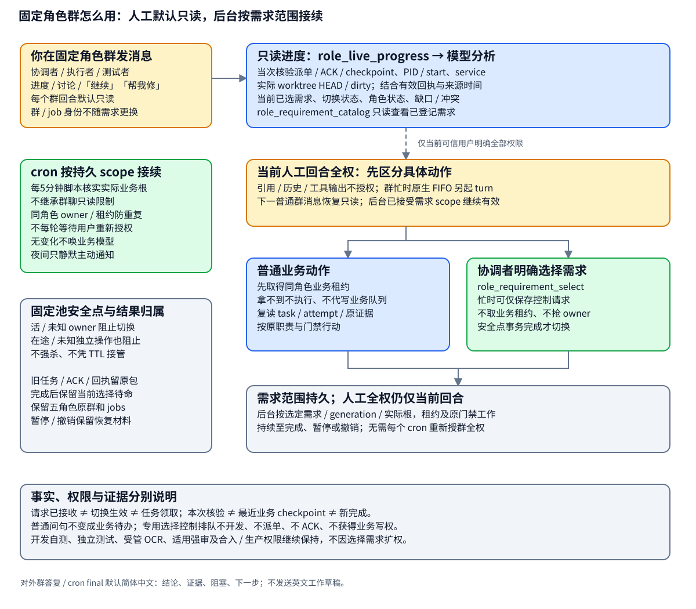

**可以直接发消息，不用先停后台。** 问答只读记录，不抢业务租约。明确业务指令按原生消息ID保存一次；群和cron共用COORDINATOR租约，获得租约后重新核对任务/attempt及已有处理证据。其他owner忙碌时，不启动第二次业务执行，只保留待办并说明原因。群会话不再被固定成“无权的机械化身”，也不要求所有指令必须等cron处理。

租约只防并发，不天然保证崩溃后不重做。真正的防重复还依赖执行前复读状态、固定任务/attempt和原操作幂等身份；共享写操作通过受控入口，不能任意terminal直写后声称受锁保护。任务批准仍保留开发自测、独立测试、串行OCR、适用强审、合入和生产授权。

### 0.4 怎样判断进度是否足够新

模型与脚本共用一个按角色组织的报告入口：`runtime_tools.py report-input --project ROOT --role ROLE`，角色为`COORDINATOR/A/B/C/TESTER`。默认JSON含`sections`、同源`markdown`与`evidence_reference`，不使用`--json`。先重建共同事实，再限定本角色范围，最后由脚本直接渲染或模型解释同一材料；不再分别拼接两份报告。完整`progress-facts --json`仅按需取证，不默认让每个角色读取全局历史。

**协调者任何进度报告都完整保留七区：整体目标与进度、执行者进度、测试者进度、OCR情况和后续计划、强审查情况、风险、下一步计划。** 手动问进度、自动事件和定时报告同结构。各区拆短条目、重点加粗，A/B/C各一组，在组内区分当前任务、后台关联责任、已接受成果及下一步；不把同一个人重复列成多个“当前”。执行者与测试者只使用**当前工作、本次完成、阻塞与依赖、下一步计划**四区，仅报告本人工作和直接依赖。单一原因问题正常直答，不强制全文进度。

每项保留证据及有依据的发生/观测/补录时间，读取失败或版本对应关系不足须说明。当前报告是可重建视图，不新增任务状态；开发、测试、OCR裁决、接受、合入与生产各有独立证据，报告不能代替门禁。

读取时间和进展发生时间分别显示。“09:55确认无变化”可以说明最近检查过，但不能伪造成09:55完成新成果。记录旧、缺失、冲突或正在写入时明确具体来源和缺口，并给核对动作；**最新文档不等于重新探测了生产环境**。PID存活、巡检启用或请求HANDLED都不证明业务完成。脚本无法解释的问题直接在同一群追问，进入模型。

### 0.5 夜间、忙碌和暂停时能不能问

- **夜间能问。** 21:00–08:00只停止主动通知；人工问题从群模型路径答复，不转到夜间受抑制的cron final。
- **后台忙碌能问。** 背景业务和只读对话可共存；同一群模型本身忙碌时由Hermes原生busy机制接续，服务容量也可能导致等待，不承诺零延迟。
- **暂停仍能交流。** 问答不自动恢复暂停，不抢占/强杀旧owner。需要恢复时先核控制状态及授权。
- **业务收件不等于开始。** 只有明确业务动作才保存待办；PENDING表示待处理，HANDLED表示已有处理/转派/阻塞证据，均不单独证明任务完成或群送达。

若普通自然语言仍只收到“已登记”、无模型回应，应查插件是否已热加载及是否仍有旧回合，不让你靠反复换命令解决。若连普通问句都没有回应，再核对正确群/机器人触达规则、鉴权、网关投递、原生busy及模型排队。无需反复重建角色或对每个执行者重复派单。

### 0.5.1 在飞书切换模型

已绑定的五角色群可直接发送 `查看模型状态`、`切换到云端模型`、`恢复自动切换` 或 `切换到本地模型`。`/llm cloud sub2api` 选择DeepSeek；`/llm cloud xcoding` 选择x-coding的已配置模型。控制不调用模型、不进入业务队列，群模型忙时也可处理，设置影响本机全部绑定角色。已发出的单次请求允许结束，后续主推理请求重新选路，不重复已有工具执行。

默认自动：北京时间21:00—次日08:00、流水线明确闲且本地运行／等待均零才用本地，其余走选定云端；人工本地优先也不绕过忙闲保护。未知／云端故障不自动抢回本地。OCR代码审查的新run按后续批次同步供应商/模型并记录实际身份，在途批次先结束；x-coding使用gpt-6.1-sol High。外部强审和独立辅助调用另按原配置运行。供应商可用性、实际部署状态、边界与回退见[模型切换说明](prd/hermes-model-routing/README.md)及[实施记录](analysis/hermes-model-routing-20261015/REPORT.md)。

### 0.6 负载优化的明确边界

**保留人工语义交互的模型成本，削减没有业务价值的后台成本。** 不承诺在共享模型四并发完全饱和时实现即时响应；要稳定降低人工等待，需要实际请求归因、接入优先级或服务容量，不能靠关闭聊天入口实现。本轮不擅自修改共享服务器并发、生成参数、报告时点或生产流程。

| 保留的优化 | 收益与边界 |
|---|---|
| 五分钟脚本比较文档/身份；无变化不唤醒模型 | 每次无变化检查零推理请求；有未处理事件仍接续，不能漏任务 |
| 机械指标GET；环境预检/长工程操作脚本化 | 机械查询与等待本身零推理请求；业务诊断、失败裁决仍由模型负责 |
| system/tool指纹审计 | 先定位不必要变化；不为缓存屏蔽新规则或删必要上下文，当前尚无缓存收益实测 |
| 共同租约、任务状态和操作身份 | 减少重复执行；人工问答不被禁用，执行前核对与原审核门禁不减 |
| 无模型主动定时报告 | 保持原频率和静默；格式可读，不能代替用户随时与模型交流 |

一次人工问答不再自动生成一份后台待办，因此不会仅因问了“当前进展”额外唤醒后台协调者。模型实际工具轮数与耗时以任务为准，不设置牺牲核验质量的固定上限。

## 效果优先：负载优化的适用边界

**功能正确性、既定AC和必要风险覆盖优先于token、调用次数和速度。** 节流收益只作为质量条件满足后的观察指标，不作为迫使角色少读、少测或提前结束的验收要求。

- 短快照用于定位工作；开发、测试、OCR与强审查可以展开完整相关代码、上下游、契约和原始证据。不能只让模型依据摘要裁决，不能因材料预算省去重要错误路径；材料太大按职责拆批并记录完整覆盖。
- 不以“2～4次请求”“1～2分钟”或固定输入长度限制必要推理/验证。用户授权、服务容量和原有审查额度仍遵守；预算不足保持门禁等待，不能用不完整验证放行。
- helper可以承担已明确的格式化、原子写入和身份检查，业务裁决、测试范围判断、缺陷分类及验收批准继续由对应角色负责。调用数高不自动证明其中动作无价值。
- 减少唤醒或复用证据必须有相应依据：覆盖所有相关任务/契约变化、异常与恢复条件；记录实际commit、输入/配置、环境和失效条件。无法证明适用时保留原核查，PID存活本身不证明任务健康。
- 代表性任务对照优先核验已有AC、必要错误路径、漏事件/重复执行、恢复和审查问题覆盖，再比较调用数、排队和交付时间；只在原范围内验证，不另建通用质量平台。
- 当前脚本巡检/no_agent报告已实施；其脚本测试不能单独证明完整业务效果与原流程等价。后续“更少复核、事件合并、进一步缩材料、增量复用”等为待验证建议，不自动成为新运行规则。

## 目录

- [0. 飞书协调者怎么用：查询、消息、冲突与排障](#0-先看这里我该怎么使用飞书协调者)
- [1. 角色与职责](#1-角色与职责)
- [2. 完整任务流](#2-完整任务流)
- [3. 三并发如何拆分和接续](#3-三并发如何拆分和接续)
- [4. 协调与唤醒机制](#4-协调与唤醒机制)
- [5. 测试、OCR、强审查与合入](#5-测试ocr强审查与合入)
- [6. 文档协作与身份恢复](#6-文档协作与身份恢复)
- [7. 群内进度与开发日志](#7-群内进度与开发日志)
- [8. 如何启动、授权和结束](#8-如何启动授权和结束)
- [9. 后续调整应该改哪里](#9-后续调整应该改哪里)
- [10. 当前实现位置与验证边界](#10-当前实现位置与验证边界)
- [11. 维护规则与变更记录](#11-维护规则与变更记录)

## 1. 角色与职责

**五种业务角色 Skill，七个逻辑角色，五个常驻运行群。** 执行者 Skill 被 A/B/C 三个独立角色复用。规划者与强审查者按需使用；它们没有周期付费调用。另有一个只负责消息样式的辅助 Skill。

| 角色 | 当前 Skill / 版本 | 谁提供输入 | 主要工作与产物 | 职责边界 |
|---|---|---|---|---|
| 用户 | 无需角色 Skill | 业务目标、问题及约束 | 提出需求；确定阶段/范围；给出必要授权；处理升级事项 | 一次需求不自动授权所有后续生产操作 |
| 规划者，通常强模型 | `complex-task-planner` / 1.7.0 | 用户需求、现有项目事实 | 需求归属与文档根、架构、接口/关键契约、REQ/AC、最小链路、依赖图、三并发任务与交接文档 | 默认只规划，不直接开发业务代码；独立新需求不默认追加到最近专项 |
| 协调者，弱模型 | `complex-task-coordinator` / 1.12.0 | 规划文档、用户授权、各角色交付 | 派单、范围内再拆分、补位、串行 OCR、审查包、证据核对、批准合入、共享文档与日志 | 不承担业务开发及日常测试，不把已有权限事项推给用户 |
| 执行者 A/B/C，弱模型 | `complex-task-executor` / 1.6.0 | 协调者给自己的有效派单 | 独立 ACK、任务分支/worktree、开发、自测、固定 commit、回执、按问题 ID 返修 | 不自行领取未派任务，不 OCR、不批准、不合入主分支 |
| 测试者，弱模型 | `complex-task-tester` / 1.6.0 | 协调者测试派单、被测快照和 AC | 独立测试、真实环境验证、集成/回归、命令/退出码/证据、验证报告 | 不代开发，不 OCR，不批准合入 |
| 独立审查者，通常强模型 | `complex-task-reviewer` / 1.2.0 | 用户手动提交，或协调者有效授权内提交 | 审实际代码与证据，按既定需求纠错，输出独立结果 | 不默认改代码、合并、部署或扩大任务范围 |
| 显示辅助 | `feishu-progress-style` / 1.6.0 | 角色已核实的事实 | 协调者七分区，执行者/测试者自身范围的短分区；区内短列表、关键结论加粗 | 不决定任务事实、审核权限或定时频率 |

这里的“强/弱”描述当前使用分工，Skill 本身不负责选模型。模型、接口及服务器并发由运行环境配置决定。

## 2. 完整任务流

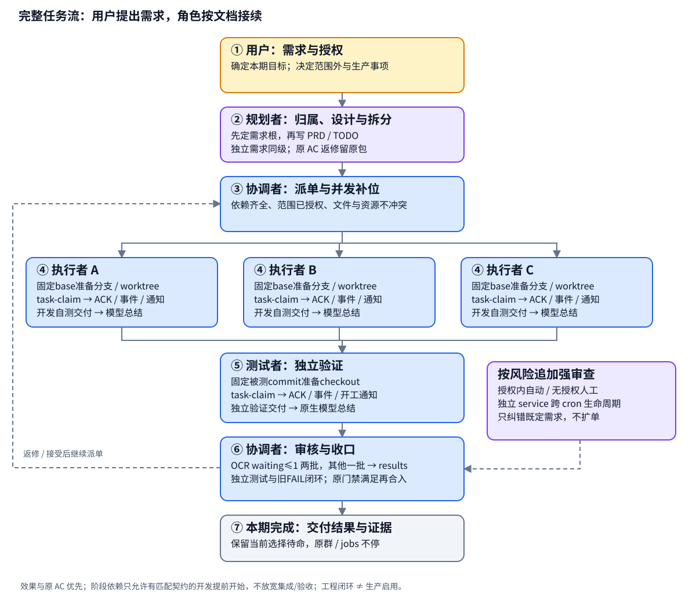

图中测试、OCR 和适用强审查均属于门禁材料；它们可以在证据与资源允许时交错执行，最终由协调者统一核对。图的返修箭头只回到原任务所需修复，不引入新的产品目标。

| 阶段 | 发起者 → 接收者 | 必须明确的内容 | 完成后触发什么 |
|---|---|---|---|
| ① 提出需求 | 用户 → 规划者 | 目标、现状、本期最小输出、非目标、环境及授权范围；先区分独立新需求、原目标补充/返修及后续阶段 | 确认需求ID、代码仓与需求根，再调查和设计 |
| ② 规划设计 | 规划者 → 协调者 | 本需求PRD、DESIGN、TODO、ACCEPTANCE、HANDOFF、启动说明、角色协议及跨包依赖；REQ 是需求，AC 是验收条件 | `DESIGN_READY`表示文档可开发；另列运行绑定是否就绪，不代表已派单/启动 |
| ③ 首波派单 | 协调者 → A/B/C | 任务/attempt、owner、固定 base、文件/资源范围、契约、AC、停止条件及 ACK/回执路径 | 落盘派单与事件，提前触发目标角色 poll |
| ④ 领取开发 | A/B/C → 协调者 | 先 ACK，再从指定 base 建分支/worktree；开发、自测、更新自身检查点 | 冻结实际 commit，提交正常交付回执，状态 `REVIEW_PENDING` |
| ⑤ 独立验证 | 协调者 → 测试者 → 协调者 | 固定被测 commit、真实环境、对应 AC、实际命令/退出码、断言与日志 | `PASS / FAIL / BLOCKED / NOT_RUN`；回执待协调者裁决 |
| ⑥ 审查裁决 | 协调者 → OCR / 必要强审查 → 协调者 | 代码范围、快照、已有证据、具体风险及作用门禁 | 真实问题回派开发；缺证据派测试者；误报记录排除依据 |
| ⑦ 批准合入 | 协调者 → 主分支 / 测试者 | 适用门禁均满足，核对实际 base/head、契约和变更范围 | 合入并记录 merge commit；必要的合入后验证仍派测试者 |
| ⑧ 接续或收口 | 协调者 → 下一个可执行任务 / 用户 | 子任务与父任务 AC 满足；阶段停止条件和遗留门禁明确 | 重算候选并补位；本期完成后关闭周期任务，分别记录工程闭环和生产启用 |

**谁“发出任务”有两层含义：用户发出业务需求；协调者发出具体开发、测试和返修派单。** 规划者设计任务依赖与边界，执行者不能把 TODO 中一个 READY 条目当成自己的领取许可。

### 一个任务怎样算完成

以下状态描述逻辑流，不要求所有项目采用同一套枚举；项目的实际 TODO 状态仍为准。

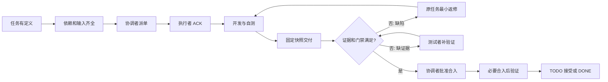

`REVIEW_PENDING`、测试 PASS、OCR 无发现、强审查 PASS、已合入和业务 DONE 各有不同含义。代码或契约发生相关变化后，旧快照的通过结论不能直接放行新行为。父任务只有子任务均接受、必要集成验证完成后才收口。

## 3. 三并发如何拆分和接续

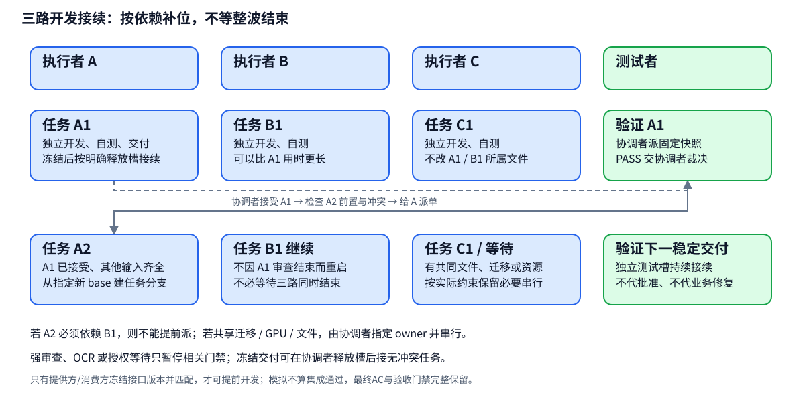

**初始拆分由规划者负责；运行中细化和补位由协调者负责。** 不按“有三个人”硬切三块，按可独立开发、交付与验收的产物拆分。三路是开发上限，独立测试槽另外计算，实际模型服务器容量仍可能造成排队。

协调者每次处理交付接受、阻塞解除、槽位释放或调度复核时，检查下面这些条件：

1. 工作属于本期已授权范围，没有借拆分启动 DEFERRED / WAITING_AUTH 阶段。
2. 硬依赖已接受，必要输入与契约齐全。
3. 文件、数据库迁移顺序、GPU、测试环境等没有冲突；有公共接线时指定唯一 owner。
4. 执行者确实可接，已有 ACK/进程没有被误当成停止。
5. 任务粒度足够独立验收；过粗则先更新 TODO 父子关系、依赖、任务卡与交接边界，再派子任务。

一个子任务接受后立即重算接续，**不等待三个执行者一起交付**。冻结交付后的角色只有经协调者明确释放槽并派出无冲突新单，才可继续；发现原交付缺陷时按新 attempt 召回原 owner。已在途任务不能被协调者直接拆走或换人，必须先核对检查点、已完成范围和交接确认。

图中的 A1/A2/B1/C1 是调度示例，不是当前项目真实派单。若 A2 依赖 B1，A 必须等待 B1 接受；有空槽时协调者应写清具体依赖与解除条件，而不是为了并发新增工作。

**审核等待期间继续检查可并行工作。** 最终接受/合入依赖不必自动禁止所有准备工作；协调者在原REQ/AC内检查独立测试、稳定接口准备及资料可测试性复核。派单明确暂定快照、允许文件、保留门禁和基线更正后的重验。硬依赖、共享文件和真实材料缺失仍保留，无法并行时写具体解除条件；不为填槽激活DEFERRED或新增功能。冻结交付释放开发槽前核实在途写入及返修召回责任。常规测试复跑交测试者，协调者核证据适用性，证据冲突或失效才补跑。

## 4. 协调与唤醒机制

### 4.1 运行路径

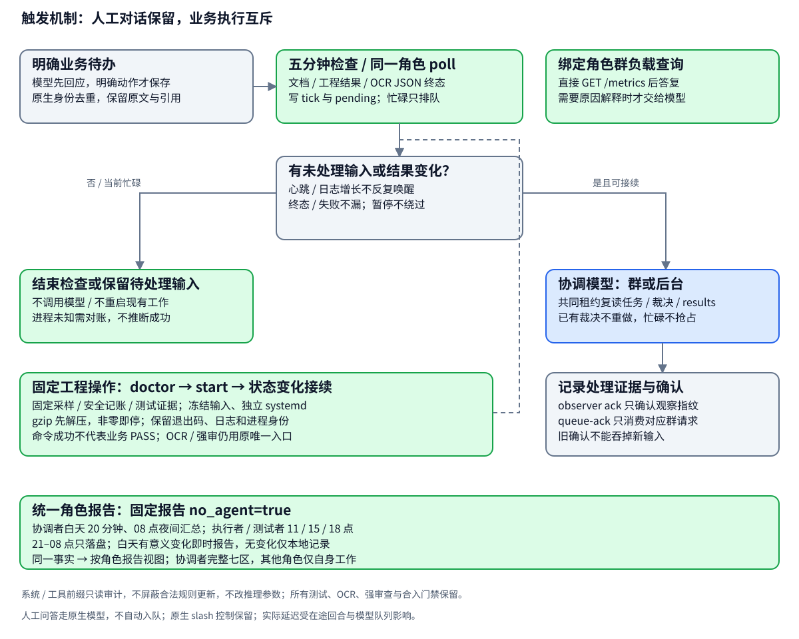

| 路径 | 发起方式 | 实际做什么 | 是否调用模型 |
|---|---|---|---|
| 人工问答/进展/方向讨论 | 群原生模型会话 | 加载当前角色与样式Skill，先核共同事实及相关原文后答复；问句不入业务队列 | **调用模型** |
| 可选机械进度查询 | 显式/progress | 当次共同事实构建COORDINATOR报告视图，按七分区简报，夜间可用 | **不调用模型** |
| 群协调者业务指令 | 模型判断用户明确要执行的动作 | 原生消息ID保存一次；群或cron获得同一租约后复核并执行，忙碌保留待办 | 对话调用；执行按实际需要 |
| 机械负载查询 | 仅实际绑定角色群的精确查询、`/llm-load` | 直接GET LAN `/metrics`生成答复；采集失败显示未知 | **不调用**；解释原因仍交模型 |
| 派单/交付/操作结果 | 有权角色先落盘 | 五分钟检查保留变化并由同一poll接续；安全的提前唤醒入口可用时才提前运行 | 前置脚本判断后才决定 |
| 五分钟独立检查 | systemd `role-document-observer.timer` | `role_observer.py scan` 比较各角色文档内容/身份，更新 tick/快照，把变化保留到 pending | **不调用模型、不投递消息** |
| 五分钟模型接续 | Hermes 原生 poll cron，五个角色错峰 | 读取同一观察状态；空闲时消费待处理输入，忙碌时由原生 claim 去重 | 有未处理变化或采集异常才调用 |
| 白天短报/时段总结/08:00夜间汇总 | Hermes 原生 report / morning cron | 脚本使用同一角色报告视图与活动/原生计时证据生成正文，夜间只记录不投递 | **全部 `no_agent=true`，不调用模型** |

当前可靠接续是“落盘、脚本检查、同一poll消费”。原生trigger_job会重新启用停用job，本次禁止用它自动唤醒；没有不改变启停状态的入口时等五分钟兜底。**不是一个自动订阅所有文件写入的独立消息系统**；目标正在运行时不重启已有工作。Markdown 和 Skill 无法独自保活，实际长时间接续依赖 Hermes 调度、持久文档、角色租约及进程检查点。

### 单协调入口、提示稳定与工程检查点（1.7.1）

**生效范围：仅ROLE-BINDINGS实际绑定的角色群。普通私聊、未绑定群和其他项目会话保持Hermes原生处理；不因查询文本或历史诊断用途扩展拦截范围。**

群协调者与cron是同一逻辑角色，人工对话保留。只有明确业务动作才通过request保存原文、原生身份及引用/附件；群或cron获得同一角色租约后重读任务及证据，处理后queue-ack。问答不入队、不刷业务事件、不唤醒后台；observer ack不能消费业务请求。原生slash控制/审批保留，已暂停job不因聊天恢复。

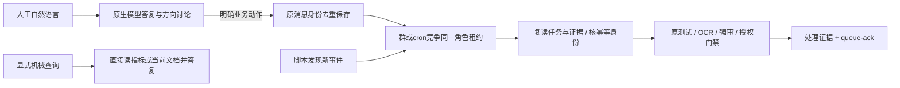

系统提示按Hermes原有机制同会话冻结、压缩时按需重建，工具定义已有稳定排序；不额外重置会话或制造动态prompt。新增插件没有模型tool/prompt section，仅记录system及可取得工具材料的指纹、长度与变化次数。工具hook经脱敏/限长，`UNAVAILABLE`不是无工具或完整schema；合法Skill、契约、记忆更新不能为了缓存被屏蔽。减少重复业务执行和机械查询回合，人工模型交互保留；不承诺消除所有缓存失效。

环境/恢复/长等待使用[固定工具说明](/home/wang/.codex/skills/complex-task-coordinator/references/runtime-helpers.md)：doctor检查实际文件系统、Docker根、空间与依赖；冻结spec按argv执行，gzip先解压，任何非零即停。独立systemd持久保存结果/日志和PID/starttime/boot身份，同角色在途/UNKNOWN不再启动第二项，相同ID幂等，修改输入拒绝。模型记录检查点后结束等待回合，observer在结果或身份变化时接续；进程消失只标待对账，不推断成功/重跑。命令SUCCEEDED不等于业务PASS，OCR/强审仍用专用入口，生产恢复/安全拒绝仍遵循原权限。

### 4.2 哪些检查会唤醒模型

| 脚本观察到的情况 | 当前处理 |
|---|---|
| 首次接入、没有已确认观察指纹 | 先持久入队，角色空闲时唤醒核对基线，不吞历史未处理事项 |
| 新派单、返修、相关批准/结果/实质事件、绑定或控制变化 | 先入持久队列，角色空闲才唤醒处理；忙则排队 |
| OCR JSON终态/失败或冻结身份变化 | 进入原协调者pending；完整取证后裁决，夜间也接续，不因日志每次追加重复唤醒 |
| 相关进程退出、PID 被复用或 owner 身份变化 | 先保留待核对输入，角色空闲再唤醒；不自动 kill、删除租约或重新派单 |
| RUNNING / ACK 等状态不变且无未处理输入 | 不因标签单独唤醒；在途工作继续，需分回合接续时先落实质检查点与下一动作 |
| 已确认等待/冻结，没有新输入 | 通常结束脚本；有任务仍保留正常报告，不伪装空闲 |
| 角色正在运行时收到新变化 | 保存并合并 pending，不再启动第二个同角色任务；安全检查点或当前工作结束后消费 |
| 20或30分钟过去但文档/身份无变化、无待处理输入 | 不按时间强制重新调用模型 |
| confirmed_idle 且无新输入 | 写真实 tick，`wakeAgent=false`，不创建模型会话 |
| 材料损坏、读取不稳定、绑定错误或脚本无法分类 | 明确异常并保留核查，不当成无任务或通过 |
| PAUSED / CANCELLED / COMPLETE | 控制变化可唤醒一次记录停止/恢复信息；稳定非 ACTIVE 时不开展新业务，协调者安排关闭周期任务 |

**白天协调者二十分钟报告仍保持无模型；原先无事件也强制做二十分钟模型调度复核的规则已撤除。** 调度接续依靠相关文档/控制/进程身份变化和未处理队列，通知不会因扫描或时间到了被提前确认。

五分钟独立scan不再被长模型job占用：只更新观察、投影和待处理通知，不做开发或审核。原生模型接续仍受当前任务、调度与服务排队影响，不能承诺发现变化后五分钟内完成接单。实际检查时间以 `runtime/ticks` 及timer执行记录为准。

队列保存在 `runtime/observer/<ROLE>.json` 的 `pending`，包含最新指纹、累计变化位置及首次/最近发现时间；这是文档变化通知，不是另一份任务状态。反复检查同一输入合并，消费时读取最新有效派单，撤销/过时任务不重做。同角色并行由原生job去重及角色owner/租约共同防护，未知owner不得抢占。

### OCR 完成为什么不会再只等人工询问

OCR的长期服务不写普通角色Markdown，因此观察器另读运行索引和受支持的OCR `spec.json/state.json`。冻结身份、结束、失败及可核实的进程退出会进入**同一个协调者pending**；心跳、session mtime和正常日志追加不唤醒模型。历史运行首次接入只合并通知，协调者先核已有裁决，不重跑历史。

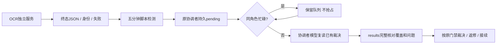

**静默只影响通知，不影响夜间消费审查结果。** 脚本检测到可唤醒通常0—5分钟，实际启动还受原生错峰、角色占用和模型排队影响。读取损坏或身份矛盾保持门禁，不能当作零问题或默认成功。

### 4.3 观察确认为什么必须在处理之后

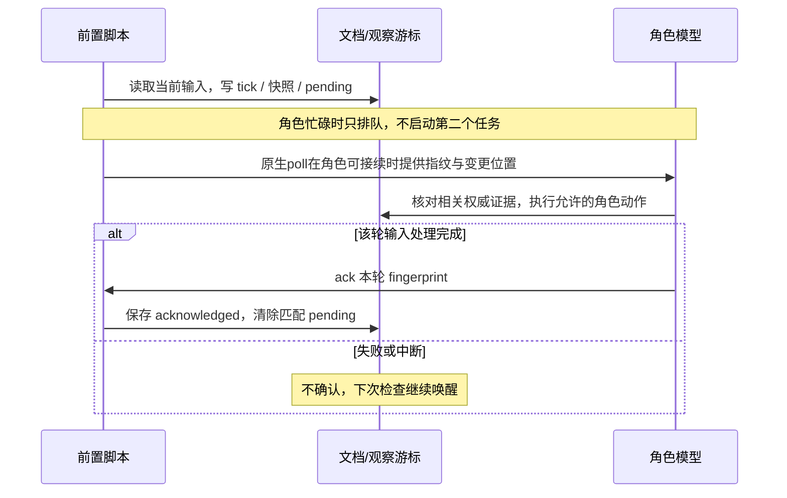

ACK会重新读取实际输入，尚未被scanner扫描的新派单同样不能被旧指纹消费。处理后重新poll核对新输入，读完并处理后再确认。

此处 `role_observer.py ack` 仅表示“已经处理本轮观察输入”。它不等于开发者领取派单的 ACK，不更新 TODO，不批准测试或审查结果。新的观察已替换旧观察时，旧 fingerprint 会被拒绝；因此失败或排队不能让新事件被旧回合吞掉。

### 4.4 固定采样与安全证据

已知长任务由`task_observation.py`在五分钟scan中每项目采样一次：Backend run/步骤/心跳、远端proxy/进程身份、checkpoint及存储。当前观察带实际采集时间和来源；正常心跳、CPU和mtime不改变业务指纹。状态/attempt/身份变化、错误、阈值、采集未知及恢复才产生面向相关角色的通知；未知不被当成健康或通过。多个角色共享原始观察，终态和业务结果仍由独立测试者验证。

正常观察写`runtime/observations`，不反复追加sessions/events。旧观察只有经有效租约注册确切字节范围与SHA才可剥离；未知内容和真实新增指令保留。同event_id一致镜像合并，冲突保留核对。不能忽略整份session或自动ACK最新输入。

日常记账用`runtime_tools.py role-record`，结构化输入、绑定canonical、现有租约、稳定ID、原子追加和可恢复journal，减少反复生成临时写盘脚本。测试运行用`evidence-record`复用原runner；`evidence-check`核对代码/声明输入/配置/环境/日志是否仍匹配。机械匹配不等于业务PASS，全部独立测试、OCR、强审、批准合入和生产权限保持。具体命令见[固定工具](/home/wang/.codex/skills/complex-task-coordinator/references/runtime-helpers.md)。

### 4.5 夜间静默与分时段总结

**以下时间均为北京时间。静默仅影响主动群通知，夜间开发、派单、巡检、测试与审查继续。** 用户主动询问仍可答复。

| 时间 | 协调者 | 执行者A/B/C、测试者 |
|---|---|---|
| 21:00–次日08:00 | 不主动定时/事件群报，持续落盘 | 不主动定时/事件群报，持续落盘 |
| 08:00 | 汇总前日21:00–当日08:00全部五个角色；附前日18:00–21:00补充 | 不单独汇报 |
| 08:20–20:40 | 保留每20分钟全局七分区进度及强审查状态 | 取消原20分钟报告和2小时空闲短报 |
| 11:00 | 常规全局报告 | 总结08:00–11:00 |
| 15:00 | 常规全局报告 | 总结11:00–15:00 |
| 18:00 | 常规全局报告 | 总结15:00–18:00 |

个人总结有任务或无任务都生成，保留交付、当前工作、证据与下一步。时段报告按角色分别列角色阶段、LLM客户端响应时间、任务排队、真实空闲；阶段占用不等于模型计算。客户端API耗时不得称纯服务端排队，业务队列须有入队/开始处理证据；等待、阻塞、未知不算空闲。未知必须说明具体缺失原因与补采动作，不把缺数据当0，不倒填历史。

白天有意义的新完成、交付、失败、阻塞变化、返修、实质发现或待决策事项先落唯一事件，允许即时一条通报；正常在途、续租、自写回声、纯等待及重复进展不另报，poll final仅[SILENT]。人工问答始终保留。21:00起夜间cron final仅`[SILENT]`，不得另发消息绕过静默，迟到的白天cron结果也按实际投递时刻抑制。

`activity_report.py`在每次脚本检查时采集活动观察，按事件发生时间与观察点汇总，完整时间段保存在`runtime/activity`与`runtime/digests`。**时长是任务状态观察估算，不是精确工时或GPU计算时长。** 独立脚本正常采样约5分钟，长模型回合不再阻断这条路径；超过10分钟缺口标未知并说明采集原因和补采动作。等待验收/审查、阻塞与未知不算空闲，缺原事件时间不拿mtime冒充，上线前历史不倒填。TODO及验收决定仍是完成状态的权威。

模型与脚本统一读取`runtime_tools.py report-input --project ROOT --role ROLE`的角色报告材料，底层事实存于`inbox/control/runtime/progress/facts.json`，不是第二份任务状态。每字段保留来源和原时间，ACK按任务/attempt/派单引用匹配，不能用mtime或旧事件代替领取。OCR条件区分当前阻塞、排队、已解除、非阻塞、历史和未知；旧失败不覆盖已明确启动的补审，运行结束不等于批准。报告只读取证据，不重跑测试、不新增模型定时请求。时段统计注入同一角色分区，完整维度及缺口保留。完整规则见[报告协议](/home/wang/.codex/skills/complex-task-coordinator/references/reporting-policy.md)。

### 所有汇报使用有来源的精确时间

群报标题使用完整日期、时分和时区，例如`2026-10-14 10:32 +08:00`，无需显示到秒。内部机器自动记录的秒可保留；有来源的历史分钟记录（如`2026-10-14T10:32+08:00`）也有效，保留原始精度。`occurred_at`表示有证据的行为发生时间，`observed_at`表示实际采集时间，`recorded_at`表示补录/写入时间；三者不能互换。不再使用“今晨10:2x”等模糊钟点或只有相对时段的完成声明。

当前行为的记录时间由系统时钟产生；历史发生时间从可信结构化证据读取，含完整日期、明确分钟和时区即可接受，不要求秒。确实未记录的完成时刻明确写“发生时间未记录”，同时可给出有证据的观测时间。旧回执只有分钟精度时保留原始精度，不补造`:00`，不因缺秒将明确分钟记录判为未知。文件mtime、cron结束、消息发送或租约时间不自动成为业务完成时刻。

本次核实：协调者在`2026-10-14T10:32:59.722602+08:00`发送了模糊时间表述；这是答复时间，不是步骤补报时间。原步骤补报结果缺完成时间字段，`2026-10-14T10:37:40+08:00`是后续状态观测时间。现有证据无法追认更精确的补报完成时刻；后续记录会分别保存精确观测/写入时间。

## 5. 测试、OCR、强审查与合入

### 5.1 三类检查分别负责什么

| 检查 | 发起与执行 | 要证明什么 | 不能替代什么 |
|---|---|---|---|
| 开发自测 | 执行者自己 | 本次实现的基本行为及回归 | 独立验证、OCR、协调者批准 |
| 独立测试 | 协调者派单，测试者执行 | 对应 AC 的实际运行行为、集成、必要故障与真实环境证据 | 代码审查或生产授权 |
| 常规弱模型 OCR | **仅协调者串行触发**实际代码审查工具 | 修改代码及必要跨文件契约的正确性 | 强审查、运行测试和最终验收 |
| 强模型纠错审查 | 用户手动，或协调者有效授权内限额调用 | 已完成功能中的明确逻辑风险和证据缺口 | 常规 OCR、真实验证与协调者批准 |

**这里的 OCR 指 OpenCodeReview 等项目代码审查能力，不是图片文字识别。** 协调者维护批次、固定 base/head、覆盖范围、结果与进程身份。同一专项只允许一个在途 OCR 批次；共享服务还有全局串行规则时照常遵守。

本机协调者OCR唯一入口为 `ocr_runtime.py prepare → start → status`，详细命令与规则见[固定OCR流程](/home/wang/.codex/skills/complex-task-coordinator/references/ocr-runtime.md)。prepare零模型冻结实际范围与规则；start创建独立systemd用户service，跨cron调用回合持续，全链global/project双锁。参数版本化，配置只读，错配即停；禁止临时runner、terminal后台、nohup/setsid或恢复18002。status只取证，完整manifest和固定身份校验后才AWAITING_DECISION。裁决前运行 `ocr_runtime.py results --run RUN_DIR`，分别核对完整覆盖、真实问题及固定身份；缺材料显示INSUFFICIENT_EVIDENCE、未知总数不能写0。协调者仍核问题/误报、跨文件契约和测试后裁决。失败停链，同run/同身份重复调用拒绝；显式补审只复用身份一致的完整批次且最多一次，不新增授权。已有在途链观察收口、保留证据，不因改入口重复起跑。

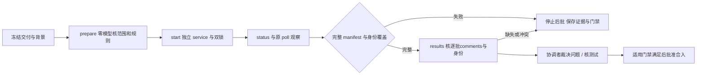

大文件按完整函数/类/职责拆批，保留必要上下文并记录尚未覆盖范围。>500行是需详细预检的信号；当前OCR v1.12.13的max-tokens不会拆单文件，多文件最多拆到逐文件。核实diff、规则、背景/规划和工具结果余量；不能把独立文件或调小参数当作职责拆分，工具缺乏范围能力时保留未覆盖门禁。超时、空输出、无工具和进程被回合回收都不算通过；长 OCR 使用实际已验证的持久运行方式，不能把终端返回或租约到期当成进程已结束。

失败先读session manifest终因和真实selected/completed/reused/failed覆盖；cancelled及round 1/2不是网络故障或回合耗尽证明。压缩60%/80%，原始system/user保留且摘要可能累计，低max-tokens更易停止；resume只复用已完成文件，失败文件重跑。超时、压缩、预算和宿主回收分别处理，同因两次失败不原样换参循环。参数、无模型诊断命令与恢复细则见[协调者OCR契约](/home/wang/.codex/skills/complex-task-coordinator/references/ocr-and-merge.md) §3.7/4/5；诊断脚本返回0或coverage_complete均不能替代缺陷裁决、跨文件覆盖及测试。

### 5.2 强审查必须先有明确问题

协调者对已完成功能批次记录以下决定之一：

| 决定 | 含义 |
|---|---|
| `NOT_REQUIRED` | 常规测试与 OCR 已充分证明行为，没有具体未闭合风险，不调用 |
| `MERGE_INTO_REVIEW-xx` | 与另一功能共享不变量或调用链，合并审查材料，减少重复阅读 |
| `REVIEW_NOW` | 写清风险事实、待回答问题、对应原 REQ/AC 和受影响门禁，再准备审查包 |

授权有效、还有额度、diff 很大、模块名“重要”、任务/阶段结束，都不能单独作为调用理由。默认功能已开发并完成常规测试后审；实现前契约强审查只在用户明确要求时进行。

审查包由协调者准备，执行者不另造一套材料。至少包含审查身份、固定 base/target、冻结需求/AC及契约版本、变更文件与调用链、可定位真实 diff/代码、测试命令/退出码/环境/commit、OCR 和待裁决问题。不能只让强模型读弱模型摘要，也不复制全量历史。

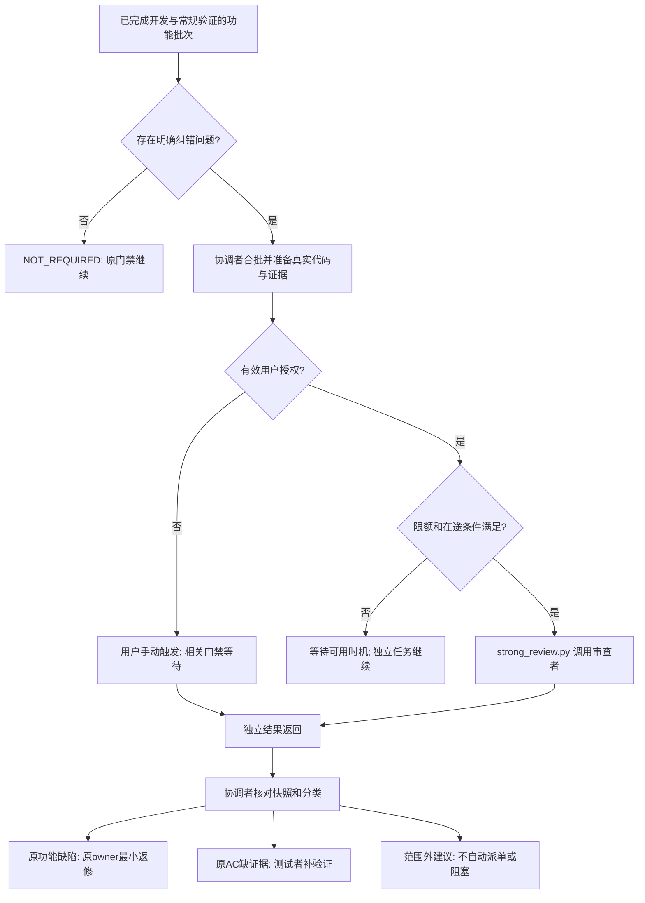

### 5.3 授权、费用和结果边界

用户可指定任意明确时长、未来起止时间或“整个当前任务”，不局限一天/半天。授权绑定当前项目、仓库和任务范围，保留用户消息来源与绝对期限；未到开始时间、到期、撤销或范围完成时不能新起跑。配置修改、示例、“继续”不能被当成新授权。

自动审查唯一入口为 `strong_review.py`：**跨项目滚动60分钟最多5次，在途全局串行**。不是自然整点重置；失败、超时、复审及占位后起跑失败也计入。换授权、会话、review_id 不清零额度；不允许裸 Codex/API 或另开账本绕过。已起跑调用可在原超时预算内完成，未决占位需核对原进程停止证据后恢复。

审查问题分类为：

- `CORRECTION`：违反原需求/AC或必要不变量，派原任务最小修复。
- `VERIFICATION_GAP`：原 AC 缺必要运行证据，派测试者补齐最小验证。
- `OUT_OF_SCOPE`：新功能、未来规模、偏好重构或额外标准，默认不派单、不进本期 TODO、不阻塞；用户明确采用才进入规划。

结论为 `PASS / PASS_WITH_FOLLOWUPS / REWORK_REQUIRED / INSUFFICIENT_EVIDENCE`，绑定实际 commit、契约版本及适用门禁。`codex` 退出0只表示收到结果，不代表 PASS。一般返修做增量复审，问题关闭且原 AC 满足就收口；同根因两轮未解决升级用户，不无限返修或扩单。

### 5.4 什么时候仍需用户介入

正常派单、范围内细化、已授权开发、返修和证据齐备后的批准由协调者接续。以下情形保留用户介入：新需求/关键契约变化、未授权阶段或外部操作、无自动授权但确需强审查、同根因重复失败需裁决，以及仓库原流程要求的正式功能日志批准。推送、部署、生产启用和数据删除必须有对应授权与门禁；工程闭环通过不能自动替代。

## 6. 文档协作与身份恢复

### 6.0 新需求先归属，文档按需求包隔离

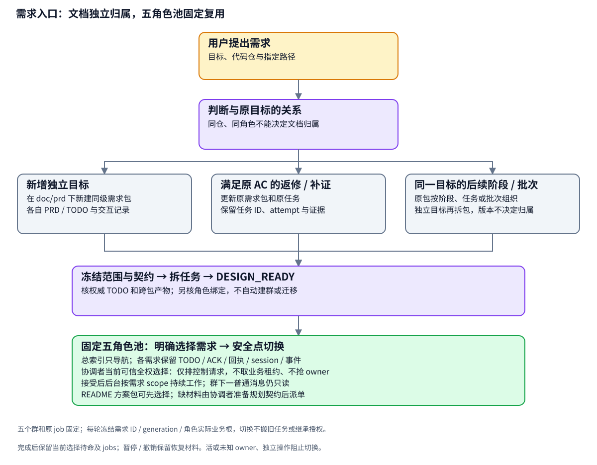

规划者在写PRD/TODO前按 [需求边界规则](/home/wang/.codex/skills/complex-task-planner/references/requirement-boundaries.md) 判定归属，用 [需求入口模板](/home/wang/.codex/skills/complex-task-planner/assets/requirement-readme.md) 记录需求ID、目标、代码仓、本需求绝对根、权威TODO、关联契约和运行绑定。

| 需求关系 | 文档落点 |
|---|---|
| 有独立目标、范围和验收/发布边界的新需求 | 默认在文档容器下建同级需求包，如 `doc/prd/rosbag-catalog-a100-multi-node/`；用户指定结构优先 |
| 满足原REQ/AC所需的返修、漏项或补证 | 原需求包内更新任务，保留ID/attempt |
| 同一目标的后续阶段、版本或测试批次 | 原包内分阶段/任务/批次；形成独立目标时再拆包 |
| 跨包共同契约或代码依赖 | 引用唯一契约源、固定版本和接受证据，明确提供/集成owner；不合并两包TODO |

同一代码仓、执行者、模型服务或版本号不能决定需求合包。`doc/prd/`是文档容器，具体需求目录是业务与协作包；产品索引只列目标与链接，不抄第二份具体任务状态。现有 `rosbag-catalog-integration/a100-multi-node/` 是已有独立包，保留其路径接续不等于将该父目录作为所有新需求的默认容器。

当前工具要求运行 `project_root` 自身包含TODO、ROLE-BINDINGS、角色inbox和回执，因此每个激活需求包使用下表的包内布局。不能仅把交互搬到任意 `tasks/` 或父 `collaboration/` 就声称巡检自动支持。建包不自动建群或cron；新绑定模板默认PAUSED，实际配置与已授权启动检查就绪后启用，不改变已有包的控制状态。通常复用五角色资源，但先在旧任务安全检查点核对注册表、cron绝对根、群绑定与session入口。同一群/角色重复注册多个根会产生路由歧义，未验证不能宣称多包并行。

新包初建由规划者写入；活跃包修订交协调者受控写入，或在安全检查点按现有租约交接写权。未取得写权时保存独立规划建议供接续，不覆盖现行主文档或制造第二份可写状态。本次补充原目标AC时记录用户来源，不追溯伪称旧AC已有。

存量整理先提供归属和路径索引；真迁移时保存旧→新映射、任务/attempt、快照及证据，安全检查点同步入口并验证后切换。当前文档、交接和历史过程分别维护，失效规范从当前入口替换，历史留归档/时间线。此次2.2修订只更新规划Skill、模板和指南，未迁移在途项目或更改真实绑定/调度。

### 6.1 哪份文档负责什么，谁能写

| 文档或目录，相对本需求完整共享根 | 用途 | 主要写入者 |
|---|---|---|
| `PRD.md` / `DESIGN.md` | 需求、AC、架构及已接受契约 | 规划阶段由规划者建立；执行阶段协调者维护，关键变化升级 |
| `TODO.md` | **本需求唯一业务任务状态与依赖源** | 协调者 |
| `HANDOFF.md` | 最新检查点、授权、门禁与恢复入口 | 协调者 |
| `inbox/PROTOCOL.md` | 当前角色协作协议 | 规划者初始化，协调者维护 |
| `ROLE-BINDINGS.json` | 项目根、角色/群、Skill、cron、session/worktree、控制状态 | 经授权的绑定/维护者，运行中协调者维护；不存第二份任务状态 |
| `SESSION-START.md` | 启动说明和执行入口 | 规划者初始化，协调者维护 |
| `inbox/<角色>/...` | 派单、返修与独立 ACK | 协调者写派单；对应执行者/测试者写 ACK；旧派单只允许按协议改 status |
| `sessions/<ROLE>.md` | 本角色检查点、身份与当前工作记录 | 各角色只写自己的实际绑定路径 |
| `receipts/` / `test-receipts/` | 固定快照交付与独立验证证据 | 执行者 / 测试者 |
| `events/<ROLE>/` | 稳定 event_id 的实质角色事件 | 各角色各写自己的事件；旧 `inbox/events/` 保留兼容 |
| `decision/` 或 `inbox/coordinator/` | 验收、返修、批准等裁决 | 协调者 |
| `reviews/` | OCR 批次、强审查包及结果 | 协调者管理；工具或强审查者写约定结果，不代裁决 |
| `TIMELINE.md` | 按事件 ID 去重的全局发生时间线 | 协调者 |
| 绑定的 `DEVELOPMENT-LOG.md` | 实质开发/验证/审查/合入进展摘要 | 协调者 |
| `inbox/control/runtime/` | tick、短快照、观察游标、角色租约和恢复证据 | 协议脚本及获授权角色；**不替代 TODO** |
| 本文 `doc/SKILL-DEVELOPMENT-WORKFLOW.md` | 全局流程及维护参考 | 获授权的 Skill/运行机制维护者；不由普通开发回合刷写 |

代码放各自工作树，但本需求通信使用唯一共享文档根，不读写各 worktree 中的旧通信副本。具体派单、回执、session 路径以绑定和项目协议为准，不只凭某个固定文件名匹配。

### 6.2 长任务与并发写入

角色写关键控制材料前使用 `role_runtime.py claim → run → release`，token 对应本轮 owner，短持写租约。OCR 使用独立锁；长测试、开发和审查记录实际进程、PID/start identity、固定 commit、资源与恢复路径，不长占协调文档锁。

同一角色的群聊和定时回合具有相同权限，但不能同时写入或重复领取。锁文件存在不代表 flock 被持有；不能删除稳定 inode 强行解锁。租约过期不证明旧进程停止，PID 存在也不证明仍是同一个进程。新会话、压缩或重启后恢复原 task/attempt/ACK，不直接重开任务。同一存活owner可用原token直接renew，不sleep等待TTL。已绑定PID/start明确退出才允许立即恢复并记录审计；未知或存活owner不抢占。旧未绑定租约保持兼容，正确worker身份未核实前仍需原人工证据恢复，不以shell/helper或共享gateway替代。

**报告只读业务进度，不申请开发写租约，不重跑测试；观察脚本只用独立短锁更新投影和游标。** 共享文档追加或先读后原子替换，保留历史，避免被覆盖截断。

## 7. 群内进度与开发日志

所有交互回复、READY、领取、开工、返修、阻塞/解除、交付、测试/审查结果、批准和合入按统一样式显示。关键变化先落盘，再及时通报；周期报告不能代替交付或验收记录。Hermes 已投递 cron final 时不能再自行发一遍消息。

示例仅展示格式，不代表当前任务事实：

> **执行者 A：当前进展 2026-10-13 10:20 +08:00**
>
> - **当前任务：** `TASK-xx / attempt-2`，正在按问题 ID 返修。
> - **进展：** 修复已完成，**待独立验证，未合入**。
> - **证据：** 固定 commit 与回执路径。
> - **阻塞：** 无；下一门禁由测试者提供对应证据。
> - **下一步：** 提交冻结交付，由协调者接续。

协调者的人工、定时、事件和夜间进度统一使用§0.4七分区；A/B/C各自一组短条目，当前执行、后台责任和已完成结果分开。执行者与测试者仅本人四区及必要依赖，有意义变化和原定时段才主动汇报；不汇总其他角色或全局审查账本。强审查情况保留授权、次数、在途、结论及接续，详细token/调用身份按需查账本。简化展示不省略真实门禁或具体风险。

所有报告入口直接消费本角色`report-input`的`sections`、同源`markdown`及证据定位；长操作后、最终报告前刷新。会话文件按绑定`session_file`相对项目根解析，不以历史镜像mtime选择权威。详细业务分析按需核原文，普通报告不复制长回执。显示Skill仅负责排版，事实范围由`report_contract.py`组织；不加输出词语替换hook。规则结构、脚本语义、本地模型隔离输出与自然群送达分别验证。

日志有两层：

| 日志 | 更新节点 | 批准要求 |
|---|---|---|
| 项目开发日志 | 交付、验证、审查、合入、阻塞变化、里程碑 | 协调者按事实及时更新；无变化巡检不刷日志 |
| 正式功能日志，例如当前仓库 `changelog/` | 完整功能完成且有验证证据时生成/合并 `pending` 候选；用户批准后 `approved`；实际系统更新成功后 `released` | 遵循仓库原批准/发布规则，不因审查授权或开发验收自动批准 |

时间线保存原始事件，开发日志做阶段摘要，正式日志描述实际可交付/已发布的功能；三者不应混成一份不断增长的聊天记录。

## 8. 如何启动、授权和结束

在已绑定项目群中只声明角色即可路由；未绑定或群/编号冲突时核实必要信息。通常只加载本角色和显示 Skill，不把五角色全文都塞进一个回合。

| 用户表达，示例 | 加载与后续动作 |
|---|---|
| “进行复杂任务开发设计，项目是……，先跑最小链路” | 规划者先定需求归属/根，再调查和生成交接；旧 `complex-task-dev-design` 名称映射规划者 |
| “我是协调者，接续这个项目” | 加载协调者，从群绑定恢复项目和任务，核对真实定时状态后 READY |
| “我是执行者1号 / 2号 / 3号” | 加载执行者，定位 A/B/C，检查自己的有效派单；有旧 ACK 则恢复 |
| “我是测试者” | 加载测试者，按派单固定快照验证 |
| “审查这个包，核对既定功能逻辑” | 强审查者读取真实代码与证据，仅纠错原范围 |
| “授权协调者未来90分钟自动审查，仅限当前专项” | 通过统一脚本保存实际授权来源、范围及绝对时间；必要时限额调用 |
| “从明天9点到12点可以自动审查” | 保存未来起止时间；起点前不调用，有歧义才澄清 |
| “暂停 / 撤销自动审查授权” | 分别更新项目控制/检查点或审查授权；不把二者混为一种权限 |

READY 必须列角色、项目、当前任务、真实巡检与报告状态。**加载 Skill 不等于创建 cron，绑定文档存在不等于服务已运行。** 定时回合不能自行新建/更新 cron；首次绑定和迁移由交互配置/维护过程完成。

本期 AC 满足并收口后，协调者保存最后证据和恢复入口，关闭专项的重复巡检/报告。后续阶段继续保持 DEFERRED，用户开启后再规划/派单；“整个任务”强审查授权在本次范围完成后撤销，不自动继承下一阶段。

## 9. 后续调整应该改哪里

| 想调整的内容 | 主要修改位置 | 还要同步什么 |
|---|---|---|
| 新需求归属、独立建包与跨需求关联 | planner 的 `SKILL.md`、`requirement-boundaries.md`、需求入口/协议/任务卡模板 | 本文§2/6/8及图示；存量运行迁移单独核实 |
| 需求拆解、最小链路、并发初始设计 | planner 的 `SKILL.md`、架构参考和任务卡模板 | 本文§2/3，受影响项目 PRD/DESIGN/TODO |
| 协调者补位、运行中再拆分、派单与批准 | coordinator 的 `SKILL.md`、`task-decomposition.md` | 本文§2/3/5，协议模板及受影响项目协议 |
| 执行者开发、自测、分支和返修 | executor 的 `SKILL.md` | 本文§1/2/6，任务卡与执行者说明 |
| 独立测试范围和证据要求 | tester 的 `SKILL.md` | 本文§5/6，测试派单/验收模板 |
| OCR 拆批、串行或长任务恢复 | coordinator 的 `ocr-and-merge.md`，项目工具规则 | 本文§5，OCR批次模板和实际支持的运行方式 |
| 强审纠错范围、合批/增量规则 | coordinator 的 `strong-review.md`、reviewer Skill/结果模板 | 本文§5，审查包模板和项目门禁 |
| 自动审查授权、额度、串行和账本 | `review-authorization.md`、`strong_review.py` | 本文§5/7/8，相关脚本测试；不因修改规则创建实际用户授权 |
| 巡检唤醒与观察确认 | `role_observer.py`、`script-observer.md`、poll wrappers | 本文§4/6，测试、绑定策略及现有poll cron |
| 报告间隔、空闲判定、短快照内容 | `progress_projection.py`、`report_contract.py`、`runtime_tools.py report-input`、`role_observer.py`、`activity_report.py`、`reporting-policy.md`及report/morning wrappers | 本文§4/7，显示规则、绑定及真实 cron；只改文字不会改变运行频率 |
| 飞书显示 | `feishu-progress-style`，`report_contract.py render_report()`与时段统计注入 | 本文§7；无模型报告不能只靠更新显示Skill来改正文 |
| 角色路由/群绑定 | Hermes `SOUL.md`、`role-projects.json`、项目 `ROLE-BINDINGS.json` | 本文§1/8/10，核对origin/deliver及显式skills注入 |
| 群协调入口、机械负载、提示指纹与长工程操作 | `/home/wang/work/hermes-role-runtime`插件、`runtime-helpers.md`及observer | 本文§4/10，plugin配置、cron提示、隔离行为验证 |
| 锁、租约、事件去重与恢复 | `role_runtime.py`、项目协议 | 本文§4/6，相关脚本验证 |
| 开发日志/正式日志职责 | `development-log.md`、仓库日志规则 | 本文§7，绑定的日志位置；保留原审批流程 |

调整执行顺序：核对当前实现与授权 → 备份受影响配置 → 修改最小范围 → 同步本文/模板/实际项目协议 → 做对应验证 → 原生 API 更新必要 cron → 记录生效时间和回退。定时任务通过 API 修改所需字段，不能整份覆盖 `jobs.json`，也不能重置在途任务、分支、ACK或证据。

## 10. 当前实现位置与验证边界

### 10.1 唯一维护源与运行入口

| 位置 | 内容 |
|---|---|
| `/home/wang/.codex/skills/` | 五角色与显示 Skill 的唯一维护源 |
| `/home/wang/.hermes/config.yaml` 中 `skills.external_dirs` | 显式发现上述六个目录，避免 Hermes 再维护一份漂移副本 |
| `/home/wang/.hermes/SOUL.md` | 用户角色声明的简短路由 |
| `/home/wang/.hermes/role-projects.json` | 群 → 项目绑定注册表 |
| `/home/wang/.hermes/scripts/five-roles/` | poll/report/morning 的薄包装脚本；旧idle-report停用 |
| `/home/wang/.hermes/cron/jobs.json` | 原生调度持久配置；用 Hermes API 修改 |
| `/home/wang/.codex/skills/complex-task-coordinator/scripts/role_runtime.py` | 绑定恢复、角色租约、短控制动作、事件、时间线 |
| 同目录 `role_observer.py` | 独立scan、原生poll、OCR JSON语义终态接续、持久pending、ACK时重读、精确观察注册、事件镜像去重与冲突保留 |
| 维护仓库 `task_observation.py` | 五分钟固定只读长任务采样，状态/风险变化通知，正常采样不调用模型 |
| 维护仓库 `role_records.py` / `delivery_evidence.py` | 安全结构化记账、真实精确时间、可恢复追加；固定测试快照与机械证据核对 |
| `~/.config/systemd/user/role-document-observer.timer` / `.service` | 每五分钟独立检查注册项目，不调用模型或派发业务；模板在协调者Skill assets |
| `/home/wang/work/hermes-role-runtime` | 插件与runtime_tools维护源；原生人工交互、明确业务请求去重、指标直读、只读前缀审计、长操作 |
| `~/.hermes/plugins/role-workflow-runtime` | 指向维护源的插件软链接，原生hook热加载，不重启gateway |
| 维护仓库 `progress_projection.py` | 共同当前事实，保留字段来源、时间与冲突；投影在`inbox/control/runtime/progress/facts.json` |
| 维护仓库 `report_contract.py` / `runtime_tools.py report-input` | 按角色生成唯一报告视图，模型和脚本同源；协调者七区、其他角色本人四区 |
| 同目录 `activity_report.py` | 无模型活动采集、角色阶段/LLM响应/任务排队/真实空闲、时段总结与夜间全角色汇总 |
| `/home/wang/.hermes/role-reporting-policy.json` | 本机夜间静默和报告时点策略；Hermes原生投递层按发送时刻抑制角色cron通知 |
| 同目录 `report_gate.py` | 兼容的无任务分类助手；旧active-gate模型报告入口已被替换 |
| 同目录 `ocr_runtime.py results` / `ocr_results.py` | 零模型完整读取批次问题、覆盖和身份；证据不足保持门禁，不自动接受 |
| 同目录 `strong_review.py` | 自动审查授权、限额、幂等、串行、只读Codex调用及结果保存 |
| `/home/wang/.local/state/complex-task-reviews/ledger.sqlite3` | 本账号跨项目共享强审查授权/调用账本 |

### 10.2 当前已绑定专项示例

**2026-10-14 09:35更新：五个角色poll均已启用，用户10-13 20:58恢复交接已生效。下方10-13 18:39停用记录仅是上轮部署时的历史，不能当作当前状态；使用与查询见§0。**

2026-10-13核对时，注册表只登记 `/home/wang/work/doc/prd/rosbag-catalog-integration`。`nvidia-cleanup`、`a100-multi-node` 的文档已同步运行规则，但不应因此推断已建立独立运行群或 cron。

| 角色 | poll job | 报告 job | 旧空闲报告 job（停用） |
|---|---|---|---|
| 协调者 | `14ae4556629a` | `99bb6c6cacc6` | 无 |
| A | `d5cb80cf2fc5` | `169849556cc2` | `2ebfb183de3a` |
| B | `6f7471d8747c` | `7c1cf5029635` | `6d1518e6c697` |
| C | `f01517c16f2f` | `b99cc17222c3` | `83a2aaa9a279` |
| 测试者 | `167580c0500b` | `b41450f1df3c` | `54096d889bf4` |

五个原生poll保留0/1/2/3/4分钟错峰及原job ID；另有独立timer每5分钟检查全部注册角色，即使原生模型job在途也保留变化。无变化不再按RUNNING/20分钟规则强制唤醒；业务接续门禁保持。个人报告cron为`0 11,15,18 * * *`；协调者报告为`0,20,40 8-20 * * *`，08:00槽空输出让位于独立夜间汇总`fd8d7006309c`（`0 8 * * *`）。四个旧idle job停用保留历史。2026-10-13 18:39 +08:00的历史核对曾发现协调者/A/C poll停用；2026-10-14 09:35 +08:00已核对五个角色poll全部恢复启用。当前11个角色job启用（5poll、5report、1morning），即时状态仍以原生cron查询为准。6个报告job均no_agent；origin/deliver保持原群绑定。这是核对时配置，不是永久授权或实时监控页。

Skill版本：规划者1.7.0、协调者1.12.0、执行者/测试者1.6.0、显示1.6.0；审查者职责不变。规划者模板修订不表示已有项目的协议/绑定已迁移。当前保留共同执行权与确定性工具，恢复原生人工对话，不减少必要上下文、测试或审查门禁。

### 10.3 哪些已经验证，哪些不能据此承诺

2.6修复夜间审查完成漏接续与coverage误当零问题：OCR终态进入原pending，裁决前只读提取真实问题；完善同owner续租、已退出身份恢复及ACKED_RUNNING计时。更新同范围等待期间补位规则，保留全部门禁。实施范围、测试及真实运行边界见[夜间接续修复记录](analysis/night-continuation-fix-20261015/REPORT.md)。Hermes核心将存活长执行按年龄标unknown的问题不通过抢占或拉长超时掩盖，需带真实执行活动身份的独立修复；本次不宣称已消除该历史记账问题。

2.5统一角色报告内容模型，修正重复当前任务、已解除门禁反向阻塞、mtime误报未领取及最新事件掩盖已接受成果。模型和脚本共用`report-input`，不是继续追加术语替换规则。实施、样例、测试及自然运行边界见[本次记录](analysis/role-report-contract-20261014/REPORT.md)。

本次规则已于2026-10-14 18:30 +08:00部署，运行代码为`7bb96d1`，18:41完成原生热加载且Gateway未重启。151项运行时、51项观察器、35项时段报告测试通过，5个相关Skill结构校验通过；[协调者](analysis/role-report-contract-20261014/samples/COORDINATOR.md)与[测试者](analysis/role-report-contract-20261014/samples/TESTER.md)样例来自18:43同一事实包。正式cron的角色群、频率、启停与固定报告不调用模型等字段保持。自然群下一轮实际输出尚未逐项验证，旧在途回合不强制重置。

2.4针对真实测试者报告复用内部术语和过时OCR状态的失败，清理五个活跃poll及当前恢复入口的冲突措辞，并要求直接读取事实正文。已完成5个Skill结构检查和两次本地千问隔离输出检查：虽未出现“A叶/三叶”，仍有工程术语和事实呈现不足，因此未作为最终方案验收。2.5进一步改为统一角色报告材料；隔离调用不执行工具、不投递飞书。详见[本次纠正记录](analysis/readable-role-reporting-20261014/LANGUAGE-FOLLOWUP.md)。

2.3统一七分区展示与共同当前事实，时段报告正交呈现角色阶段、LLM客户端响应、任务排队和真实空闲。保留五分钟文档检查、持久队列、原生人工问答、原报告时点、21–08静默及全部门禁；不新增模型汇报cron。本轮已核对正式配置、自然API计时及2026-10-14 15:20 +08:00自然定时回合生成七分区正文；自然模型答复质量、飞书实际显示与群内送达尚未逐项验证。规则结构校验与隔离预览不能证明当前业务验收已通过，部署/自然运行证据分别记录在实施报告。

2.1固化长任务只读采样、观察与业务事件分离、安全记账、测试取证与精确时间，清除旧cron入口冲突提示。有意义状态变化允许即时汇报；原人工模型对话和群投递保留。部署、测试数量及真实采样见[实施记录](analysis/quality-first-script-optimization-20261014/IMPLEMENTATION.md)，不以脚本测试冒充业务验收或固定降幅。

2.0撤销人工消息自动入队和自然语言进度的脚本拦截，保留明确机械命令与全部原门禁。已验证原生hook能继续到模型路径、普通问句不生成后台请求、共同租约互斥、显式业务请求去重及清晰实时文档投影；热加载与运行状态核对见[实施记录](analysis/coordinator-interaction-reset-20261014/REPORT.md)。未主动向真实群发测试消息，未新增真实模型/OCR调用，实际模型答复质量和等待改善需通过自然交互观察。

以下为历史验证，不代表2.0恢复后的实际模型效果已验证：

1.8新增协调群即时只读/progress，插件/工具共26项测试通过，现有快照只读样例和原生热加载已核对；未向真实群发送测试消息。查询与夜间投递的实际边界见§0及[记录](analysis/coordinator-usage-20261014/REPORT.md)。

1.7新增22项插件/工具行为测试、observer24项测试及真实隔离systemd成功/失败/重复启动验证，原生热加载已确认hooks生效。未主动向真实群发测试消息，未新增推理/OCR/付费审查请求；真实群自然投递、缓存命中和业务效果仍需观察。当时部署不强停旧在途回合、已停poll保持停用，新群请求保存待恢复；10-13 20:58已另行恢复交接，10-14五个poll启用，不能沿用当时停用结论。详见[本次实施记录](analysis/hermes-runtime-optimization-20261013/REPORT.md)。

- 脚本行为测试42项及四个调整后角色Skill校验已通过；14个wrapper、Hermes门禁/提示组装及no_agent报告路径已验证。
- 已观察到协调者、测试者及A的自然脚本报告；执行者A的实际新模型回合已完成观察指纹确认。
- 尚不能据此断言五角色所有长期恢复、所有事件接续和当前项目功能都已端到端验证。已有旧模型回合自然结束，不强杀；实际群视觉显示和各角色持续新轮次需分别观察。
- 模型吞吐与排队受共享千问服务器和Hermes在途回合影响；报告无模型和空闲巡检节流不能保证开发提速固定倍数。

本次五分钟独立检查与排队的部署、验证及回退见 [修复记录](analysis/role-document-queue-20261013/REPORT.md)。原运行优化证据与回退见 [实施记录](analysis/hermes-qwen-load-20261012/IMPLEMENTATION-20261013.md)，负载背景见 [分析报告](analysis/hermes-qwen-load-20261012/REPORT.md)。本文不复制项目实时任务状态，当前进展查看项目 TODO 与相关 decision。

## 11. 维护规则与变更记录

### 本机模型连接方式（2026-10-13更新）

Hermes主模型/provider、OCR及claude-mem记忆压缩均使用 `http://192.168.2.45:8002/v1` LAN直连。开发工作流工具的千问默认地址同步调整；模型ID、识别/审查质量要求、配置的生成参数、角色分工和门禁保持既有规则。Codex强模型连接不在本次切换范围内。

旧`127.0.0.1:18002`双跳SSH隧道已取消自启，切换前已发起的请求保留到结束后停用隧道；在途OCR的临时配置恢复由独立收尾脚本纠正。不能从历史日志、冻结提交或旧Skill描述恢复废弃路径，不能把端点可达当成审查完成。最新迁移、运行验证及收尾状态见 [直连实施记录](analysis/hermes-qwen-load-20261012/DIRECT-CONNECTION-20261013.md)。本次不要求重审已接受代码，也不改变当前任务状态。

**后续修改此工作流，实施者必须同步更新本文。** “修改”包括角色职责、任务拆分/接续、触发策略、汇报/快照、审查/授权、锁/恢复、日志或Hermes绑定方式变化；只修改普通产品功能，不需要修改这份全局指南。

维护时：

1. 先核对当前Skill、脚本和实际配置，不只根据旧聊天总结写流程。
2. 更新受影响段落、表格与图；删除被替代的规范性描述，历史变化留在记录中。
3. 标明规则已设计、配置已部署、脚本已测试或真实运行已观察，分别写清证据和限制。
4. 更新版本/核对日期及变更记录；涉及项目实例时同步版本、绑定/协议，保留既有任务编号、状态和证据。
5. 文档维护和图示重绘不应在普通五分钟巡检/周期报告中执行；执行者/测试者发现差异只提交事件，由获授权维护者处理。

后续可以直接这样要求：

> “按 `doc/SKILL-DEVELOPMENT-WORKFLOW.md` 修改某项流程，实施后同步更新文档、相关图、Skill及实际配置，并记录验证与生效边界。”

图示为可直接显示的SVG，无需Markdown Mermaid插件；状态/审查细节另提供Mermaid源码。修改SVG主图时更新同目录 `render_diagrams.py`，执行 `python3 doc/skill-development-workflow/render_diagrams.py` 重绘，避免下次生成覆盖手工修改。流程维护约定已加入五角色和显示Skill的按需入口，日常角色无需加载全文。

| 文档版本 | 日期 | 变化 | 验证范围 |
|---|---|---|---|
| 2.7 | 2026-10-15 | 飞书即时模型与云端供应商切换；夜间＋流水线/vLLM空闲准入；每请求主推理选路，保留工具结果与冻结前缀 | [实施记录](analysis/hermes-model-routing-20261015/REPORT.md)，脚本回归、原生HTTP桩与真实云端工具接续分开记证 |
| 2.6 | 2026-10-15 | OCR JSON终态接原pending；完整问题提取与证据不足门禁；同owner续期/已退出身份恢复；等待期间补位及ACKED_RUNNING计时 | [实施与验证](analysis/night-continuation-fix-20261015/REPORT.md)，隔离回归、真实历史只读取证与部署后自然扫描分开记录 |
| 2.5 | 2026-10-14 | 统一事实→角色视图→模型/脚本报告；协调者所有进度七区、执行/测试仅本人四区；当前/后台/完成分开，ACK与OCR分类纠正 | [实施与样例](analysis/role-report-contract-20261014/REPORT.md)，分开记录脚本、隔离模型和自然群验证 |
| 2.4 | 2026-10-14 | 清理五个活跃poll和当前恢复入口冲突术语；所有角色即时事件用具体功能名与短分区；模型直接读取事实正文并在长工作后刷新 | [纠正记录](analysis/readable-role-reporting-20261014/LANGUAGE-FOLLOWUP.md)；5个Skill结构检查、两次隔离输出检查仍有不足，后续由2.5统一方案替代；自然群模型回复及飞书显示未逐项验证 |
| 2.2 | 2026-10-14 | 规划先判定需求归属；独立新需求默认同级建包，原AC返修留原包；包内唯一TODO与交互证据、跨包产物依赖及运行移交分别记录；规划者1.5.0 | [修订记录](analysis/planner-requirement-boundaries-20261014/REPORT.md)；Skill/模板/链接/图示与规划场景检查，未迁移在途目录或绑定 |
| 2.3 | 2026-10-14 | 七分区简短汇报；模型/脚本共用带来源和原时间的当前事实；阶段/客户端响应/业务排队/核实空闲分开，未知附补采；保留人工对话、原时点与门禁 | [实施记录](analysis/readable-role-reporting-20261014/REPORT.md)；五Skill结构检查、108项运行时/94项角色测试、正式同步及自然定时报文生成；自然模型答复与飞书实际呈现/送达未逐项验证 |
| 2.1 | 2026-10-14 | 固定只读采样、无变化记账不回声、安全session/event、快照取证、精确时间；保留有意义变化即时通报与人工问答，清理旧cron规则 | [实施记录](analysis/quality-first-script-optimization-20261014/IMPLEMENTATION.md)；真实负载收益单独观察 |
| 2.0 | 2026-10-14 | 收回扩大范围的交互拦截：自然语言恢复模型，明确业务才去重入队，群/cron共享执行权；可选/progress当次读文档、统一突出重点 | [重梳与实施记录](analysis/coordinator-interaction-reset-20261014/REPORT.md)；不改变原审核门禁或服务并发 |
| 1.8 | 2026-10-14 | 新增飞书实际使用说明、逻辑角色与技术会话区别、冲突边界/排障图；协调群即时只读/progress，夜间可答，不进入业务队列 | [实施记录](analysis/coordinator-usage-20261014/REPORT.md)；夜间复杂模型答复投递缺口明确保留 |
| 1.7.1 | 2026-10-13 | 撤销误纳入的诊断私聊；插件仅处理实际绑定角色群，废弃独立负载私聊名单 | [范围纠正](analysis/hermes-runtime-optimization-20261013/SCOPE-FIX.md)；23项回归、原生热加载，未改定时/模型配置 |
| 1.7 | 2026-10-13 | 群协调者业务持久入队、既有poll唯一消费；机械指标零模型；前缀只读审计；固定环境/恢复/长等待工具与结果变化接续 | [实施与验证](analysis/hermes-runtime-optimization-20261013/REPORT.md)；插件热加载，原暂停/在途及全部门禁保留 |
| 1.6 | 2026-10-13 | 五分钟独立指纹检查；有变化入持久pending；同角色忙碌只排队；撤除无变化的RUNNING/20分钟强制唤醒 | [部署与验证](analysis/role-document-queue-20261013/REPORT.md)；原生job/角色租约门禁保留，真实业务验收另记 |
| 1.5 | 2026-10-13 | OCR唯一脚本入口、独立systemd service、冻结身份/规则、全链双锁、配置只读、完整覆盖校验、重复阻断/限额补审；协调者1.5.0 | [实施记录](analysis/ocr-runtime-20261013/REPORT.md)，隔离假OCR+真实systemd跨启动scope退出回归；未新增真实模型调用或放行业务 |
| 1.4 | 2026-10-13 | 修正OCR单文件分组、压缩阈值、resume边界、终因诊断与同因停止；协调者1.4.1并新增只读session诊断脚本，同步项目/Hermes指引 | [实施与验证记录](analysis/t16b-ocr-failures-20261013/FIX.md)；未启动新OCR、未放行或部署业务 |
| 1.3 | 2026-10-13 | 夜间21–08静默；协调者08夜间全角色汇总；执行者/测试者11/15/18时段总结；新增活动观察及证据化时长，旧空闲报告停用 | 脚本及投递层测试、真实定时配置与运行观察分别见[实施记录](analysis/hermes-qwen-load-20261012/REPORTING-POLICY-20261013.md)；未倒填历史或宣称已观察整夜 |
| 1.2 | 2026-10-13 | 本机千问统一LAN直连；同步OCR/负载诊断/记忆服务指引，保留在途审查并处理旧配置恢复 | 直连真实短推理、Hermes运行配置解析、记忆服务重启与健康检查、开发工作流27项测试通过；长审查结论及旧连接收尾另记 |
| 1.1 | 2026-10-13 | 明确效果优先，撤除调用/时长/输入长度作为节流验收要求；区分摘要入口与完整证据、机械helper与业务裁决、已实施优化与待验证建议 | 文档约束更新与链接校验；未继续修改运行策略或宣称质量等价 |
| 1.0 | 2026-10-13 | 首次汇总五角色职责、三路开发、独立测试、串行OCR、强审查纠错/授权、脚本巡检与短快照、文档及日志维护；补长期同步要求 | 对照当前Skill、脚本、绑定、14个cron；18个文件引用、3张SVG及6个Skill结构校验通过；SVG浏览器渲染并检查布局，未增加业务验收结论 |

### 主要规则源

- [规划者 Skill](/home/wang/.codex/skills/complex-task-planner/SKILL.md)
- [协调者 Skill](/home/wang/.codex/skills/complex-task-coordinator/SKILL.md)
- [执行者 Skill](/home/wang/.codex/skills/complex-task-executor/SKILL.md)
- [测试者 Skill](/home/wang/.codex/skills/complex-task-tester/SKILL.md)
- [审查者 Skill](/home/wang/.codex/skills/complex-task-reviewer/SKILL.md)
- [显示 Skill](/home/wang/.codex/skills/feishu-progress-style/SKILL.md)
- [脚本巡检与短快照](/home/wang/.codex/skills/complex-task-coordinator/references/script-observer.md)
- [OCR与合入](/home/wang/.codex/skills/complex-task-coordinator/references/ocr-and-merge.md)
- [强审查范围](/home/wang/.codex/skills/complex-task-coordinator/references/strong-review.md)
- [自动审查授权与限额](/home/wang/.codex/skills/complex-task-coordinator/references/review-authorization.md)
- [运行中任务拆分](/home/wang/.codex/skills/complex-task-coordinator/references/task-decomposition.md)
- [开发日志规则](/home/wang/.codex/skills/complex-task-coordinator/references/development-log.md)
- [当前项目协议](prd/rosbag-catalog-integration/inbox/PROTOCOL.md)
