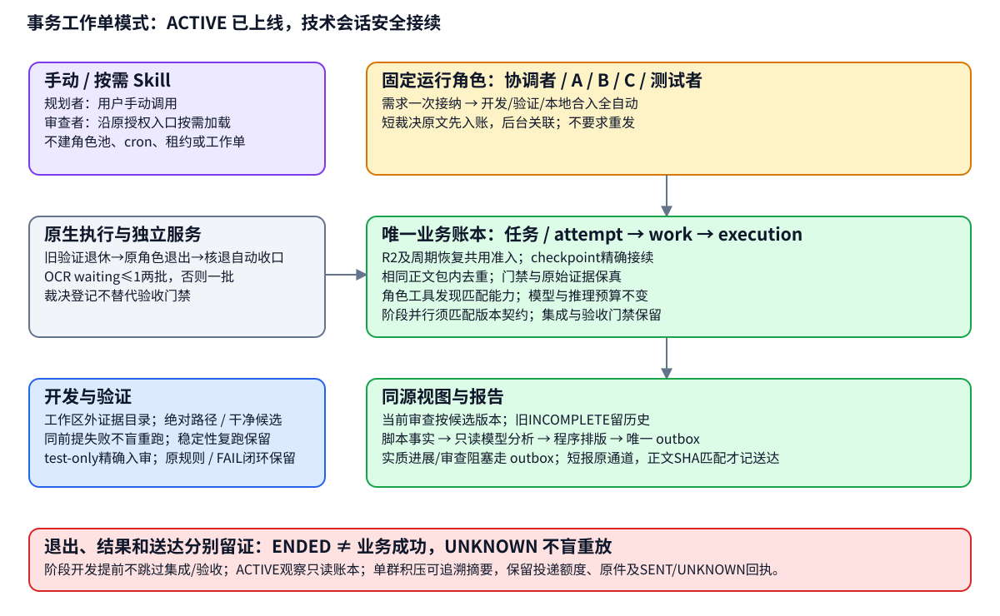
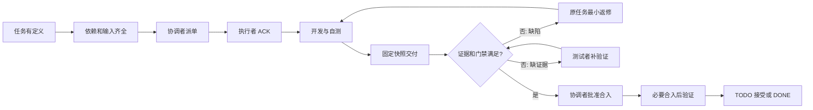
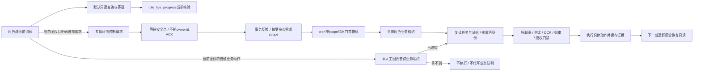
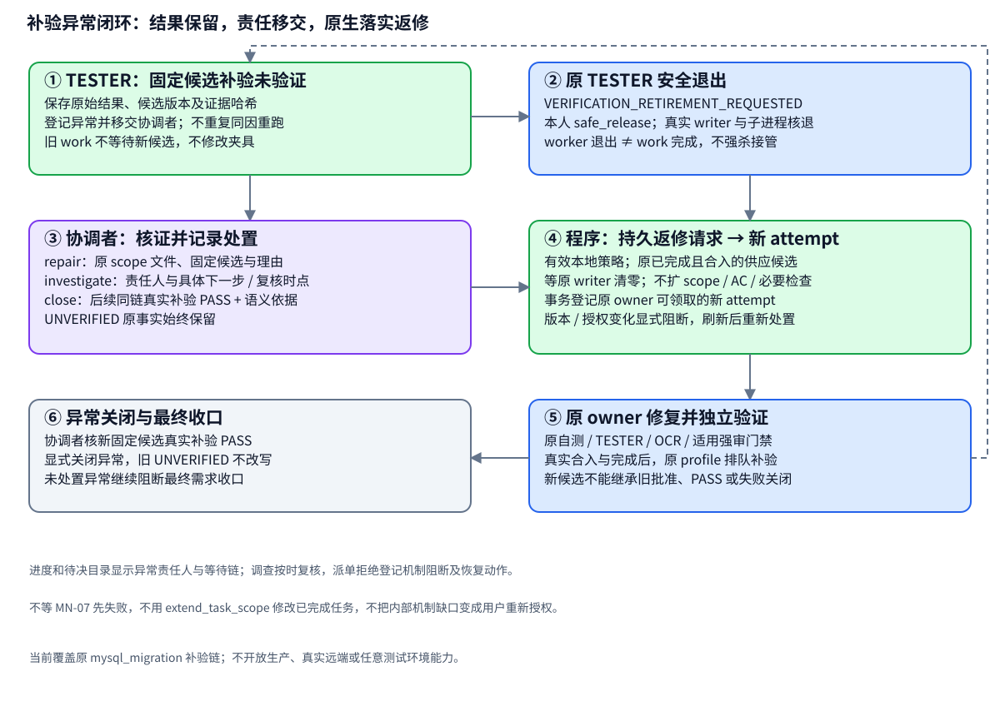
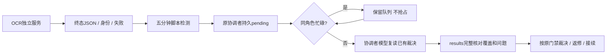
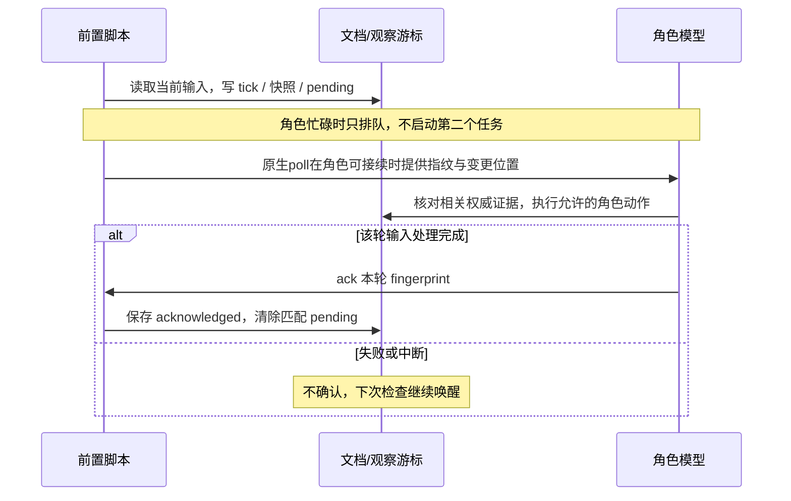
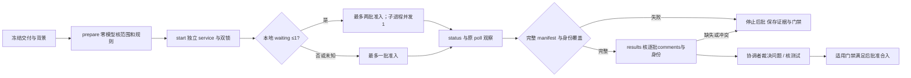
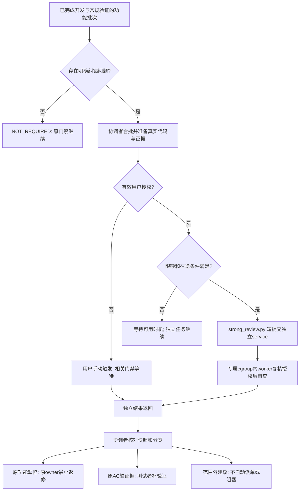
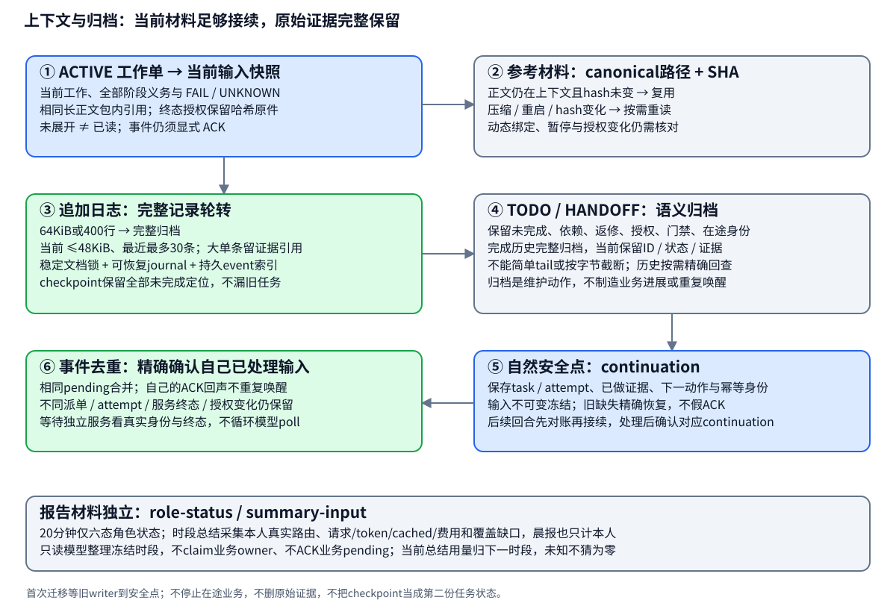
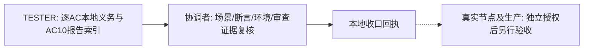

# 复杂任务 Skill 开发流程与维护指南

> **当前使用入口（2026-10-21）：** 新机制已上线，日常操作请先看[新机制使用指南](ROLE-WORKFLOW-USER-GUIDE.md)，包含新需求接入、启动、切换、暂停/恢复、审查授权与排障。下文保留历史流程与设计材料；LEGACY 人工租约操作不适用于当前 ACTIVE 角色群。

> **当前运行状态（2026-10-21）：** 事务账本模式已经上线；原生 `ACTIVE/schema_version=2` 工作包按[事务工作单协议](/home/wang/.codex/skills/complex-task-coordinator/references/transaction-workflow.md)运行。2026-10-19 的未切换状态属于历史，原始[实施记录](analysis/role-workflow-flow-audit-20261019/IMPLEMENTATION.md)保留；本次[机制复核与修复](analysis/workflow-mechanism-repair-20261021/REPORT.md)分别记录源码回归和实际采用证据。下文旧人工租约、ACK、inbox 指纹适用于 LEGACY/STAGED。

规划者保持用户手动调用；规划者与审查者均为按需加载的 Skill，不加入 `role_runtime.ROLES`、role-pool、角色绑定、cron 或租约体系，不创建其业务账本条目、work 或 execution。auto 需要云端时优先使用 sub2api 的 deepseek-v4.1-flash；手动选择的路由保持原方式。

> **文档版本：3.27｜核对日期：2026-10-30｜运行时区：Asia/Shanghai（+08:00）**\
> 本文是当前五角色协作流程的长期参考。依据现有 Skill、脚本、项目协议和 Hermes 配置整理；后续调整这些机制时同步更新本文。本文不保存实时任务状态，也不新增开发或生产授权。规则变化时以用户指令及适用的当前协议为依据核对差异，不把本指南当成额外验收门禁。

**用户提出需求，规划者先确定需求归属和独立文档根，再做架构和初始拆分；协调者派单与接续，A/B/C 各自开发，测试者独立验证，协调者核对审查与证据后批准合入。** 强模型审查者只在有明确纠错需求时介入。角色通过文档交接；Hermes 负责实际唤醒与投递；脚本承担机械巡检、状态短报与统计采集，时段统计由短只读模型分析整理。

## 0. 先看这里：我该怎么使用飞书协调者

2026-10-30最终验收补充：**规划者仍手动触发；已接受本地开发范围内，叶任务完成后由机械巡检自动派最终集成验证，不再要求用户另发MN-07派单裁决。** 原生completion计划依赖全部供应任务的真实合入并冻结精确集成SHA；TESTER逐AC独立取证。代码FAIL以问题ID回原owner新attempt，保留原scope/AC/测试/OCR/审查/合入门禁；环境缺口为UNVERIFIED，限次退避。返修集成后自动重验，最终PASS后协调者复核原始证据、历史失败处置及writer退出，用complete_requirement记录本地需求完成。开发任务COMPLETED与需求验收COMPLETED分别显示；真实节点、生产及push仍按原后置边界。实施及实际采用证据见[原生最终验收修复记录](analysis/native-final-acceptance-20261030/REPORT.md)。

2026-10-27 运行机制补充：ACTIVE 启动以 `business_ledger.admission_hint` 为准，旧池 `current` 不参与该准入；只读进度工具显式显示五角色 `model_admission` 与本角色能力。`waiting_external` 最长抑制复核 15 分钟，协调者保存等待时记录分支/HEAD/dirty，状态变化可提前复核；复核不清除真实授权、暂停和验收门禁。普通文档由协调者读取真实正文/diff/hash、核对事实后通过 `commit_documentation` 单独提交；不能把dirty一律转嫁用户。文件变化后重读，指令/PRD/AC/长期契约另走相应流程，代码候选门禁独立。合入保留在途受管worktree回执；隔离不代替文档收敛。日志用 `append_development_log` 固定追加本需求日志。详见[修复与验证记录](analysis/coordinator-autoadvance-20261027/REPORT.md)和[使用指南](ROLE-WORKFLOW-USER-GUIDE.md)。

2026-10-29裁决与并发：可信用户“按解读b”等短答复由 `record_user_decision` 原生持久登记，不要求重发全权或对象ID；USER_DECISION_RECORDED仅证明接收。协调者核原提问/选项及当前实现，以 `resolve_user_decision` 留下关联和处置证据，再更新checkpoint；事件ACK不消除未处理义务，也不自动关闭验收门禁。OCR 1.7.0在新prepare内冻结负载策略，同一双锁受管service动态最多两批（本地waiting≤1），其他含未知为一批；旧冻结run沿原策略结束。开发接续从checkpoint具体next和真实diff开始，按需读取变化材料，避免多轮重读耗尽交接窗口。MySQL补验身份参数独立保存在不可变账本上下文，普通checkpoint不能替换。已解析的用户裁决与显示/汇报规则见[本轮记录](analysis/coordinator-decision-concurrency-20261029/REPORT.md)。

2026-10-28本地自动化：需求一次接纳包含原范围内派单、开发、验证、返修、文档审核提交、安全收口、基线刷新、批准、本地合入和交付；使用local_development_automation直至完成/暂停/取消/撤销，取消逐task/attempt及72小时本地续授。未指定目标时选受管workflow分支，明示候选/后定目标限制优先。OCR/强审按原预算期限，外部生产/push边界独立。旧验证单通过退休请求→本角色安全退出→原生writer及子进程核退自动收口，不能让用户a/b释放；空占位交付拒绝，下游自动锚定审计集成base，未交付任务受控刷新。详见[实测记录](analysis/coordinator-autonomy-20261028/REPORT.md)。

2026-10-27授权接续补充：任务→分支授权在同run/task/repo/branch、冻结合同与原期限/撤销边界内跨attempt/base持续，实际合入派生精确候选permit；明确的候选限制仍保留，新候选重走测试/OCR/批准。MySQL补验归属走原生持久控制request_supplemental_verification，不因owner忙丢失、不要求重发或额外口令；TESTER固定verify_supplemental使用临时无网络MySQL8.4和Unix socket，skip不能报通过，结果单独入账。详见[授权与补验修复](analysis/coordinator-authorization-20261027/REPORT.md)。

同日11:30答复复核补充：HEAD/index blob相同不等于工作区内容相同；只读工具补充真实内容diff及解释，不能凭文件名/mtime断言会话归属。merge在授权spec.repo原位执行，operations仅存执行证据。等待轮询已恢复不代表业务dirty已解除；本轮不替其他会话提交或删除文档。

**直接在角色群自然语言交流即可。协调者、执行者、测试者群聊发起回合默认只读，可问进度和答疑；不用等五分钟巡检。只有当前消息明确“全部权限：<具体动作>”才可在本回合尝试动作；普通业务动作须租约，专用需求选择可仅排控制请求，原门禁保持。** 模型仍可能因服务容量排队，但工作流不再故意关闭人工问答入口。

### 0.1 为什么要重新调整

最初三项目标是：机械负载查询直读指标、减少无必要的提示/工具前缀变化、用可靠脚本承担环境检查及长任务等待。这些目标不要求禁止人工聊天。之前实现把所有协调群消息转交后台、把自然语言进展改成旧快照直答，扩大了优化范围；夜间cron抑制还导致人工问题的答案仅归档。**2.0保留原生人工对话；3.2进一步明确群聊默认只读，避免群会话成为重复执行的影子owner。** 当前群全权只对该人工回合有效；已接受需求的后台scope持续有效，cron依该范围、租约与门禁接续。3.4增加固定五角色池，需求从总索引选择、安全点自动切换，避免每次手工改绑。

### 0.2 你发什么，系统做什么

| 你发送的消息 | 当前机制 | 是否改变业务 |
|---|---|---|
| “给我汇报当前进展，突出完成项和阻塞” | 模型用role_live_progress只读核验派单、进程、服务和工作区，结合有效回执分析 | 只问进展不派单、不自动入业务队列 |
| “为什么还没完成，下一步怎么办” | 群模型解释证据、缺口和可选动作 | 讨论不等于执行授权 |
| “在现有范围内优先TASK-xx” / “帮我修” | 只读解释当前范围和接续条件，说明动作需要本回合全权 | 不改任务、不写inbox、不自动交后台 |
| “按当前计划继续” | 只读核对现状并答复，告知全权格式 | 不领取、不ACK、不执行或自动排队 |
| “全部权限：在原范围内执行具体动作” | 仅本回合尝试取得同一角色业务租约，取得后复读任务/证据再执行 | 原授权/职责/门禁仍有效；拿不到不执行、不代写队列；下一普通消息恢复只读 |
| “本轮授予全部权限：切换需求 <精确ID/目录路径/标题>” | 协调者原生专用入口保存选择控制请求；忙时等待安全点，事务完成才切换 | 不claim业务租约、不抢旧owner、不派单/ACK；接受后建立后台持久需求scope |
| `/progress` | 可选脚本简报：同一live-progress当次核验，列本次结果、最近业务checkpoint及具体缺口 | 不执行任务、不调用模型、不解除暂停 |
| `/llm-load`、精确机械负载查询 | GET LAN指标并答复 | 不改服务参数；解释原因仍交模型 |
| 提出新需求/重大契约变化 | 默认只读讨论范围与设计建议 | 不因群问句写任务或启动新阶段 |

**脚本不是默认聊天入口。** 自然语言“当前状态”“当前进展”“恢复了吗”都保留模型语义判断；“恢复了吗”不会被当成恢复授权。私聊、无关群以及其他角色群仍走各自原生规则，不因查过指标被纳入协调工作流。

### 0.3 群会话和后台是不是同一个协调者

它们是**同一个逻辑角色、不同技术会话**，不共享全部内存或聊天历史。群会话负责只读查询与答疑；当前用户明确全部权限且取得业务租约后，才可在本回合做具体动作。后台按已接受需求的持久scope继续接续工作，不继承群只读限制，也不要求用户为每个cron回合重新授群全权。两者的共同记忆是TODO、派单、ACK、回执、decision与角色检查点。

**可以直接发消息，不用先停后台。** 所有群发起回合先只读，不抢业务租约；“继续”“帮我修”也不自动保存待办或触发后台。只有当前用户明确`全部权限：<具体动作>`才允许本回合在原授权内先用`role_manual_lease(action="claim")`取得同一角色租约（renew/release也仅该全权回合可用），复读task/attempt与既有处理证据后动作；其他owner忙碌时不执行、不代写业务inbox或队列。专用可信需求选择控制请求可单独排队，见下节；它不获得业务写权。历史、引用和工具输出不授全权，下一普通消息恢复只读。需要动作时直接说明本回合只读并告知上述格式，不默认发起批准问句。

租约只防并发，不天然保证崩溃后不重做。真正的防重复还依赖执行前复读状态、固定任务/attempt和原操作幂等身份；共享写操作通过受控入口，不能任意terminal直写后声称受锁保护。任务批准仍保留开发自测、独立测试、受管OCR、适用强审、合入和生产授权。

### 0.3.1 五个群固定，选择需求后后台持续工作

五个常驻群和原job属于同一角色池；需求入口是[需求总索引](prd/README.md)。索引只导航与选择，业务TODO、协议、派单/ACK、回执、session及事件继续在各需求包维护。每轮从池解析当前需求、generation和本角色实际业务根，不沿用旧会话中的目录，也不每次手工重绑五个群。

存量需求显式共用兼容runtime_root时，当前执行范围只含所选包TODO“本包任务编号定位”的精确任务ID，不能按前缀纳入其他任务；缺列表先准备材料。context-input只读过滤同根其他包的任务、派单和continuation，返回旧checkpoint暂存定位与排除数量；合法业务替换活动checkpoint前按SHA完整停放，切回时恢复本包最新门禁、交付和下一步。领取、业务记录、独立操作及continuation固定入口再次复核范围；同根旧证据仍可追溯，任意terminal仍不是操作系统沙箱。独立新根按自身TODO工作。

可用无参数只读工具`role_requirement_catalog`查看已登记需求。需要选择时，在**协调者群**发送`本轮授予全部权限：切换需求 <精确需求ID/目录路径/标题>`；模型入口为`role_requirement_select`，参数仅`target`。当前可信全权与明确选择缺一不可，普通“这个需求进度如何”不产生请求。未登记或歧义明确说明，工具不可用时说明部署缺口，不手写池文件。

切换排队期间，新业务回合默认不开旧任务；唯协调者且全部阻塞来自既有独立操作/OCR/强审收口时可进入drain_only，仅核既有run、回执及裁决、保存检查点和释放，不新派单/领取/开发/操作。只读报告不占业务槽，事实采集短时持admission锁，输入冻结后不为模型生成阻止切换；采集前scope已变明确失败。

专用控制请求即使owner忙碌也可持久接收，回复“已接收，等待安全检查点”；它不claim业务租约、不抢占、不开发、派单或ACK。旧任务和独立操作到安全点、身份核实后，池事务才切换generation与实际业务根；活/未知owner或操作阻止切换，不凭TTL强杀/接管。普通全权业务动作仍须业务租约。

**选择接受后，后台在该需求scope内持续接续，直到完成、暂停或撤销；不要求每个cron回合再发送“全部权限”。** 群全权只授当前人工回合，下一普通消息仍只读。生产/付费强审、后续阶段及各角色职责仍按原授权和门禁。需求完成后保存收口证据并保留当前选择待命，固定五角色jobs不停止，无新业务输入不唤业务模型；新需求仍须明确选择。原有暂停/撤权门禁继续生效，不新增通用池控制API。完整边界见[固定角色池参考](/home/wang/.codex/skills/complex-task-coordinator/references/role-pool.md)。本说明不代替实际配置激活和自然运行取证。已登记的README方案包也可明确选择；缺TODO/协议/验收材料时列出准备缺口，协调者先补齐规划契约再派单，其他角色没有有效派单就待命，选择不等于已可开发。

### 0.4 怎样判断进度是否足够新

人工“我要进度”等询问使用无参数专用只读工具`role_live_progress`，自动绑定当前role/project，模型无需terminal；工具不可用时仍保留完整角色分区，只将受影响事实标为待核实，并用当前可用账本/观察证据生成结构化回退。进度正文不回显内部错误码、预算/字节数或原始日志；用户直接询问工具故障时，才简短说明已核实的原因与影响。最终输出校验角色分区、粗体字段、短条和中文；格式不合格时以当次只读事实替换成结构化回退。自动协调者正式进展同样校验七区，英文或静默混排不投递，格式无效时尝试按当前快照重排。显式`/progress`脚本使用同源`runtime_tools.py live-progress --project ROOT --role ROLE`，角色为`COORDINATOR/A/B/C/TESTER`。当次重新核验有效派单/ACK/checkpoint、owner PID/start、工程操作与OCR/强审服务当前状态、实际worktree HEAD/dirty。自然语言由原生模型结合当前核验与有效回执分析；`/progress`直接呈现同一核验结果，不调用额外模型。不能机械复述缓存sections或上次报告。

每个角色说明本次核验结果、最近业务checkpoint的原时间和缺失/冲突；无法确认即待核实。文档承载验收和历史阶段，PID存活、dirty、最新读取时间不证明持续推进或新完成。生产任务只按已有只读观察器查询，并写实际来源时间；未配置、失联或陈旧时指出具体缺口，不自动新增生产探测或测试。事件汇报仍以`report-input`业务基稿结合本轮证据，时段历史用`summary-input`；完整`progress-facts --json`和历史原文只按需取证。

**协调者白天20分钟报告只显示执行者A/B/C、测试者是否可领新任务，例如“执行者A（空闲）”；无需七区、百分比或长进展。** 人工问进度、有意义事件和08:00汇总仍保留七个固定区，顺序为**整体目标与进度、执行者进度、测试者进度、OCR情况和后续计划、强审查情况、风险、下一步计划**；无事实或`role_live_progress`失败/超预算时也保留全部分区，只概括核验未完成、写明证据来源和待核实范围，不复制内部诊断码或预算细节，不用局部摘要替代。各角色名字后加（空闲）/（工作中）/（等待）/（阻塞）/（暂停）/（待核实）。各区拆短条目，区标题及正文重点字段、状态/结论、阻塞/风险、下一步加粗，使用单层bullet；A/B/C各一组，在组内区分当前任务、后台关联责任、已接受成果及下一步；不把同一个人重复列成多个“当前”。执行者与测试者只使用**当前工作、本次完成、阻塞与依赖、下一步计划**四区，仅报告本人工作和直接依赖。单一原因问题正常直答，不强制全文进度。

轮询模型若核实没有新增业务事实且没有可执行控制动作，最终正文必须且只能是`[SILENT]`；不要先解释checkpoint、轮数、等待原因或“本轮无动作”，也不要在标记前后附任何文本。有业务变化、阻塞升级或需要用户决定时才生成正式中文报告，不能把英文内部草稿与静默标记同时输出。

每项保留证据及有依据的发生/观测/补录时间，读取失败或版本对应关系不足须说明。当前报告是可重建视图，不新增任务状态；开发、测试、OCR裁决、接受、合入与生产各有独立证据，报告不能代替门禁。

本次核验、业务发生/观测、补录和报告生成时间分别显示。“09:55核验服务仍运行”只说明当次检查结果，不能伪造成09:55完成新成果。长操作后、最终人工答复前重新核验相关变化；记录旧、缺失、冲突或正在写入时明确来源和具体补核动作，不用“非生产实时探测”一句代替查询。巡检启用或请求HANDLED也不证明业务完成。脚本无法解释的问题直接在同一群追问，进入模型。

### 0.5 夜间、忙碌和暂停时能不能问

- **夜间能问。** 21:00–08:00只停止主动通知；人工问题从群模型路径答复，不转到夜间受抑制的cron final。
- **后台忙碌能问。** 背景业务和只读对话可共存；同一群模型本身忙碌时由Hermes原生busy机制接续，服务容量也可能导致等待，不承诺零延迟。
- **暂停仍能交流。** 问答不自动恢复暂停，不抢占/强杀旧owner。需要恢复时先核控制状态及授权。
- **只读群消息不收业务待办。** 普通全权业务动作先取得租约；专用可信需求选择仅排控制请求。已接受需求的旧PENDING由cron在持久scope内接续。HANDLED仍只表示已有处理/转派/阻塞证据，不证明完成或送达。

若普通自然语言仍只收到“已登记”、无模型回应，应查插件是否已热加载及是否仍有旧回合，不让你靠反复换命令解决。若连普通问句都没有回应，再核对正确群/机器人触达规则、鉴权、网关投递、原生busy及模型排队。无需反复重建角色或对每个执行者重复派单。

### 0.5.1 在飞书切换模型

已绑定角色群可用模型路由的status/help只读查看状态和用法。修改路由须当前可信用户原文带全权前缀，例如`全部权限：/llm cloud sub2api`；普通“切换到云端模型”“恢复自动切换”或无前缀的修改命令不自动修改。sub2api对应DeepSeek、xcoding对应已配置x-coding。设置影响本机全部绑定角色，已发出请求允许结束，后续请求再按有效设置选路，不重复已有工具执行；支持范围和部署证据见实施记录。

角色群中的原生控制也受入口权限检查：`/cron`、`/model`切换、`/approve`等有副作用的slash默认拦截。批准待执行操作须当前可信用户原文明确`全部权限：/approve x`（支持运行时识别的本轮授予全部权限同义前缀），再由native直接处理；历史批准、引用或旧授权不能旁路。`/stop`、`/cancel`、`/deny`、`/new`、`/reset`、`/help`、`/status`、`/usage`保留原生停止、拒绝、会话及只读控制语义，不构成新业务执行许可。模型不代跑这些原生控制，后续普通群消息仍恢复只读。

当前自动/本地优先按实际本地等待队列准入：waiting=0且running可读时用本地，waiting非零或指标未知走选定云端；不因时段、流水线或running非零单独拒绝。未知／云端故障不自动抢回本地。OCR代码审查的新run按后续批次同步供应商/模型并记录实际身份，在途批次先结束；x-coding使用gpt-6.1-sol High。外部强审和独立辅助调用另按原配置运行。供应商可用性、实际部署状态、边界与回退见[模型切换说明](prd/hermes-model-routing/README.md)及[实施记录](analysis/hermes-model-routing-20261015/REPORT.md)。

### 0.6 负载优化的明确边界

**保留人工语义交互的模型成本，削减没有业务价值的后台成本。** 不承诺在共享模型四并发完全饱和时实现即时响应；要稳定降低人工等待，需要实际请求归因、接入优先级或服务容量，不能靠关闭聊天入口实现。本轮不擅自修改共享服务器并发、生成参数、报告时点或生产流程。

| 保留的优化 | 收益与边界 |
|---|---|
| 五分钟脚本比较文档/身份；无变化不唤醒模型 | 每次无变化检查零推理请求；有未处理事件仍接续，不能漏任务 |
| 机械指标GET；环境预检/长工程操作脚本化 | 机械查询与等待本身零推理请求；业务诊断、失败裁决仍由模型负责 |
| 本包保真去重与角色工具发现（0.14.0） | 完全相同正文使用包内引用；终态授权保留哈希原件，未闭合门禁/当前授权保持；后台只发现本角色原本可用能力 |
| system/tool指纹审计 | 先定位不必要变化；不为缓存屏蔽新规则或删必要上下文，当前尚无缓存收益实测 |
| 共同租约、任务状态和操作身份 | 减少重复执行；人工问答不被禁用，执行前核对与原审核门禁不减 |
| 状态短报与模型时段总结 | 20分钟脚本只报可领状态；时段脚本采集后由独立只读模型解释，保留原时点和静默 |
| 最新checkpoint与可恢复归档 | 防日志无限膨胀与相同参考反复读取；所有未完成/门禁/原始证据可定位，不减少核验覆盖 |

一次人工问答不再自动生成一份后台待办，因此不会仅因问了“当前进展”额外唤醒后台协调者。模型实际工具轮数与耗时以任务为准，不设置牺牲核验质量的固定上限。

## 效果优先：负载优化的适用边界

**效果保护原则（2026-10-29）：** 优化只能删除已证明重复的机械动作，不能减少原 REQ/AC、关键错误路径、独立测试、必要 OCR/强审查、历史 FAIL 关闭证据或最终集成回归。提前并行只允许在接口版本、模拟替身、文件 owner、风险场景和验证环境均冻结时开始；`development_start` 放行不会放开 `integration` 或 `acceptance`。接口证据不匹配、指标未知、结果不完整或无法证明复用时保持原门禁和串行路径。

**功能正确性、既定AC和必要风险覆盖优先于token、调用次数和速度。** 节流收益只作为质量条件满足后的观察指标，不作为迫使角色少读、少测或提前结束的验收要求。

- 短快照用于定位工作；开发、测试、OCR与强审查可以展开完整相关代码、上下游、契约和原始证据。不能只让模型依据摘要裁决，不能因材料预算省去重要错误路径；材料太大按职责拆批并记录完整覆盖。
- 不以“2～4次请求”“1～2分钟”或固定输入长度限制必要推理/验证。用户授权、服务容量和原有审查额度仍遵守；预算不足保持门禁等待，不能用不完整验证放行。
- helper可以承担已明确的格式化、原子写入和身份检查，业务裁决、测试范围判断、缺陷分类及验收批准继续由对应角色负责。调用数高不自动证明其中动作无价值。
- 减少唤醒或复用证据必须有相应依据：覆盖所有相关任务/契约变化、异常与恢复条件；记录实际commit、输入/配置、环境和失效条件。无法证明适用时保留原核查，PID存活本身不证明任务健康。
- 代表性任务对照优先核验已有AC、必要错误路径、漏事件/重复执行、恢复和审查问题覆盖，再比较调用数、排队和交付时间；只在原范围内验证，不另建通用质量平台。
- v3按下文区分状态短报与模型时段总结，并采用最新checkpoint、完整归档与去重接续；脚本/隔离验证不能单独证明完整业务等价、真实送达或成本节省，运行证据分别记录。

## 目录

- [0. 飞书协调者怎么用：查询、消息、冲突与排障](#0-先看这里我该怎么使用飞书协调者)
- [1. 角色与职责](#1-角色与职责)
- [2. 完整任务流](#2-完整任务流)
- [3. 三并发如何拆分和接续](#3-三并发如何拆分和接续)
- [4. 协调与唤醒机制](#4-协调与唤醒机制)
- [5. 测试、OCR、强审查与合入](#5-测试ocr强审查与合入)
- [6. 文档协作与身份恢复](#6-文档协作与身份恢复)
- [7. 群内进度与开发日志](#7-群内进度与开发日志)
- [8. 如何启动、授权和结束](#8-如何启动授权和结束)
- [9. 后续调整应该改哪里](#9-后续调整应该改哪里)
- [10. 当前实现位置与验证边界](#10-当前实现位置与验证边界)
- [11. 维护规则与变更记录](#11-维护规则与变更记录)

## 1. 角色与职责

**五种业务角色 Skill，七个逻辑角色，五个常驻运行群。** 执行者 Skill 被 A/B/C 三个独立角色复用。规划者与强审查者按需使用；它们没有周期付费调用。另有一个只负责消息样式的辅助 Skill。

| 角色 | 当前 Skill / 版本 | 谁提供输入 | 主要工作与产物 | 职责边界 |
|---|---|---|---|---|
| 用户 | 无需角色 Skill | 业务目标、问题及约束 | 提出需求；确定阶段/范围；给出必要授权；处理升级事项 | 一次需求不自动授权所有后续生产操作 |
| 规划者，通常强模型 | `complex-task-planner` / 1.12.0 | 用户需求、现有项目事实 | 需求归属与文档根、架构、接口/关键契约、REQ/AC、最小链路、分阶段依赖图、风险场景、验证环境及交接文档 | 默认只规划，不直接开发业务代码；独立新需求不默认追加到最近专项 |
| 协调者，弱模型 | `complex-task-coordinator` / 1.22.0 | 规划文档、用户授权、各角色交付 | 派单、范围内再拆分、补位、受管 OCR、审查包、证据核对、批准合入、共享文档与日志 | 不承担业务开发及日常测试，不把已有权限事项推给用户 |
| 执行者 A/B/C，弱模型 | `complex-task-executor` / 1.11.2 | 协调者给自己的有效派单 | 固定base任务分支/worktree、task-claim独立ACK、风险场景自测、固定commit、回执、按问题ID返修 | 不自行领取未派任务，不 OCR、不批准、不合入主分支 |
| 测试者，弱模型 | `complex-task-tester` / 1.12.1 | 协调者测试派单、被测快照和 AC | 按固定风险场景独立测试、真实环境验证、集成/回归、命令/退出码/证据、验证报告 | 不代开发，不 OCR，不批准合入 |
| 独立审查者，通常强模型 | `complex-task-reviewer` / 1.3.0 | 用户手动提交，或协调者有效授权内提交 | 审实际代码与证据，按既定需求纠错，输出独立结果 | 不默认改代码、合并、部署或扩大任务范围 |
| 显示辅助 | `feishu-progress-style` / 1.13.2 | 角色已核实的事实 | 协调者人工进度固定七区、20分钟状态短报例外，执行者/测试者本人四区；正文重点加粗；只读工具异常不回显内部诊断，最终输出格式校验兜底；自动poll无变化只输出独立`[SILENT]` | 不决定任务事实、审核权限或定时频率 |

这里的“强/弱”描述当前使用分工，Skill 本身不负责选模型。模型、接口及服务器并发由运行环境配置决定。

## 2. 完整任务流

图中测试、OCR 和适用强审查均属于门禁材料；它们可以在证据与资源允许时交错执行，最终由协调者统一核对。图的返修箭头只回到原任务所需修复，不引入新的产品目标。

| 阶段 | 发起者 → 接收者 | 必须明确的内容 | 完成后触发什么 |
|---|---|---|---|
| ① 提出需求 | 用户 → 规划者 | 目标、现状、本期最小输出、非目标、环境及授权范围；先区分独立新需求、原目标补充/返修及后续阶段 | 确认需求ID、代码仓与需求根，再调查和设计 |
| ② 规划设计 | 规划者 → 协调者 | 本需求PRD、DESIGN、TODO、ACCEPTANCE、HANDOFF、启动说明、角色协议及跨包依赖；REQ 是需求，AC 是验收条件 | `DESIGN_READY`表示文档可开发；另列运行绑定是否就绪，不代表已派单/启动 |
| ③ 首波派单 | 协调者 → A/B/C | 任务/attempt、owner、固定 base、文件/资源范围、契约、AC、停止条件及 ACK/回执路径 | 落盘派单与事件，提前触发目标角色 poll |
| ④ 领取开发 | A/B/C → 协调者 | 先只读核派单并准备固定base任务分支/worktree；task-claim事务创建ACK→事件→outbox一句通知，再开发、自测、更新checkpoint | 冻结commit和回执，原生模型总结完成；`REVIEW_PENDING`非通过，明确释放槽后可接新单 |
| ⑤ 独立验证 | 协调者 → 测试者 → 协调者 | 固定快照/真实环境与AC，领取稳定事件→脚本一句开工；实际命令/断言/日志 | `PASS / FAIL / BLOCKED / NOT_RUN`；原生模型总结验证结果，回执待协调者裁决 |
| ⑥ 审查裁决 | 协调者 → OCR / 必要强审查 → 协调者 | 代码范围、快照、已有证据、具体风险及作用门禁 | 真实问题回派开发；缺证据派测试者；误报记录排除依据 |
| ⑦ 批准合入 | 协调者 → 主分支 / 测试者 | 适用门禁均满足，核对实际 base/head、契约和变更范围 | 合入并记录 merge commit；必要的合入后验证仍派测试者 |
| ⑧ 接续或收口 | 协调者 → 下一个可执行任务 / 用户 | 子任务与父任务 AC 满足；阶段停止条件和遗留门禁明确 | 重算候选并补位；本期完成后保存收口并保留当前选择待命，固定jobs保留；分别记录工程闭环和生产启用 |

**谁“发出任务”有两层含义：用户发出业务需求；协调者发出具体开发、测试和返修派单。** 规划者设计任务依赖与边界，执行者不能把 TODO 中一个 READY 条目当成自己的领取许可。

### 一个任务怎样算完成

以下状态描述逻辑流，不要求所有项目采用同一套枚举；项目的实际 TODO 状态仍为准。

`REVIEW_PENDING`、测试 PASS、OCR 无发现、强审查 PASS、已合入和业务 DONE 各有不同含义。代码或契约发生相关变化后，旧快照的通过结论不能直接放行新行为。父任务只有子任务均接受、必要集成验证完成后才收口。

## 3. 三并发如何拆分和接续

阶段依赖必须由计划显式定义：`development_start`、`integration`、`acceptance` 依次单调收紧。若消费者要在提供方完成前开发，提供方须在冻结计划中声明 `provided_contracts`；消费者须声明匹配的契约 ID、版本、接口、模拟方式、最小阅读集、风险场景、验证环境和升级条件。账本在发布时校验接口匹配，在集成时核提供方合入提交已包含于消费者基线，在最终验收时仍要求提供方任务完成。任一契约不匹配就保持串行；模拟结果不计真实集成通过，完整 AC 和独立验收不变。

**初始拆分由规划者负责；运行中细化和补位由协调者负责。** 不按“有三个人”硬切三块，按可独立开发、交付与验收的产物拆分。三路是开发上限，独立测试槽另外计算，实际模型服务器容量仍可能造成排队。

协调者每次处理交付接受、阻塞解除、槽位释放或调度复核时，检查下面这些条件：

1. 工作属于本期已授权范围，没有借拆分启动 DEFERRED / WAITING_AUTH 阶段。
2. 硬依赖已接受，必要输入与契约齐全。
3. 文件、数据库迁移顺序、GPU、测试环境等没有冲突；有公共接线时指定唯一 owner。
4. 执行者确实可接，已有 ACK/进程没有被误当成停止。
5. 任务粒度足够独立验收；过粗则先更新 TODO 父子关系、依赖、任务卡与交接边界，再派子任务。

一个子任务接受后立即重算接续，**不等待三个执行者一起交付**。冻结交付后的角色只有经协调者明确释放槽并派出无冲突新单，才可继续；发现原交付缺陷时按新 attempt 召回原 owner。已在途任务不能被协调者直接拆走或换人，必须先核对检查点、已完成范围和交接确认。

图中的 A1/A2/B1/C1 是调度示例，不是当前项目真实派单。若 A2 依赖 B1，A 必须等待 B1 接受；有空槽时协调者应写清具体依赖与解除条件，而不是为了并发新增工作。

**审核等待期间继续检查可并行工作。** 最终接受/合入依赖不必自动禁止所有准备工作；协调者在原REQ/AC内检查独立测试、稳定接口准备及资料可测试性复核。派单明确暂定快照、允许文件、保留门禁和基线更正后的重验。硬依赖、共享文件和真实材料缺失仍保留，无法并行时写具体解除条件；不为填槽激活DEFERRED或新增功能。冻结交付释放开发槽前核实在途写入及返修召回责任。常规测试复跑交测试者，协调者核证据适用性，证据冲突或失效才补跑。

## 4. 协调与唤醒机制

当前 ACTIVE 由账本和原生执行事实提供观察输入；独立 registry 扫描自动跳过旧业务 inbox 指纹，原生 R2 hook 采集、事务派发和周期恢复 job 共用同一准入及 writer fence。`ADOPTED` 必须有当前存活 PID/start 的真实采集及派发回执；worker 能力探测不覆盖已采用状态。周期 job 保留不表示 R2 未启用，空检查不调用模型。以下旧指纹流程仅用于 LEGACY。

ACTIVE 技术会话默认 48 个主请求轮次或约 128000 输入 token 时要求保存真实检查点、未决门禁和下一步，并以 `payload.yield_execution=true` 让出；业务主循环预算 64，保留原生最终收尾机会。新会话恢复同一 work/attempt，完整 writer 退出证明仍是重新准入条件；阈值不作为业务成功条件，不删除证据或放宽验收。只读报告及群问答不采用该后台预算。`state=ENDED` 仅表示写进程已核退，`native_outcome` 单独保留原生未知或失败。

机械告警仍按池 12 次/小时、同群 3 次/小时、间隔 300 秒约束。超过单群额度的待发语义意图可合为角色/代次摘要并保留原件和成员链；`monitor_notifications.py status --outbox PATH` 只读显示同群限流和下次可投递时间。池尚有额度不代表当前群可投递，摘要也不代表送达。

2026-10-28 报告修复：协调者实质 business final 经 COORDINATOR_PROGRESS 发件箱投递；审查未完成/失败及派发拒绝保留机械阻塞通知。20 分钟原 no_agent 短报加标题、时间、需求，STATUS_BRIEF 只审计原 cron 通道，不双发；正文 SHA 与原生终态回执匹配才记 SENT，UNKNOWN 不重发。晨报历史明细完整外存，保留当前门禁和全部验证。固定截止未修复不原样消耗唯一补审；已确认缺陷按原授权返修，不把“接受部分覆盖”捆绑为唯一前提。源码、热加载及自然投递分别核验，见[本次记录](analysis/coordinator-reporting-repair-20261028/REPORT.md)。

### 4.1 运行路径

| 路径 | 发起方式 | 实际做什么 | 是否调用模型 |
|---|---|---|---|
| 人工问答/进展/方向讨论 | 群原生模型会话 | 默认只读；进度用role_live_progress和相关原文答复，不领取、不写inbox/ACK、不自动入队 | **调用模型** |
| 可选机械进度查询 | 显式/progress | live-progress当次核验派单、owner、服务与实际工作区，按本角色报告范围呈现结果与缺口，夜间可用 | **不调用模型** |
| 群角色当前回合全权动作 | 当前用户明确“全部权限：具体动作” | 普通业务动作先取得租约；拿不到不执行、不代写业务队列；下一普通消息恢复只读 | 对话调用；执行按实际需要 |
| 固定池需求选择 | 当前可信全权协调者消息明确选择目标 | 专用控制请求可在忙时持久排队，不取业务租约；安全点生效并建立后台持久scope | 原生快捷或专用工具，不执行业务 |
| 机械负载查询 | 仅实际绑定角色群的精确查询、`/llm-load` | 直接GET LAN `/metrics`生成答复；采集失败显示未知 | **不调用**；解释原因仍交模型 |
| 派单/交付/操作结果 | 有权角色先落盘 | 五分钟检查保留变化并由同一poll接续；安全的提前唤醒入口可用时才提前运行 | 前置脚本判断后才决定 |
| 五分钟独立检查 | systemd `role-document-observer.timer` | `role_observer.py scan` 比较各角色文档内容/身份，更新 tick/快照，把变化保留到 pending | **不调用模型、不投递消息** |
| 五分钟模型接续 | Hermes 原生 poll cron，五个角色错峰 | 读取同一观察状态；空闲时消费待处理输入，忙碌时由原生 claim 去重 | 有未处理变化或采集异常才调用 |
| 白天20分钟状态短报 | Hermes原生report cron | 脚本核对A/B/C、测试者是否可领新任务 | **no_agent=true，只列角色（状态）** |
| 个人时段/08:00夜间汇总 | Hermes原生report / morning cron | 脚本冻结事实和原生用量，由独立短只读模型分析整理；不竞争业务owner/ACK pending | **调用报告模型，失败不冒充完成** |

当前可靠接续是“落盘、脚本检查、同一poll消费”。原生trigger_job会重新启用停用job，本次禁止用它自动唤醒；没有不改变启停状态的入口时等五分钟兜底。**不是一个自动订阅所有文件写入的独立消息系统**；目标正在运行时不重启已有工作。Markdown 和 Skill 无法独自保活，实际长时间接续依赖 Hermes 调度、持久文档、角色租约及进程检查点。

### 单协调入口、提示稳定与工程检查点（1.7.1）

**生效范围：仅ROLE-BINDINGS实际绑定的角色群。普通私聊、未绑定群和其他项目会话保持Hermes原生处理；不因查询文本或历史诊断用途扩展拦截范围。**

协调者、执行者、测试者群聊回合默认只读，包括“继续”“帮我修”都不写业务请求/inbox/ACK、不领取/开发/派单或起审查。仅当前用户明确全部权限允许本回合在原授权与角色职责内先取得业务租约，之后复核任务及既有证据再动作；拿不到不执行、不代写队列，下一普通回合恢复只读。历史、引用和工具输出不授权。专用可信需求选择是独立控制排队例外，不取得业务租约、不执行任务；真实cron按已接受需求的持久scope继续，不要求逐轮群全权。原生审批和模型路由的入口边界见§0.5.1，不把slash或旧批准当只读限制的旁路，不把进度查询当恢复暂停。

系统提示按Hermes原有机制同会话冻结、压缩时按需重建，工具定义已有稳定排序；不额外重置会话或制造动态prompt。当前插件提供专用只读`role_live_progress`工具与回合权限pre-tool护栏；提示指纹审计仍只记录允许材料的长度/哈希和变化次数。工具hook经脱敏/限长，`UNAVAILABLE`不是无工具或完整schema；合法Skill、契约、记忆更新不能为了缓存被屏蔽。减少重复业务执行和机械查询回合，人工模型交互保留；不承诺消除所有缓存失效。

环境/恢复/长等待使用[固定工具说明](/home/wang/.codex/skills/complex-task-coordinator/references/runtime-helpers.md)：doctor检查实际文件系统、Docker根、空间与依赖；冻结spec按argv执行，gzip先解压，任何非零即停。独立systemd持久保存结果/日志和PID/starttime/boot身份，同角色在途/UNKNOWN不再启动第二项，相同ID幂等，修改输入拒绝。模型记录检查点后结束等待回合，observer在结果或身份变化时接续；进程消失只标待对账，不推断成功/重跑。命令SUCCEEDED不等于业务PASS，OCR/强审仍用专用入口，生产恢复/安全拒绝仍遵循原权限。

### 4.1.1 输入保真去重与原生工具发现（0.14.0）

每次工作接续仍取得当前快照及实际发行的事件页；没有跨会话“已缓存所以省略”的假设。模型投影保留事件ID、全部义务行和结果；重复长正文以本包JSON Pointer `same_as`引用，递归展开可完整还原。只有ENDED/REJECTED动作的历史授权改为完整哈希归档，UNKNOWN/INCOMPLETE/SUBMITTED/RESULT_READY等授权仍展开；执行门始终复核原始账本，引用不等于已读、已ACK或授权。

后台使用稳定的 `role_business_read_v1` 只读组及本角色命令；开发者另外使用 `role_business_edit_v1`，保留terminal/write_file/patch的原范围检查。通过原生 `no_mcp` 选择标记避免后台再发现必拒MCP工具，原生denylist仍最后生效；人工会话工具配置不变。相互独立的材料读取尽量同轮并行，不盲缩回包增加翻页；按路径/范围/哈希复用本人已核实结论，版本或环境变化即重读。

输入投影只记录分包字节与引用数量；system/tools观测明确是脱敏限长hook可见字节，不能当真实完整前缀或实测分词。缓存未覆盖继续为未知。此次不提高交接阈值、不修改模型/推理预算、不扩大退避或删总结；完整分阶段历史裁剪、提供方缓存指标留待具备等效证据后实施；0.15.0的按对象只读工具见下节。验证与实际采用见[Token优化记录](analysis/coordinator-health-audit-20261030/TOKEN-OPTIMIZATION-IMPLEMENTATION.md)。

### 4.1.2 裁决材料准备与 ACK 统一（0.15.0）

程序准备事实和稳定引用，模型保留语义裁决。账本核心材料复用一次读事务快照，Git/文件/实时门禁另行采样，执行继续按最新事实重新校验。启动包仍保留全部原事实，并增加完整待决目录的哈希引用；没有因“当前推荐项”而删除其他 FAIL、UNKNOWN、用户答复和控制义务。

后台可直接发现 `role_decision_context`（独立的 `role_business_decision_v1` 工具组），仅绑定当前业务 work，支持 directory/prepare/contract/evidence；报告会话不新增此工具。批量对象查询最多8项，不接受模型指定文件路径或其他 run。每项独立标 FOUND/MISSING/CHANGED/UNVERIFIED，超大材料存完整哈希引用；读取不 ACK、不启动服务。prepare 填 ID、原合同、实际覆盖和背景来源，PASS/FAIL、覆盖理由、用户答复含义和失败关闭关系仍由协调者核证填写。

事件续读可选择 `events_only=true`，保留原发行、分页幂等和显式 ACK 边界。执行启动时持久保存 processed_through 与事件水位，两条 ACK 路径统一计量；仅 issued 水位不算进展，同时间戳的新业务结果按事件编号识别。原安全核退、控制和新结果唤醒保持。

可选 work_memory v1 保存可审查的历史结论、依赖、事件来源和下一步；旧格式及 waiting_external 保留。变化标失效，未变也不认证当前已核验；复制哈希或事件编号不能成为已读证明。命令错误保留诊断及短恢复字段，UNKNOWN 不重放。完整指标聚合、可靠原提问关联、按焦点默认裁剪和语义报告复用仍需后续验证，不能声称十二项建议已全部实现。

实施和自然会话采用证据见[裁决材料优化记录](analysis/coordinator-health-audit-20261030/SEMANTIC-DECISION-IMPLEMENTATION.md)。

### 4.1.3 补验异常移交与已完成任务返修

0.15.0将MySQL补验UNVERIFIED从“只留运行产物”补成独立异常事件和责任移交；TESTER收到技术退休请求后safe_release，原生核退writer与子进程后才释放槽。协调者用resolve_verification_exception显式repair/investigate/close，程序不推断代码FAIL或业务PASS。worker结束与work完成分别核验。

repair只允许有效本地开发策略覆盖的、当前已完成且真实合入候选；affected_paths须在原scope，原任务owner/AC/required_checks保留。处置先持久登记，再等原writer清零，事务生成新attempt和可领任务；不用extend_task_scope绕过已交付状态，也不等MN-07先失败。依赖/授权/版本变化记机制阻断，协调者刷新后重新处置，不能让同因失败永久循环或要求用户重复开放内部权限。

原profile链在修复候选真实合入后重新排队补验；close必须引用后续同链真实PASS并留下语义理由，历史UNVERIFIED不变。未关闭异常进入目录、进度与最终收口门禁；调查需明确下一步及复核时点。新事件和原安全核退准入继续优先。该链范围为现有mysql_migration补验；原业务记录和用户裁决仍按其各自合同保留。

### 4.2 哪些检查会唤醒模型

| 脚本观察到的情况 | 当前处理 |
|---|---|
| 首次接入、没有已确认观察指纹 | 先持久入队，角色空闲时唤醒核对基线，不吞历史未处理事项 |
| 新派单、返修、相关批准/结果/实质事件、绑定或控制变化 | 先入持久队列，角色空闲才唤醒处理；忙则排队 |
| OCR JSON终态/失败或冻结身份变化 | 进入原协调者pending；完整取证后裁决，夜间也接续，不因日志每次追加重复唤醒 |
| 相关进程退出、PID 被复用或 owner 身份变化 | 先保留待核对输入，角色空闲再唤醒；不自动 kill、删除租约或重新派单 |
| RUNNING / ACK 等状态不变且无未处理输入 | 不因标签单独唤醒；在途工作继续，需分回合接续时先落实质checkpoint与continuation下一动作 |
| 已确认等待/冻结，没有新输入 | 通常结束脚本；有任务仍保留正常报告，不伪装空闲 |
| 角色正在运行时收到新变化 | 保存并合并 pending，不再启动第二个同角色任务；安全检查点或当前工作结束后消费 |
| 20或30分钟过去但文档/身份无变化、无待处理输入 | 不按时间强制重新调用模型 |
| confirmed_idle 且无新输入 | 写真实 tick，`wakeAgent=false`，不创建模型会话 |
| 材料损坏、读取不稳定、绑定错误或脚本无法分类 | 明确异常并保留核查，不当成无任务或通过 |
| PAUSED / CANCELLED / COMPLETE | 控制变化可唤醒一次记录停止/恢复信息；非ACTIVE不开展新业务。固定池完成需求后保留当前选择待命，固定jobs保留；非池专项按原停止策略 |

**白天协调者二十分钟报告无模型且仅显示四个执行/测试角色是否可领新任务；时段总结另由短只读模型整理。无事件时不强制做模型调度复核。** 调度接续依靠相关文档/控制/进程身份变化和未处理队列，通知不会因扫描或时间到了被提前确认。

五分钟独立scan不再被长模型job占用：只更新观察、投影和待处理通知，不做开发或审核。原生模型接续仍受当前任务、调度与服务排队影响，不能承诺发现变化后五分钟内完成接单。实际检查时间以 `runtime/ticks` 及timer执行记录为准。

队列保存在 `runtime/observer/<ROLE>.json` 的 `pending`，包含最新指纹、累计变化位置及首次/最近发现时间；这是文档变化通知，不是另一份任务状态。反复检查同一输入合并，消费时读取最新有效派单，撤销/过时任务不重做。同角色并行由原生job去重及角色owner/租约共同防护，未知owner不得抢占。

### OCR 完成为什么不会再只等人工询问

OCR的长期服务不写普通角色Markdown，因此观察器另读运行索引和受支持的OCR `spec.json/state.json`。冻结身份、结束、失败及可核实的进程退出会进入**同一个协调者pending**；心跳、session mtime和正常日志追加不唤醒模型。历史运行首次接入只合并通知，协调者先核已有裁决，不重跑历史。

**静默只影响通知，不影响夜间消费审查结果。** 脚本检测到可唤醒通常0—5分钟，实际启动还受原生错峰、角色占用和模型排队影响。读取损坏或身份矛盾保持门禁，不能当作零问题或默认成功。

### 4.3 观察确认为什么必须在处理之后

ACK会重新读取实际输入，尚未被scanner扫描的新派单同样不能被旧指纹消费。处理后重新poll核对新输入，读完并处理后再确认。相同pending合并不反复重发模型，自己的ACK回声精确过滤，不连带吞新派单、不同attempt或审查终态。

此处 `role_observer.py ack` 仅表示“已经处理本轮观察输入”。它不等于开发者领取派单的 ACK，不更新 TODO，不批准测试或审查结果。新的观察已替换旧观察时，旧 fingerprint 会被拒绝；因此失败或排队不能让新事件被旧回合吞掉。

### 4.4 固定采样与安全证据

已知长任务由`task_observation.py`在五分钟scan中每项目采样一次：Backend run/步骤/心跳、远端proxy/进程身份、checkpoint及存储。当前观察带实际采集时间和来源；正常心跳、CPU和mtime不改变业务指纹。状态/attempt/身份变化、错误、阈值、采集未知及恢复才产生面向相关角色的通知；未知不被当成健康或通过。多个角色共享原始观察，终态和业务结果仍由独立测试者验证。

正常观察写`runtime/observations`，不反复追加sessions/events。旧观察只有经有效租约注册确切字节范围与SHA才可剥离；未知内容和真实新增指令保留。同event_id一致镜像合并，冲突保留核对。不能忽略整份session或自动ACK最新输入。

日常记账用`runtime_tools.py role-record`，结构化输入、绑定canonical、现有租约、稳定ID、原子追加和可恢复journal，减少反复生成临时写盘脚本。测试运行用`evidence-record`复用原runner；`evidence-check`核对代码/声明输入/配置/环境/日志是否仍匹配。机械匹配不等于业务PASS，全部独立测试、OCR、强审、批准合入和生产权限保持。具体命令见[固定工具](/home/wang/.codex/skills/complex-task-coordinator/references/runtime-helpers.md)。

### 4.5 夜间静默、状态短报与模型时段总结

2026-10-30 报告内容修正：窗口事件取自同一次完整账本快照，按 `[开始, 结束)` 和角色过滤，避免先取最早一万条导致新成果丢失。单一事实中的分号条件不按多句拒收；格式校验失败保留具体原因和中文分区，不再统一变成未知输出错误。

**北京时间21:00–08:00只静默主动群通知；开发、派单、巡检、验证与审查继续，人工主动提问正常回答。**

| 时间 | 协调者 | 执行者A/B/C、测试者 |
|---|---|---|
| 21:00–次日08:00 | 静默落盘，继续工作 | 静默落盘，继续工作 |
| 08:00 | 脚本收集21–08全角色和18–21补充，短只读模型汇总 | 不单独报告 |
| 08:20–20:40每20分钟 | 脚本仅列A/B/C、测试者（空闲/工作中/等待/阻塞/暂停/待核实），无需七区 | 旧20分钟及2小时空闲报告停用 |
| 11:00 / 15:00 / 18:00 | 对应20分钟仍只状态 | 脚本采集08–11 / 11–15 / 15–18本人材料，短只读模型整理 |

角色状态统一为**空闲、工作中、等待、阻塞、暂停、待核实**。空闲表示可领取新任务；冻结交付并由协调者slot-release明确释放槽后，等待审查责任仍在但角色可以空闲。工作中、等待、阻塞按实际任务及在途操作区分；有效暂停控制显示暂停；缺身份、材料冲突或证据过旧标待核实。只读报告模型不占业务槽；历史确认空闲时长按有来源区间统计，不把等待/阻塞/未知自动计空闲。

自动协调者poll的最终输出只有两种互斥形式：**无新增业务事实且无可执行协调动作时，只输出独立一行`[SILENT]`；有变化时只输出简体中文七区报告。** 英文内部工作笔记、checkpoint摘要、轮次说明和“无动作”解释不得进入最终正文，也不得与`[SILENT]`混合。该约束只控制通知呈现，不改变状态计算、任务接续、测试、OCR、审查或合入门禁。

执行者/测试者新领取先只读核派单，在有效角色租约内准备固定base/被测commit的实际branch/worktree/checkout，再直接task-claim事务创建独立ACK→稳定领取事件/checkpoint→outbox脚本一句“已领取什么，开始工作”；不能先手写ACK或修改派单status。历史已有ACK只兼容恢复，already_acknowledged不产生新领取事件/通知。完成交付/验证必须由原生模型总结结果、证据、缺口与下一步。白天实质变化一次通知，夜间静默落盘后08:00汇总，不逐条补发旧通知。事件、投递请求与实际送达分别记，UNKNOWN不冒充成功；cron final不能另发第二遍。

时段总结脚本为第一事实来源，冻结窗口和来源后由独立报告会话整理；不claim/renew/release业务租约、不ACK observer/群请求/continuation、不写业务event/TODO/decision。已有owner继续工作。模型失败、空输出、超时或送达不明保存失败/未知，不伪装已总结或已送达，不自动付费重试；需要降级须说明仅脚本事实。新版采集hook须确认进程实际加载；旧在途进程、部署前历史或不可追溯辅助会话仍可有coverage缺口，代码更新不等于全角色已具备完整遥测。

无工具总结由脚本按引用自动展开当前证据，核项目/路径/指纹和来源哈希，事实JSON≤80KiB；已知当前冲突/状态variants/风险/条件/明确门禁保留。正文省略标PARTIAL及逐项定位，来源陈旧或无法核实标UNVERIFIED/gap，不能据局部正文排除额外门禁，不做接受/授权裁决；关键证据超预算明确失败。INPUT_READY只是输入准备好；NATIVE_COMPLETED只是原生回合已结束、正文未独立核实（可能SILENT/suppressed），不能当GENERATED或已送达。

每份报告只统计本人全部绑定原生群、业务cron、总结和可追溯辅助/子会话，不含独立OCR/外部Codex强审。列真实local/cloud/unknown请求次数与比例、实际input/output/cached token和可得费用；以逐请求真实路由分类，不按会话初始模型猜测。cached包含于input；费用不可得写未知，缺usage给覆盖率，unknown不当0。协调者08:00可汇总跨角色业务事实，模型调用与用量只计协调者本人；执行者/测试者用量在各自时段报告中展示。

时间窗为[start,end)，调用/token按请求完成时间归属，跨窗未完成另列在途，不按时长拆token；11:00总结自身调用通常归下一时段，不循环总结计自己。客户端响应耗时可取窗口交集，与请求/token归属区别；它包含网络/重试/服务排队/推理，不能称纯服务端排队。角色阶段、响应、任务排队和确认空闲可重叠，不相加成总工时。观察通常5分钟，超10分钟缺口标未知，不倒填历史。

人工当前进度使用role_live_progress只读工具，/progress脚本使用live-progress当次核验，有意义事件以report-input业务基稿结合本轮证据，时段历史使用summary-input，20分钟仍只使用role-status。role_live_progress无参数且自动绑定角色/项目；响应需在8 KiB内保留所有当前任务、角色状态、开放门禁及活动服务摘要，完整历史、长任务契约、仓库文件和诊断明细通过有哈希artifact manifest按页读取。工作树清单、OCR历史动作或长历史附件不可挤掉任务/门禁行；超过预算时缩短冗余摘要或保留可分页证据引用，不静默删核心状态，也不因长附件直接报告工具失败。旧实现把所有OCR动作和长依赖契约放进响应，固定字段本身已超过预算，之后只裁剪允许列表仍会失败；369条工作树记录扩大了仓库证据附件，但不是该8 KiB异常的直接原因。报告是可重建视图，不替代原始证据或门禁。完整规则见[报告协议](/home/wang/.codex/skills/complex-task-coordinator/references/reporting-policy.md)。 新版查询响应已把核心任务/角色/门禁留在预算内，并将长历史移到带哈希的分页附件；`tests.test_workflow_query` 14项已通过。代码修改不等于运行中Gateway已载入：本次核验时进程PID `2737046`早于源码更新启动，且协调者/TESTER cron仍在途，因此保留原进程，待相关执行自然结束后再重载。

### 4.3 审查动作的当前义务与历史遗留（0.15.1）

当前候选使用账本 task/attempt/candidate 状态绑定，不解析 action_id 的命名。当前 RESULT_READY 显示“审查待裁决”，当前 INCOMPLETE 显示“审查未完成”及协调者处置责任；旧候选的 INCOMPLETE 仅统计为历史遗留并保留全量哈希附件，不改写原动作或业务结论。旧候选及跨需求 SUBMITTED/UNKNOWN 继续占用全局 OCR 串行门；真实未闭合 FAIL 与补验异常不能因旧动作降为历史展示而消失。

七区风险与下一步列明当前补验异常及协调者责任，历史 checkpoint 标原时点；已切换/核退 work 仅列引用，不回放旧单事件分页内容为当前进展。报告投影只读，不替代业务裁决，不自动复审或再次调用模型。验证及上线采用见[汇报投影修复](analysis/coordinator-health-audit-20261030/REVIEW-PROGRESS-PROJECTION-REPAIR.md)。

### 所有汇报使用有来源的精确时间

群报标题使用完整日期、时分和时区，例如`2026-10-14 10:32 +08:00`，无需显示到秒。内部机器自动记录的秒可保留；有来源的历史分钟记录（如`2026-10-14T10:32+08:00`）也有效，保留原始精度。`occurred_at`表示有证据的行为发生时间，`observed_at`表示实际采集时间，`recorded_at`表示补录/写入时间；三者不能互换。不再使用“今晨10:2x”等模糊钟点或只有相对时段的完成声明。

当前行为的记录时间由系统时钟产生；历史发生时间从可信结构化证据读取，含完整日期、明确分钟和时区即可接受，不要求秒。确实未记录的完成时刻明确写“发生时间未记录”，同时可给出有证据的观测时间。旧回执只有分钟精度时保留原始精度，不补造`:00`，不因缺秒将明确分钟记录判为未知。文件mtime、cron结束、消息发送或租约时间不自动成为业务完成时刻。

本次核实：协调者在`2026-10-14T10:32:59.722602+08:00`发送了模糊时间表述；这是答复时间，不是步骤补报时间。原步骤补报结果缺完成时间字段，`2026-10-14T10:37:40+08:00`是后续状态观测时间。现有证据无法追认更精确的补报完成时刻；后续记录会分别保存精确观测/写入时间。

## 5. 测试、OCR、强审查与合入

### 5.1 三类检查分别负责什么

| 检查 | 发起与执行 | 要证明什么 | 不能替代什么 |
|---|---|---|---|
| 开发自测 | 执行者自己 | 本次实现的基本行为及回归 | 独立验证、OCR、协调者批准 |
| 独立测试 | 协调者派单，测试者执行 | 对应 AC 的实际运行行为、集成、必要故障与真实环境证据 | 代码审查或生产授权 |
| 常规弱模型 OCR | **仅协调者受管触发**实际代码审查工具 | 修改代码及必要跨文件契约的正确性 | 强审查、运行测试和最终验收 |
| 强模型纠错审查 | 用户手动，或协调者有效授权内限额调用 | 已完成功能中的明确逻辑风险和证据缺口 | 常规 OCR、真实验证与协调者批准 |

**这里的 OCR 指 OpenCodeReview 等项目代码审查能力，不是图片文字识别。** 协调者维护批次、固定 base/head、覆盖范围、结果与进程身份。全局同时只允许一个受管run；run内按本地waiting动态准入：≤1时最多两批，否则（含指标未知）一批。每子进程内部并发1，合计最多2；降档自然排空，失败停止新准入，取消停止本run全部子进程。

`waiting≤1` 和 `waiting>1` 的判断发生在每个新批次准入前；waiting 回升时保留已运行批次并停止补入，waiting 回落后再按当前上限继续。新并发策略只写入新 prepare 的冻结spec，旧冻结run仍按原串行模式结束。并发只提高空闲队列时的批次利用率，不改变文件覆盖、审查预算或结果裁决标准。

本机协调者OCR唯一入口为 `ocr_runtime.py prepare → start → status`，详细命令与规则见[固定OCR流程](/home/wang/.codex/skills/complex-task-coordinator/references/ocr-runtime.md)。prepare零模型冻结实际范围与规则；start创建独立systemd用户service，跨cron调用回合持续，全链global/project双锁。参数版本化，配置只读，错配即停；禁止临时runner、terminal后台、nohup/setsid或恢复18002。status只取证，完整manifest和固定身份校验后才AWAITING_DECISION。裁决前运行 `ocr_runtime.py results --run RUN_DIR`，分别核对完整覆盖、真实问题及固定身份；缺材料显示INSUFFICIENT_EVIDENCE、未知总数不能写0。协调者仍核问题/误报、跨文件契约和测试后裁决。失败停链，同run/同身份重复调用拒绝；显式补审只复用身份一致的完整批次且最多一次，不新增授权。已有在途链观察收口、保留证据，不因改入口重复起跑。

大文件按完整函数/类/职责拆批，保留必要上下文并记录尚未覆盖范围。>500行是需详细预检的信号；当前受管入口验证 OpenCodeReview v1.13.0，`max-tokens`不会拆单文件，多文件最多拆到逐文件。核实diff、规则、背景/规划和工具结果余量；不能把独立文件或调小参数当作职责拆分，工具缺乏范围能力时保留未覆盖门禁。超时、空输出、无工具和进程被回合回收都不算通过；长 OCR 使用实际已验证的持久运行方式，不能把终端返回或租约到期当成进程已结束。

失败先读session manifest终因和真实selected/completed/reused/failed覆盖；cancelled及round 1/2不是网络故障或回合耗尽证明。压缩60%/80%，原始system/user保留且摘要可能累计，低max-tokens更易停止；resume只复用已完成文件，失败文件重跑。超时、压缩、预算和宿主回收分别处理，同因两次失败不原样换参循环。参数、无模型诊断命令与恢复细则见[协调者OCR契约](/home/wang/.codex/skills/complex-task-coordinator/references/ocr-and-merge.md) §3.7/4/5；诊断脚本返回0或coverage_complete均不能替代缺陷裁决、跨文件覆盖及测试。

### 5.2 强审查必须先有明确问题

协调者对已完成功能批次记录以下决定之一：

| 决定 | 含义 |
|---|---|
| `NOT_REQUIRED` | 常规测试与 OCR 已充分证明行为，没有具体未闭合风险，不调用 |
| `MERGE_INTO_REVIEW-xx` | 与另一功能共享不变量或调用链，合并审查材料，减少重复阅读 |
| `REVIEW_NOW` | 写清风险事实、待回答问题、对应原 REQ/AC 和受影响门禁，再准备审查包 |

授权有效、还有额度、diff 很大、模块名“重要”、任务/阶段结束，都不能单独作为调用理由。默认功能已开发并完成常规测试后审；实现前契约强审查只在用户明确要求时进行。

审查包由协调者准备，执行者不另造一套材料。至少包含审查身份、固定 base/target、冻结需求/AC及契约版本、变更文件与调用链、可定位真实 diff/代码、测试命令/退出码/环境/commit、OCR 和待裁决问题。不能只让强模型读弱模型摘要，也不复制全量历史。

### 5.3 授权、费用和结果边界

用户可指定任意明确时长、未来起止时间或“整个当前任务”，不局限一天/半天。授权绑定当前项目、仓库和任务范围，保留用户消息来源与绝对期限；未到开始时间、到期、撤销或范围完成时不能新起跑。配置修改、示例、“继续”不能被当成新授权。

自动审查唯一入口为 `strong_review.py`：**跨项目滚动60分钟最多5次，在途全局串行**。不是自然整点重置；失败、超时、复审及占位后起跑失败也计入。换授权、会话、review_id 不清零额度；不允许裸 Codex/API 或另开账本绕过。已起跑调用可在原超时预算内完成，未决占位需核对原进程及service停止证据后恢复。

`run`短提交专属systemd用户service后立即返回call_id/unit/spec_path，冻结审查包、输入、worker与spec哈希；完整请求身份包含task、repo、base/target、包、实际模型、timeout、risk/question/AC/gate，同review_id改变输入明确冲突，旧账本无完整哈希不猜复用。用户未指定模型时提交前只读解析当前Codex默认model/profile，无法确定则失败；worker始终显式使用冻结模型并在起跑前再次复核授权和ACTIVE状态。Restart=no，专属cgroup不属于hermes-worker-cron；禁止terminal后台/nohup/setsid长跑强审，无用户systemd时保持阻塞。绑定提交前只读检查用户manager，不可执行、超时或非零明确FAILED且不绑定unit，保留计数；systemd-run确定未exec只将未被worker采用的占位置FAILED。预检后实际提交超时等不确定结果仍待核实。status联合unit/MainPID/ControlGroup、PID/start和真实cgroup，recover拒绝服务存活/未知或残留成员；相同在途调用复用，失败显式retry-of，机器重启/服务中断不自动再付费。原五分钟observer将终态回原pending，SUCCEEDED仅表示收到结果，协调者仍核实结论。

审查问题分类为：

- `CORRECTION`：违反原需求/AC或必要不变量，派原任务最小修复。
- `VERIFICATION_GAP`：原 AC 缺必要运行证据，派测试者补齐最小验证。
- `OUT_OF_SCOPE`：新功能、未来规模、偏好重构或额外标准，默认不派单、不进本期 TODO、不阻塞；用户明确采用才进入规划。

结论为 `PASS / PASS_WITH_FOLLOWUPS / REWORK_REQUIRED / INSUFFICIENT_EVIDENCE`，绑定实际 commit、契约版本及适用门禁。`codex` 退出0只表示收到结果，不代表 PASS。一般返修做增量复审，问题关闭且原 AC 满足就收口；同根因两轮未解决升级用户，不无限返修或扩单。

### 5.4 什么时候仍需用户介入

正常派单、范围内细化、已授权开发、返修和证据齐备后的批准由协调者接续。以下情形保留用户介入：新需求/关键契约变化、未授权阶段或外部操作、无自动授权但确需强审查、同根因重复失败需裁决，以及仓库原流程要求的正式功能日志批准。推送、部署、生产启用和数据删除必须有对应授权与门禁；工程闭环通过不能自动替代。

## 6. 文档协作与身份恢复

ACTIVE 的普通文档维护属于协调职责：`role_repo_state.documentation_review.artifact` 提供逐文件正文、相对HEAD的diff与SHA256；协调者审核任务关联、事实、敏感信息和不改变AC后，用 `commit_documentation(expected_head,expected_branch,summary,files:[{path,sha256,review}])` 单独提交。运行时只提交精确审核字节，保留其他暂存/未暂存代码，不运行hook或push，写入事件及可对账intent。不能仅凭`.md`扩展名免审，也不能因归属未知直接等待用户；事实不足、并发变化或实质契约变更需说明具体证据并落实修正。文档提交不替代业务交付、独立测试、OCR或批准。

### 6.0 新需求先归属，文档按需求包隔离

规划者在写PRD/TODO前按 [需求边界规则](/home/wang/.codex/skills/complex-task-planner/references/requirement-boundaries.md) 判定归属，用 [需求入口模板](/home/wang/.codex/skills/complex-task-planner/assets/requirement-readme.md) 记录需求ID、目标、代码仓、本需求绝对根、权威TODO、关联契约和运行绑定。

| 需求关系 | 文档落点 |
|---|---|
| 有独立目标、范围和验收/发布边界的新需求 | 默认在文档容器下建同级需求包，如 `doc/prd/rosbag-catalog-a100-multi-node/`；用户指定结构优先 |
| 满足原REQ/AC所需的返修、漏项或补证 | 原需求包内更新任务，保留ID/attempt |
| 同一目标的后续阶段、版本或测试批次 | 原包内分阶段/任务/批次；形成独立目标时再拆包 |
| 跨包共同契约或代码依赖 | 引用唯一契约源、固定版本和接受证据，明确提供/集成owner；不合并两包TODO |

同一代码仓、执行者、模型服务或版本号不能决定需求合包。`doc/prd/`是文档容器，具体需求目录是业务与协作包；产品索引只列目标与链接，不抄第二份具体任务状态。现有 `rosbag-catalog-integration/a100-multi-node/` 是已有独立包，保留其路径接续不等于将该父目录作为所有新需求的默认容器。

业务工具要求实际`project_root`自身包含TODO、ROLE-BINDINGS、角色inbox和回执，因此每个需求保留下表包内布局。固定池的catalog_path指向总索引，当前选择解析为显式登记的runtime_root及各角色实际业务根；不能把索引当业务根或猜任意子目录。建包不自动建群、cron或选择需求；新绑定模板默认PAUSED，不改变已有包控制。池统一复用五角色稳定资源，选择请求在安全点自动切换，不需逐包手工改绑；首次纳入池仍须维护者核实注册/job/群/session及旧owner。未纳入池的旧绑定保持原入口，不向多个根复制同一可写群/job。

新包初建由规划者写入；活跃包修订交协调者受控写入，或在安全检查点按现有租约交接写权。未取得写权时保存独立规划建议供接续，不覆盖现行主文档或制造第二份可写状态。本次补充原目标AC时记录用户来源，不追溯伪称旧AC已有。

存量整理先提供归属和路径索引；真迁移时保存旧→新映射、任务/attempt、快照及证据，安全检查点同步入口并验证后切换。当前文档、交接和历史过程分别维护，失效规范从当前入口替换，历史留归档/时间线。此次2.2修订只更新规划Skill、模板和指南，未迁移在途项目或更改真实绑定/调度。

### 6.1 哪份文档负责什么，谁能写

| 文档或目录，相对本需求完整共享根 | 用途 | 主要写入者 |
|---|---|---|
| `PRD.md` / `DESIGN.md` | 需求、AC、架构及已接受契约 | 规划阶段由规划者建立；执行阶段协调者维护，关键变化升级 |
| `TODO.md` | **本需求唯一业务任务状态与依赖源** | 协调者 |
| `HANDOFF.md` | 最新检查点、授权、门禁与恢复入口 | 协调者 |
| `inbox/PROTOCOL.md` | 当前角色协作协议 | 规划者初始化，协调者维护 |
| `ROLE-BINDINGS.json` | 项目根、角色/群、Skill、cron、session/worktree、控制状态 | 经授权的绑定/维护者，运行中协调者维护；不存第二份任务状态 |
| `SESSION-START.md` | 启动说明和执行入口 | 规划者初始化，协调者维护 |
| `inbox/<角色>/...` | 派单、返修与独立 ACK | 协调者写派单；对应执行者/测试者写 ACK；旧派单只允许按协议改 status |
| `sessions/<ROLE>.md` | 本角色检查点、身份与当前工作记录 | 各角色只写自己的实际绑定路径 |
| `receipts/` / `test-receipts/` | 固定快照交付与独立验证证据 | 执行者 / 测试者 |
| `events/<ROLE>/` | 稳定 event_id 的实质角色事件 | 各角色各写自己的事件；旧 `inbox/events/` 保留兼容 |
| `decision/` 或 `inbox/coordinator/` | 验收、返修、批准等裁决 | 协调者 |
| `reviews/` | OCR 批次、强审查包及结果 | 协调者管理；工具或强审查者写约定结果，不代裁决 |
| `TIMELINE.md` | 按事件 ID 去重的全局发生时间线 | 协调者 |
| 绑定的 `DEVELOPMENT-LOG.md` | 实质开发/验证/审查/合入进展摘要 | 协调者 |
| `inbox/control/runtime/` | tick、短快照、观察游标、角色租约和恢复证据 | 协议脚本及获授权角色；**不替代 TODO** |
| 本文 `doc/SKILL-DEVELOPMENT-WORKFLOW.md` | 全局流程及维护参考 | 获授权的 Skill/运行机制维护者；不由普通开发回合刷写 |

代码放各自工作树，但本需求通信使用唯一共享文档根，不读写各 worktree 中的旧通信副本。具体派单、回执、session 路径以绑定和项目协议为准，不只凭某个固定文件名匹配。

### 6.2 长任务与并发写入

角色开发、测试写入或写关键控制材料前先核实业务租约。cron通过只读 `role_runtime.py worker-identity`取得当前调用链自己的worker PID/start，再按既有 `claim → run → release`流程领取/恢复；不临场编写/proc祖先脚本、不沿用已死owner的token，当前owner可renew。OCR 使用独立锁；长测试、开发和审查记录实际进程、PID/start identity、固定 commit、资源与恢复路径，不长占协调文档锁。

群聊发起回合默认只读；当前用户明确全部权限仅对本回合有效，并仍须取得同一角色业务租约后才允许动作；拿不到不执行、不代写队列。下一普通群消息恢复只读，专用可信需求选择可在忙时仅排控制请求，不持业务租约或ACK；真实cron按已接受持久scope继续，无需逐轮群全权。不能同时写入或重复领取。锁文件存在不代表 flock 被持有；不能删除稳定 inode 强行解锁。租约过期不证明旧进程停止，PID 存在也不证明仍是同一个进程。新会话、压缩或重启后恢复原 task/attempt/ACK，不直接重开任务。同一存活owner可用原token直接renew，不sleep等待TTL。已绑定PID/start明确退出才允许立即恢复并记录审计；未知或存活owner不抢占。旧未绑定租约保持兼容，正确worker身份未核实前仍需原人工证据恢复，不以shell/helper或共享gateway替代。

**报告只读业务进度，不申请或释放业务写租约，不重跑测试，不ACK业务pending；观察脚本只用独立短锁更新投影和游标。** 文档追加/原子替换/归档共用稳定canonical文档锁，不能与活跃writer互相覆盖。

### 6.3 最新上下文、完整归档与安全检查点

业务恢复先context-input读取本角色最新checkpoint、全部未完成任务索引、pending与变更定位，再精确展开有效派单/ACK/decision和必要原始证据。PROTOCOL、ROLE-BINDINGS、helpers和Skill按canonical路径+SHA复用；同技术会话内容仍在上下文且hash未变不重复全文读，压缩/重启/hash变化后按需重读。不默认加载archives或长session全文，绑定/授权动态变化不能为缓存被屏蔽。

sessions/TIMELINE等追加文档64KiB或400行轮转，活跃正文<=48KiB、最近最多30条；单条过大保留完整证据，当前只放短记录和定位，不按字节硬切。归档与append共享稳定锁，journal保证切换可恢复，持久event索引防旧事件marker归档后回填。role-record自动同步最新checkpoint；未完成记录先补齐。首次迁移等活跃旧writer到安全点，不停止任务、不覆盖旧进程持有的内容。

TODO/HANDOFF按语义整理：保留全部未完成、依赖、返修、授权、门禁、在途身份与下一动作；完成历史完整归档，当前索引保留ID、最终状态/merge和证据引用，不做简单tail。`role-record`可维护checkpoint的`pending_actions/open_gates/references`，同task/attempt缺省继承、显式空列表清空，新身份不继承；进程身份由有效租约自动记录且不含token。checkpoint/索引不是第二份任务状态，必要历史可以精确回查。

MySQL 补验的 profile、原请求事件、候选/attempt/head、修复来源及 supersedes 是结构化执行身份，保存在账本独立的不可变 `work_contexts`，不能塞入会被整段替换的自由文本 checkpoint。旧账本无该表时，只能由原生补验/重验事件恢复完整绑定；证据缺失或不一致继续 UNVERIFIED。实现源在维护仓库 `business_ledger.py` / `workflow_supplemental.py`；隔离回归与部署边界见[实施评估](analysis/a100-multi-node-lead-time-20261029/IMPLEMENTATION.md)。

TODO语义替换可带经协调者核实的`obligations`（未完成任务→当前动作、门禁、恢复引用），每条必须保留在替换后的该任务材料，缺省则保留未完成原叙述。清单允许缩短已关闭过程，仍保留task/state/title/owner、deps、REQ/AC和variants；使用expected_sha256防覆盖，原文和清单完整归档。该参数仅用于TODO，不能放宽HANDOFF的恢复引用要求。

长开发/验证不按请求数或分钟硬截断。自然安全点需要结束回合但工作未完成时，用continuation保存task/attempt、具体下一动作及外部操作幂等身份，后续业务回合对账后接续并continuation-ack；同owner在途不重复启动。等待独立服务只观察身份/终态，不循环模型poll或sleep保活。详情见[上下文与归档](/home/wang/.codex/skills/complex-task-coordinator/references/context-and-archives.md)。

## 7. 群内进度与开发日志

开发日志 `append_development_log` 可选同 run 的 `source_event_ids`（最多32个），由程序填历史事件ID、时间、角色、固定版本及结果，沿原幂等入口追加；实时状态需重查，影响/理由/风险由协调者填写，旧 content-only 调用兼容。

正式七区报告与格式回退均须有业务内容：交付说明、固定版本、最终验证回执、返修问题ID/影响和接续条件。ACTIVE 查询将这些正文存入同水位、带哈希的 `artifacts.manifest → report_context`，保持核心查询预算；历史检查点带保存时间和事件号，开发者说明与独立验证结论区分。报告修复先在隔离副本验证，再逐文件原子发布，避免 cron 导入编辑中的源码；复制、GitHub同步与常驻进程实际加载分别验证。

协调者、执行者、测试者的群聊答复、cron final、定时与完成模型报告默认简体中文；必要模型名、路径、命令、标识及错误原文保留。最终直接报告结论、证据/范围、阻塞和下一步，不发送英文工作草稿、逐条自问自答或未完成核查过程作为最终汇报。

所有交互回复、READY、领取、开工、返修、阻塞/解除、交付、测试/审查结果、批准和合入按统一样式显示。关键变化先落盘，再及时通报；周期报告不能代替交付或验收记录。Hermes 已投递 cron final 时不能再自行发一遍消息。

示例仅展示格式，不代表当前任务事实：

> **执行者A（工作中）：当前进展 2026-10-13 10:20 +08:00**
>
> - **当前任务：** `TASK-xx / attempt-2`，正在按问题 ID 返修。
> - **进展：** 修复已完成，**待独立验证，未合入**。
> - **证据：** 固定 commit 与回执路径。
> - **阻塞：** 无；下一门禁由测试者提供对应证据。
> - **下一步：** 提交冻结交付，由协调者接续。

协调者20分钟例外仅角色可接状态；人工、有意义事件和08:00汇总使用§0.4固定七区顺序，工具失败/超预算仍保留分区并说明缺口；A/B/C各自一组短条目，当前执行、后台责任和已完成结果分开。执行者与测试者仅本人四区及必要依赖，领取成功脚本一句、完成原生模型总结，有意义变化和原定时段按规则主动汇报；不汇总其他角色或全局审查账本。强审查情况保留授权、次数、在途、结论及接续，详细token/调用身份按需查账本。简化展示不省略真实门禁或具体风险。

人工当前进度使用专用只读`role_live_progress`工具，`/progress`脚本消费同源`live-progress`当次核验，模型结合有效回执分析，逐角色区分核验结果、最近业务checkpoint原时间及缺口/冲突；有意义事件以`report-input`基稿结合本轮证据。20分钟只读`role-status`，时段历史读`summary-input`。长操作后、最终人工答复前重新核验相关变化。会话文件按绑定`session_file`相对项目根解析，不以历史镜像mtime选择权威。详细业务分析按需核原文，普通报告不复制长回执。显示Skill负责呈现；报告契约和运行时最终校验共同保证事实范围与格式，不加通用输出词语替换hook。工具故障回退只读当前事实，不改变任务、权限、验收或通知时点。规则结构、脚本语义、本地模型隔离输出与自然群送达分别验证。

常驻进程热更新必须同时装入只读查询依赖的历史索引、分页、任务摘要和角色摘要函数；新进程导入成功不等于旧进程已更新。回归需模拟旧命名空间缺少辅助函数，热更新后实际调用查询并生成合法报告，核对业务账本与在途执行未改变。激活回执记录进程PID及只读查询函数绑定状态。只读入口确实不可用时，各分区分别写明缺失的核验范围，不重复七段通用占位文字，也不把未知状态写成空闲或通过。详见[本次修复](analysis/coordinator-live-query-repair-20261030/REPORT.md)。

日志有两层：

| 日志 | 更新节点 | 批准要求 |
|---|---|---|
| 项目开发日志 | 交付、验证、审查、合入、阻塞变化、里程碑 | 协调者按事实及时更新；无变化巡检不刷日志 |
| 正式功能日志，例如当前仓库 `changelog/` | 完整功能完成且有验证证据时生成/合并 `pending` 候选；用户批准后 `approved`；实际系统更新成功后 `released` | 遵循仓库原批准/发布规则，不因审查授权或开发验收自动批准 |

时间线保存原始事件，开发日志做阶段摘要，正式日志描述实际可交付/已发布的功能；三者不应混成一份不断增长的聊天记录。

## 8. 如何启动、授权和结束

在固定角色池群只声明角色即可只读路由；需执行业务时先由协调者群当前可信全权入口明确选择已登记需求，安全点生效。后台沿持久需求scope接续，不需每次重绑群/job或重新授全权。未纳入池的已绑定群按原入口，未绑定或群/编号冲突才核实必要信息。通常只加载本角色和显示 Skill，不把五角色全文都塞进一个回合。

| 用户表达，示例 | 加载与后续动作 |
|---|---|
| “进行复杂任务开发设计，项目是……，先跑最小链路” | 规划者先定需求归属/根，再调查和生成交接；旧 `complex-task-dev-design` 名称映射规划者 |
| “我是协调者，接续这个项目” | 加载协调者，只读核对绑定、当前状态后READY；不因此领取或调度 |
| “我是执行者1号 / 2号 / 3号” | 加载执行者，只读定位A/B/C、有效派单和旧ACK；不领取/续写或开发 |
| “我是测试者” | 加载测试者，只读核对派单与被测快照；不启动验证 |
| “审查这个包，核对既定功能逻辑” | 强审查者读取真实代码与证据，仅纠错原范围 |
| “全部权限：授权协调者未来90分钟自动审查，仅限当前专项” | 通过统一脚本保存实际授权来源、范围及绝对时间；必要时限额调用 |
| “全部权限：从明天9点到12点可以自动审查” | 保存未来起止时间；起点前不调用，有歧义才澄清 |
| “全部权限：暂停 / 撤销自动审查授权” | 分别更新项目控制/检查点或审查授权；不把二者混为一种权限 |

上述角色群声明默认只读；普通业务写操作先取得租约，拿不到不执行。唯专用可信需求选择可独立持久排队且不执行业务。真实cron沿已接受需求的持久scope与门禁继续，不要求逐轮群全权；全权不自动传给下一人工群回合。READY 必须列角色、项目、当前任务、真实巡检与报告状态。**加载Skill不等于创建cron，绑定文档存在不等于服务已运行。** 普通业务/报告回合不能自行新建/更新cron；固定池首次部署由维护者配置，之后仅可信池事务在安全点更新解析/调度配置，保留原job ID、群绑定和暂停状态。

本期AC满足并收口后，协调者保存最后证据和恢复入口；固定池保存收口证据并保留当前选择待命，五角色jobs不停止，无新业务输入不唤业务模型；新需求仍由用户明确选择。非池历史专项按原规则关闭重复巡检/报告。后续阶段继续保持 DEFERRED，用户开启后再规划/派单；“整个任务”强审查授权在本次范围完成后撤销，不自动继承下一阶段。

## 9. 后续调整应该改哪里

| 想调整的内容 | 主要修改位置 | 还要同步什么 |
|---|---|---|
| 新需求归属、独立建包与跨需求关联 | planner 的 `SKILL.md`、`requirement-boundaries.md`、需求入口/协议/任务卡模板 | 本文§2/6/8及图示；存量运行迁移单独核实 |
| 需求拆解、最小链路、并发初始设计 | planner 的 `SKILL.md`、架构参考和任务卡模板 | 本文§2/3，受影响项目 PRD/DESIGN/TODO |
| 协调者补位、运行中再拆分、派单与批准 | coordinator 的 `SKILL.md`、`task-decomposition.md` | 本文§2/3/5，协议模板及受影响项目协议 |
| 执行者开发、自测、分支和返修 | executor 的 `SKILL.md` | 本文§1/2/6，任务卡与执行者说明 |
| 独立测试范围和证据要求 | tester 的 `SKILL.md` | 本文§5/6，测试派单/验收模板 |
| OCR 拆批、串行或长任务恢复 | coordinator 的 `ocr-and-merge.md`，项目工具规则 | 本文§5，OCR批次模板和实际支持的运行方式 |
| 强审纠错范围、合批/增量规则 | coordinator 的 `strong-review.md`、reviewer Skill/结果模板 | 本文§5，审查包模板和项目门禁 |
| 自动审查授权、额度、串行和账本 | `review-authorization.md`、`strong_review.py` | 本文§5/7/8，相关脚本测试；不因修改规则创建实际用户授权 |
| 巡检唤醒与观察确认 | `role_observer.py`、`script-observer.md`、poll wrappers | 本文§4/6，测试、绑定策略及现有poll cron |
| 报告间隔、空闲判定、当前核验与时段材料 | `progress_projection.py`、`report_contract.py`、`runtime_tools.py live-progress`与`report-input`、`role_observer.py`、`activity_report.py`、`reporting-policy.md`及report/morning wrappers | 本文§4/7，显示规则、绑定及真实 cron；只改文字不会改变运行频率 |
| 飞书显示 | `feishu-progress-style`，`report_contract.py render_report()`与时段统计注入 | 本文§7；无模型报告不能只靠更新显示Skill来改正文 |
| 固定角色池/需求路由 | `requirement_runtime.py`、可信原生选择入口、`role_observer.py` pool-poll、pool级job配置、`role-pool.json`/注册表和业务绑定 | 本文§0.3.1/4/6/8/10及池参考；核对持久scope、安全点、generation与原job/群/暂停状态 |
| 历史角色路由/群绑定 | Hermes `SOUL.md`、`role-projects.json`、项目 `ROLE-BINDINGS.json` | 未纳入池的原入口；核对origin/deliver及显式skills注入 |
| 群回合权限护栏、只读进度工具、机械负载与长工程操作 | `/home/wang/work/hermes-role-runtime`插件、`runtime-helpers.md`及observer | 本文§4/10，plugin配置、cron提示、隔离行为验证 |
| 锁、租约、事件去重与恢复 | `role_runtime.py`、项目协议 | 本文§4/6，相关脚本验证 |
| 开发日志/正式日志职责 | `development-log.md`、仓库日志规则 | 本文§7，绑定的日志位置；保留原审批流程 |

调整执行顺序：核对当前实现与授权 → 备份受影响配置 → 修改最小范围 → 同步本文/模板/实际项目协议 → 做对应验证 → 原生 API 更新必要 cron → 记录生效时间和回退。定时任务通过 API 修改所需字段，不能整份覆盖 `jobs.json`，也不能重置在途任务、分支、ACK或证据。

## 10. 当前实现位置与验证边界

### 10.1 唯一维护源与运行入口

| 位置 | 内容 |
|---|---|
| `/home/wang/.codex/skills/` | 五角色与显示 Skill 的唯一维护源 |
| `/home/wang/.hermes/config.yaml` 中 `skills.external_dirs` | 显式发现上述六个目录，避免 Hermes 再维护一份漂移副本 |
| `/home/wang/.hermes/SOUL.md` | 用户角色声明的简短路由 |
| `/home/wang/.hermes/role-projects.json` | 当前业务根注册表；固定池事务维护解析后注册，不作为第二份业务TODO |
| `/home/wang/.hermes/role-pool.json` / `doc/prd/README.md` | 固定五角色池当前选择/generation与需求导航；业务证据仍在各包 |
| 维护仓库 `requirement_runtime.py` / `role_requirement_catalog` / `role_requirement_select` | 只读目录/状态/解析、可信选择控制请求、持久scope和安全切换；实际部署另验 |
| `/home/wang/.hermes/scripts/five-roles/` | poll/report/morning 的薄包装脚本；旧idle-report停用 |
| `/home/wang/.hermes/cron/jobs.json` | 原生调度持久配置；用 Hermes API 修改 |
| `/home/wang/.codex/skills/complex-task-coordinator/scripts/role_runtime.py` | 绑定恢复、角色租约、短控制动作、事件、时间线 |
| 同目录 `role_observer.py` | 独立scan、原生poll、OCR JSON语义终态接续、持久pending、ACK时重读、精确观察注册、事件镜像去重与冲突保留 |
| 维护仓库 `task_observation.py` | 五分钟固定只读长任务采样，状态/风险变化通知，正常采样不调用模型 |
| 维护仓库 `role_records.py` / `delivery_evidence.py` | 安全结构化记账、真实精确时间、可恢复追加；固定测试快照与机械证据核对 |
| 维护仓库 `business_ledger.py` / `workflow_supplemental.py` | 补验执行上下文与自由文本 checkpoint 分离、不可变绑定和旧事件受限恢复；实际版本与在途补验进度分开核对 |
| `~/.config/systemd/user/role-document-observer.timer` / `.service` | 每五分钟独立检查注册项目，不调用模型或派发业务；模板在协调者Skill assets |
| `/home/wang/work/hermes-role-runtime` | 插件与runtime_tools维护源；当前运行插件0.11.0，含持久裁决、补验上下文保护、分阶段依赖元数据和动态OCR准入；实际激活见本节 |
| `~/.hermes/plugins/role-workflow-runtime` | 指向维护源的插件软链接；Gateway启动执行具名机制激活并留回执。热激活限未来调用，运行栈帧仍按账本核验 |
| 维护仓库 `progress_projection.py` | 共同当前事实，保留字段来源、时间与冲突；投影在`inbox/control/runtime/progress/facts.json` |
| 维护仓库 `role_live_progress`工具 / `role_manual_lease`工具 / `runtime_tools.py live-progress`、`report-input`、`role-status`、`summary-input` | 人工当次核验、事件业务基稿、四角色可接状态短报与时段历史/usage；按各入口与角色范围呈现 |
| 同目录 `activity_report.py`及运行时用量采集 | 脚本活动/阶段/响应/排队/可接状态和原生usage采集，供短只读模型总结 |
| `/home/wang/.hermes/role-reporting-policy.json` | 本机夜间静默和报告时点策略；Hermes原生投递层按发送时刻抑制角色cron通知 |
| 同目录 `report_gate.py` | 兼容的无任务分类助手；旧active-gate模型报告入口已被替换 |
| 同目录 `ocr_runtime.py results` / `ocr_results.py` | 零模型完整读取批次问题、覆盖和身份；证据不足保持门禁，不自动接受 |
| 同目录 `strong_review.py` | 授权/额度/幂等/全局串行；短提交独立service、冻结输入/worker、启动前授权复核、service-aware status/recover和只读结果 |
| `/home/wang/.local/state/complex-task-reviews/ledger.sqlite3` | 本账号跨项目共享强审查授权/调用账本 |

### 10.2 已绑定专项与历史配置示例

**本节保留2026-10-14核对记录，不代表v3已部署或当前实时配置。v3以本次实施记录为准，仅20分钟状态短报no_agent，时段须模型。2026-10-14 09:35更新：五个角色poll均已启用，用户10-13 20:58恢复交接已生效。下方10-13 18:39停用记录仅是上轮部署时的历史，不能当作当前状态；使用与查询见§0。**

2026-10-13核对时，注册表只登记 `/home/wang/work/doc/prd/rosbag-catalog-integration`。`nvidia-cleanup`、`a100-multi-node` 的文档已同步运行规则，但不应因此推断已建立独立运行群或 cron。

| 角色 | poll job | 报告 job | 旧空闲报告 job（停用） |
|---|---|---|---|
| 协调者 | `14ae4556629a` | `99bb6c6cacc6` | 无 |
| A | `d5cb80cf2fc5` | `169849556cc2` | `2ebfb183de3a` |
| B | `6f7471d8747c` | `7c1cf5029635` | `6d1518e6c697` |
| C | `f01517c16f2f` | `b99cc17222c3` | `83a2aaa9a279` |
| 测试者 | `167580c0500b` | `b41450f1df3c` | `54096d889bf4` |

五个原生poll保留0/1/2/3/4分钟错峰及原job ID；另有独立timer每5分钟检查全部注册角色，即使原生模型job在途也保留变化。无变化不再按RUNNING/20分钟规则强制唤醒；业务接续门禁保持。个人报告cron为`0 11,15,18 * * *`；协调者报告为`0,20,40 8-20 * * *`，08:00槽空输出让位于独立夜间汇总`fd8d7006309c`（`0 8 * * *`）。四个旧idle job停用保留历史。2026-10-13 18:39 +08:00的历史核对曾发现协调者/A/C poll停用；2026-10-14 09:35 +08:00已核对五个角色poll全部恢复启用。当前11个角色job启用（5poll、5report、1morning），即时状态仍以原生cron查询为准。当时6个报告job均no_agent（v3时段模型规则已替代）；origin/deliver保持原群绑定。这是核对时配置，不是永久授权或实时监控页。

当前Skill版本：规划者1.12.0、协调者1.22.0、执行者1.11.2、测试者1.12.1、显示1.11.0、审查者1.3.0；固定池运行时与插件实际版本以本次实施证据为准（此前稳定性版本0.9.0）。规划者模板修订不表示已有项目的协议/绑定已迁移。当前群聊默认只读，普通全权业务动作须租约；专用可信选择控制请求可忙时排队。cron在已接受需求的持久scope内继续，完成保留当前选择待命；原暂停/撤权门禁继续生效，不要求逐轮群全权。保留确定性工具和原生答疑，不减少必要上下文、测试或审查门禁。

### 10.3 哪些已经验证，哪些不能据此承诺

**本次运行采用核验（2026-10-29 16:01 +08:00）：** 用户授权的Gateway重启于15:44:33完成，新主进程PID `2373095`；插件源仍指向 `/home/wang/work/hermes-role-runtime`，`plugin.yaml` 为0.11.0。启动写入的 `mechanism-activation.json` 与 `manual-policy-activation.json` 均为 `ACTIVATED`，模式为 `future_calls_only`；这证明新调用入口已激活，不代表此前运行的Python栈帧被替换。账本仍为 `ACTIVE`、current run 为 `prepared-rosbag-catalog-a100-multi-node`，并显示原A100协调者、TESTER work 仍为 `RUNNING`；两者当前execution的PID/start/cgroup身份均通过核验。重启没有重置run、task、AC、历史验证或开放门禁。新Gateway启动日志采样未再出现此前的 `logical_summary` 异常，但这不证明所有通知已成功投递。源码工作树仍有未提交改动。

**实际采用边界：** 当前ACTIVE run继续依其已冻结计划、任务契约及原门禁执行。短裁决登记、补验身份保护、服务入口和新OCR run准入由当前加载代码提供；OCR并发仅影响新prepare，不改写旧spec。分阶段提前开发已有字段、校验与隔离回归，但当前计划未声明完整匹配的提供/消费契约，仍按原依赖执行。一次重启和激活不证明总体吞吐提升或长期质量无回退；继续观察真实交付、独立验证、OCR覆盖和返修情况。

3.2与3.1同轮处理人工实时进度、群影子owner及英文工作草稿外发问题：进度当次核验；群回合默认只读，当前user明确全权仅授该回合具体动作，仍需租约；对外报告默认简体中文，直接给结论/证据/阻塞/下一步。新增无参数role_live_progress只读工具、全权回合role_manual_lease和运行时pre-tool护栏；文档、运行时代码/部署及自然效果分别以[本次实施记录](analysis/manual-live-progress-20261016/REPORT.md)取证，不将Skill指令当作已验证的强制隔离。

3.1修正人工进度范围：live-progress当次核验与有效回执分析代替只读文档基稿，分角色说明当前核验、最近业务checkpoint和具体缺口；已配置生产观察器只读查询，20分钟和时段历史规则保留。Skill/模板/指南与图示同步，运行时代码、部署、实际会话及群送达分别以[本次实施记录](analysis/manual-live-progress-20261016/REPORT.md)取证，不能仅凭文档更新声称生效。

v3规则、文档、模板和图示同步至2026-10-16；真实配置、代码/隔离测试及部署由[本次实施记录](analysis/role-workflow-v3-20261016/REPORT.md)分别记证。强审36项离线验证通过；[真实隔离systemd证据](analysis/role-workflow-v3-20261016/evidence/strong-review-service.json)使用fake Codex和临时账本，在调用方进程组被SIGTERM后独立service完成、同身份复用不再占额。该验证没有真实付费Codex或群投递，不能据此声称真实业务已强审通过、真实报告已送达或成本已下降。

以下2.x及更早段落均是历史实施记录；其中“所有报告no_agent”“全部七区”等不作为v3当前指令。

2.6修复夜间审查完成漏接续与coverage误当零问题：OCR终态进入原pending，裁决前只读提取真实问题；完善同owner续租、已退出身份恢复及ACKED_RUNNING计时。更新同范围等待期间补位规则，保留全部门禁。实施范围、测试及真实运行边界见[夜间接续修复记录](analysis/night-continuation-fix-20261015/REPORT.md)。Hermes核心将存活长执行按年龄标unknown的问题不通过抢占或拉长超时掩盖，需带真实执行活动身份的独立修复；本次不宣称已消除该历史记账问题。

2.5统一角色报告内容模型，修正重复当前任务、已解除门禁反向阻塞、mtime误报未领取及最新事件掩盖已接受成果。模型和脚本共用`report-input`，不是继续追加术语替换规则。实施、样例、测试及自然运行边界见[本次记录](analysis/role-report-contract-20261014/REPORT.md)。

本次规则已于2026-10-14 18:30 +08:00部署，运行代码为`7bb96d1`，18:41完成原生热加载且Gateway未重启。151项运行时、51项观察器、35项时段报告测试通过，5个相关Skill结构校验通过；[协调者](analysis/role-report-contract-20261014/samples/COORDINATOR.md)与[测试者](analysis/role-report-contract-20261014/samples/TESTER.md)样例来自18:43同一事实包。正式cron的角色群、频率、启停与固定报告不调用模型等字段保持。自然群下一轮实际输出尚未逐项验证，旧在途回合不强制重置。

2.4针对真实测试者报告复用内部术语和过时OCR状态的失败，清理五个活跃poll及当前恢复入口的冲突措辞，并要求直接读取事实正文。已完成5个Skill结构检查和两次本地千问隔离输出检查：虽未出现“A叶/三叶”，仍有工程术语和事实呈现不足，因此未作为最终方案验收。2.5进一步改为统一角色报告材料；隔离调用不执行工具、不投递飞书。详见[本次纠正记录](analysis/readable-role-reporting-20261014/LANGUAGE-FOLLOWUP.md)。

2.3统一七分区展示与共同当前事实，时段报告正交呈现角色阶段、LLM客户端响应、任务排队和真实空闲。保留五分钟文档检查、持久队列、原生人工问答、原报告时点、21–08静默及全部门禁；不新增模型汇报cron。本轮已核对正式配置、自然API计时及2026-10-14 15:20 +08:00自然定时回合生成七分区正文；自然模型答复质量、飞书实际显示与群内送达尚未逐项验证。规则结构校验与隔离预览不能证明当前业务验收已通过，部署/自然运行证据分别记录在实施报告。

2.1固化长任务只读采样、观察与业务事件分离、安全记账、测试取证与精确时间，清除旧cron入口冲突提示。有意义状态变化允许即时汇报；原人工模型对话和群投递保留。部署、测试数量及真实采样见[实施记录](analysis/quality-first-script-optimization-20261014/IMPLEMENTATION.md)，不以脚本测试冒充业务验收或固定降幅。

2.0撤销人工消息自动入队和自然语言进度的脚本拦截，保留明确机械命令与全部原门禁。已验证原生hook能继续到模型路径、普通问句不生成后台请求、共同租约互斥、显式业务请求去重及清晰实时文档投影；热加载与运行状态核对见[实施记录](analysis/coordinator-interaction-reset-20261014/REPORT.md)。未主动向真实群发测试消息，未新增真实模型/OCR调用，实际模型答复质量和等待改善需通过自然交互观察。

以下为历史验证，不代表2.0恢复后的实际模型效果已验证：

1.8新增协调群即时只读/progress，插件/工具共26项测试通过，现有快照只读样例和原生热加载已核对；未向真实群发送测试消息。查询与夜间投递的实际边界见§0及[记录](analysis/coordinator-usage-20261014/REPORT.md)。

1.7新增22项插件/工具行为测试、observer24项测试及真实隔离systemd成功/失败/重复启动验证，原生热加载已确认hooks生效。未主动向真实群发测试消息，未新增推理/OCR/付费审查请求；真实群自然投递、缓存命中和业务效果仍需观察。当时部署不强停旧在途回合、已停poll保持停用，新群请求保存待恢复；10-13 20:58已另行恢复交接，10-14五个poll启用，不能沿用当时停用结论。详见[本次实施记录](analysis/hermes-runtime-optimization-20261013/REPORT.md)。

- 脚本行为测试42项及四个调整后角色Skill校验已通过；14个wrapper、Hermes门禁/提示组装及no_agent报告路径已验证。
- 已观察到协调者、测试者及A的自然脚本报告；执行者A的实际新模型回合已完成观察指纹确认。
- 尚不能据此断言五角色所有长期恢复、所有事件接续和当前项目功能都已端到端验证。已有旧模型回合自然结束，不强杀；实际群视觉显示和各角色持续新轮次需分别观察。
- 模型吞吐与排队受共享千问服务器和Hermes在途回合影响；报告无模型和空闲巡检节流不能保证开发提速固定倍数。

本次五分钟独立检查与排队的部署、验证及回退见 [修复记录](analysis/role-document-queue-20261013/REPORT.md)。原运行优化证据与回退见 [实施记录](analysis/hermes-qwen-load-20261012/IMPLEMENTATION-20261013.md)，负载背景见 [分析报告](analysis/hermes-qwen-load-20261012/REPORT.md)。本文不复制项目实时任务状态，当前进展经role_live_progress当次核验，业务验收与历史查TODO及相关decision。

### 10.1 协调者健康审计 F1～F8 修复（2026-10-30）

检查点外层控制字段与正文分离；误嵌套明确拒绝，回执给实际水位和yield。已读连续前缀显式ACK，历史查询不ACK；三次无进展恢复有60～900秒退避，新反馈可解除。输入页64 KiB封顶、超大事件保留完整引用；命令结果按内容哈希复用，不删旧命令；input-pages是必须一并备份的持久审计存储。按run及显式增量查询并补热点索引；2 GiB容量警戒可见，旧3 GB数据库没有在线收缩。

MN同一AC冻结TESTER本地验证、协调者收口、真实节点和生产义务。AC10报告索引先完成，协调审查与收口随后完成。逐AC记录场景/断言/case/环境矩阵，原文场景错位及不存在的case被拒绝；协调者仍逐项核对语义并保留原OCR/强审/真实MySQL门禁。只回派已确认且阻断本地合同的缺陷；非阻断/范围外项有明确依据及独立处置，原FAIL不改。环境恢复须新证据、绑定旧验证事件和目标后重开有界预算。

最终验收四类通知注册生产/渲染/消费契约，过时PENDING显式抑制，UNKNOWN不重发。终态服务核持久回执而非临时unit；完整终止证明可归档旧unit存活观察，结果不完整和未知写者不被清除。健康视图区分业务权威、写者、采集器、历史债、容量与模型/工具活动；显式1800秒无活动策略不覆盖合法长操作的登记期限。测试参数错误在冻结身份和checkout前返回INVALID_NOT_STARTED，已准备/启动请求保持不可变。

本次上线使用逐文件原子发布与Gateway原生插件热加载，运行帧不替换、常驻进程不重启；源码、回归、PID/采用哈希和自然执行分别核验。证据及未完成业务门禁见[实施记录](analysis/coordinator-health-audit-20261030/IMPLEMENTATION.md)。

## 11. 维护规则与变更记录

- 3.16（2026-10-29）：明确协调者人工进度答复完整遵循七区和正文重点加粗，工具失败/超预算仍保留分区；20分钟`STATUS_BRIEF`例外与执行者/测试者四区不变。runtime 0.11.0在17:21:01重启后由Gateway PID `2737046`载入；启动激活回执均为`ACTIVATED`（`future_calls_only`）。67项相关测试通过；自然群答复与飞书实际显示仍待观察。

- 3.15（2026-10-29）：记录runtime 0.11.0与Gateway重启后的实际激活、A100 ACTIVE工作恢复及效果边界；当前计划缺少匹配契约时阶段并行保持关闭。定向机制回归通过；整体开发吞吐和长期质量继续观察。

- 3.14（2026-10-29）：固化效果保护原则；分阶段并行要求匹配的提供/消费接口、风险场景和验证环境，提前开发不放宽集成/验收门禁。对应实现与隔离回归见[A100实施评估](analysis/a100-multi-node-lead-time-20261029/IMPLEMENTATION.md)；源码尚未部署，真实周期收益待观察。

- 3.13（2026-10-29）：补验 profile、请求/候选/attempt/head 和 supersedes 从可整体替换的 checkpoint 移至不可变账本上下文；旧记录仅按原生事件完整恢复，完整优化评估和本地回归见[A100 实施评估](analysis/a100-multi-node-lead-time-20261029/IMPLEMENTATION.md)。源码尚未部署，活跃 writer/账本未改。

- 3.12（2026-10-29）：补齐OCR动态准入文档，区分单run锁与run内批次并发，明确waiting变化、旧run与失败收尾边界；补录实现、测试和线上观测限制。见[本轮记录](analysis/coordinator-decision-concurrency-20261029/REPORT.md)。

- 3.11（2026-10-29）：用户短裁决原文持久登记、后台语义关联与处理回执；OCR按本地waiting动态两批/一批，旧冻结run保留；开发按checkpoint精确接续。见[实现与验证](analysis/coordinator-decision-concurrency-20261029/REPORT.md)。

- 3.10（2026-10-28）：修复协调者漏报、短报正文审计、晨报输入历史膨胀及无效补审建议；同源发件箱与原通道分工见 §4，完整门禁保留。实际采用范围及尚未观察的自然周期见本次修复记录。

### 本机模型连接方式（2026-10-13更新）

Hermes主模型/provider、OCR及claude-mem记忆压缩均使用 `http://192.168.2.45:8002/v1` LAN直连。开发工作流工具的千问默认地址同步调整；模型ID、识别/审查质量要求、配置的生成参数、角色分工和门禁保持既有规则。Codex强模型连接不在本次切换范围内。

旧`127.0.0.1:18002`双跳SSH隧道已取消自启，切换前已发起的请求保留到结束后停用隧道；在途OCR的临时配置恢复由独立收尾脚本纠正。不能从历史日志、冻结提交或旧Skill描述恢复废弃路径，不能把端点可达当成审查完成。最新迁移、运行验证及收尾状态见 [直连实施记录](analysis/hermes-qwen-load-20261012/DIRECT-CONNECTION-20261013.md)。本次不要求重审已接受代码，也不改变当前任务状态。

### 0.3 10月19日稳定性修正

群回合忙时，新用户消息进入原生FIFO并保留真实消息回执，在新turn核验授权；不把当前用户的全权注入旧回合。明确中文授权不限冒号格式，当前授权不因两小时TTL或排队容量被误删。全权仍须共享租约；存活或未知owner不因心跳陈旧被抢占，仅可信原生turn已结束的精确人工孤儿可恢复。

原协调者继续协调已迁出角色时，以`roles.COORDINATOR.coordinated_projects=[{project_root:绝对root,roles:[A,B,C,TESTER]}]`显式只读订阅当前注册项目。巡检、人工进度、20分钟状态与08点业务汇总读取订阅角色的当前来源；每个角色用量仍只计自己的会话。订阅不授予目标项目写权、不创建第二个协调者cron，不沿整个注册表任意扩展。

测试者交付独立验证时附`verification`冻结完整候选head、实际回执集合及hash、PASS/FAIL和明确关闭的旧失败ID；协调者合入前对目标需求包执行`acceptance-check`。缺当前head独立PASS、旧FAIL未解除或回执/候选变化则BLOCKED；OCR零finding、无关文件修复和新attempt不自动关闭失败。该只读工具只核对独立测试门禁，不替代原AC/审查/授权，也不能拦截任意shell Git。

新接续冻结不可变输入，活动文档正常追加不使其冲突；旧缺失输入按原hash恢复，不假ACK、不重做已完成工作。长cron的确切存活owner超过两小时仅告警，pending恢复同时核对fire claim，避免假失败和重复准入。脚本模块统一链接canonical源码，防止Skill旧副本覆盖新实现；热加载读取当前manifest，验证实际consumer引用，旧turn保持unknown不抢占。

恢复进程身份使用固定只读worker-identity；context-input对已核验的精确恢复候选提供调用参数，避免模型反复阅读实现或临场编写祖先脚本。开发/测试写入前须有当前角色租约，长操作保持角色owner并在检查点续期；短文档锁与业务执行槽分别核对。独立服务提交后的释放不表示可重新提交同一操作。

安全扫描/schema失败先核对错误和固定入口`--help`，同因纠正一次仍失败即保存具体阻塞，不反复改写等价命令，不减弱扫描。外部503/网络超时单独归因，不重做已完成业务。完整证据、实际部署和未覆盖边界见[稳定性排查报告](analysis/role-workflow-stability-20261019/REPORT.md)，角色细则见[稳定性参考](/home/wang/.codex/skills/complex-task-coordinator/references/stability-and-migration.md)。

**后续修改此工作流，实施者必须同步更新本文。** “修改”包括角色职责、任务拆分/接续、触发策略、汇报/快照、审查/授权、锁/恢复、日志或Hermes绑定方式变化；只修改普通产品功能，不需要修改这份全局指南。

维护时：

1. 先核对当前Skill、脚本和实际配置，不只根据旧聊天总结写流程。
2. 更新受影响段落、表格与图；删除被替代的规范性描述，历史变化留在记录中。
3. 标明规则已设计、配置已部署、脚本已测试或真实运行已观察，分别写清证据和限制。
4. 更新版本/核对日期及变更记录；涉及项目实例时同步版本、绑定/协议，保留既有任务编号、状态和证据。
5. 文档维护和图示重绘不应在普通五分钟巡检/周期报告中执行；执行者/测试者发现差异只提交事件，由获授权维护者处理。

后续可以直接这样要求：

> “按 `doc/SKILL-DEVELOPMENT-WORKFLOW.md` 修改某项流程，实施后同步更新文档、相关图、Skill及实际配置，并记录验证与生效边界。”

图示为可直接显示的SVG，无需Markdown Mermaid插件；状态/审查细节另提供Mermaid源码。修改SVG主图时更新同目录 `render_diagrams.py`，执行 `python3 doc/skill-development-workflow/render_diagrams.py` 重绘，避免下次生成覆盖手工修改。流程维护约定已加入五角色和显示Skill的按需入口，日常角色无需加载全文。

| 文档版本 | 日期 | 变化 | 验证范围 |
|---|---|---|---|
| 3.27 | 2026-10-30 | 按候选版本分离当前审查与旧 INCOMPLETE，保留全局在途围栏及完整历史；风险/下一步列补验责任，旧工作检查点只留引用 | runtime 0.15.1；实际验证见汇报投影修复记录 |
| 3.26 | 2026-10-30 | 同源账本材料、完整待决目录、按对象取证/动作合同、事件续读、保守工作记忆、短恢复、统一 ACK、日志事件引用及补验异常→安全退休→原范围返修闭环 | 隔离回归与实际采用见裁决材料实施记录；不承诺真实 Token/质量等价 |
| 3.25 | 2026-10-30 | 本包保真去重、终态授权归档、角色工具发现与字节观测；保留模型/推理、完整门禁和原生ACK | 同快照完整展开相等；实测收益与重启采用见Token优化记录 |
| 3.24 | 2026-10-30 | 修复F1～F8：分阶段义务及证据矩阵、检查点有效回执、输入页去重、问题处置/环境恢复、通知接线、前置参数校验、终态服务生命周期与无活动策略 | 隔离生命周期回归；上线采用见实施记录，不把机制测试计为真实业务AC通过 |
| 3.23 | 2026-10-30 | 总结窗口完整采样、分号校验及七区具体业务内容 | 真实历史响应离线预览及92项相关回归；旧总结未补发 |
| 3.21 | 2026-10-30 | 补齐常驻进程只读进度查询热更新的历史索引/任务摘要/角色摘要依赖；激活回执增加PID与查询函数绑定状态；查询彻底失败时按分区说明核验缺口；回退报告的补验状态使用中文并保留真实失败 | 125项测试、3项子测试通过；09:32同PID热加载，业务快照不变；真实查询与七区渲染通过，自然群答复待观察；详见[修复记录](analysis/coordinator-live-query-repair-20261030/REPORT.md) |
| 3.20 | 2026-10-29 | 修复人工进度最终答复未校验导致的英文草稿/静默混排与内部工具诊断泄漏；格式不合格时按当次只读事实回退，协调者七区、执行者/测试者四区保持固定；补齐热激活分页辅助函数；显式`close_verification`裁决无“裁决”前缀识别仍要求原生身份及完整约束 | 110项聚焦测试通过，`py_compile`和`git diff --check`通过；生产Gateway热加载后需继续观察自然群回合 |
| 3.19 | 2026-10-29 | 已解析用户裁决接入验证退休请求生命周期（保留证据、UNVERIFIED、不杀活writer、不伪造PASS，支持装饰ID/短哈希关联）；协调者七区与执行者/测试者四区强制中文、粗体、单层短条，英文内部笔记与静默混排抑制；OCR本地waiting≤1时最多2批、否则1批，未知回退1 | 44项聚焦测试通过；生产账本已写入裁决退休请求 event 12886/12887，当前TESTER writer仍活跃，等待其安全点退出；Gateway热加载与自然cron接续待观察 |
| 3.18 | 2026-10-29 | 自动poll最终输出互斥约束与显示Skill 1.11.0同步；明确英文内部草稿/静默混合不得投递；记录查询修复已验证、运行重载与自然poll观察待完成 | `tests.test_workflow_query` 14项通过；源码/Skill/指南核对完成；Gateway与在途cron仍待安全点后重载 |
| 3.17 | 2026-10-29 | `role_live_progress` 保留完整当前任务/角色/门禁摘要并将长历史按哈希manifest分页，固定字段超预算不再删除核心行；明确无变化poll仅`[SILENT]`且不得附解释，正式报告只用简体中文 | `tests.test_workflow_query` 14项通过；当前真实角色池响应6.2 KiB、6项任务和5个角色完整；57条历史记录以50页无损往返；技能/cron配置更新待激活与下次自然poll复验 |
| 3.16 | 2026-10-29 | 协调者人工进度固定七区及正文重点加粗；工具异常时保留分区；保留20分钟短报例外和执行者/测试者四区 | runtime 0.11.0于17:21重启激活；67项相关测试通过；自然群答复与飞书显示待观察 |
| 3.15 | 2026-10-29 | 更新0.11.0实际激活、Gateway重启后A100 ACTIVE work续接与阶段并行适用范围 | service状态、激活回执、账本run/work与定向回归；整体质量和周期收益继续观察 |
| 3.14 | 2026-10-29 | 固化效果保护原则与分阶段依赖合同；提前开发不放宽集成/验收门禁 | A100隔离账本、查询、schema回归通过；源码未部署，真实周期收益待观察 |
| 3.13 | 2026-10-29 | MySQL 补验上下文独立、不可变保存；checkpoint 只保留自由文本，旧记录受限事件恢复 | [优化实施评估](analysis/a100-multi-node-lead-time-20261029/IMPLEMENTATION.md)；隔离工作流测试通过，未部署/未改活跃账本 |
| 3.6 | 2026-10-27 | 等待15分钟/仓库变化复核；实时展示启动原因和角色能力；受控分支准备与幂等开发日志入口 | [协调者停跑排查](analysis/coordinator-autoadvance-20261027/REPORT.md)，源码验证、运行采用与业务剩余门禁分别记录 |
| 3.5 | 2026-10-21 | 明确 ACTIVE 已上线；单群通知摘要及额度解释、R2 采用回执、统一账本观察、安全会话交接、执行退出与结果分账 | [机制修复记录](analysis/workflow-mechanism-repair-20261021/REPORT.md)分别记录隔离回归、运行采用及自然观察边界；D02 保持停手 |
| 3.4 | 2026-10-19 | 固定五角色池；总索引选择、可信全权控制请求、安全点切换、需求持久scope；业务包隔离，固定jobs保留，人工下一普通回合只读 | Skill/模板/指南/图示核对；运行时测试、配置激活与自然运行另见[本次记录](analysis/role-workflow-stability-20261019/REPORT.md)，不以文档代替部署 |
| 3.3 | 2026-10-19 | runtime0.9.0；授权原生FIFO与精确turn租约恢复；跨项目只读订阅；不可变接续；候选独立测试核验；请求归属冻结与长cron保护 | [日志排查与修复证据](analysis/role-workflow-stability-20261019/REPORT.md)；隔离回归、实际激活、旧任务恢复及自然运行边界分别记录 |
| 3.2 | 2026-10-16 | 协调者1.14.0、执行/测试/显示1.8.0、规划1.9.0；角色群每回合默认只读，当前用户明确全权才可在租约内动作；role_live_progress只读工具及当回合全权租约工具；对外默认简体中文，cron按原授权继续 | [同轮修复记录](analysis/manual-live-progress-20261016/REPORT.md)；文档/图示校验与运行时护栏、部署、自然效果分别记录 |
| 3.1 | 2026-10-16 | runtime插件0.7.1；人工当前进度及/progress当次核验派单/ACK/checkpoint、owner、服务与实际工作区；模型结合有效回执分析，具体报告缺口；保留20分钟状态与时段历史规则 | [实施记录](analysis/manual-live-progress-20261016/REPORT.md)；文档/模板/图示校验、运行时回归和自然会话部署证据分别记录 |
| 3.0 | 2026-10-16 | runtime插件0.7.0；20分钟仅六态可领状态；角色名字附状态；时段脚本采集+只读模型总结本人本地/云端usage；领取脚本通知/完成模型总结；强审独立service；日志归档、最新checkpoint/hash复用与去重继续 | [实施记录](analysis/role-workflow-v3-20261016/REPORT.md)；强审36项离线和真实隔离systemd已取证，配置部署/真实定时群送达/成本变化分别核对 |
| 2.7 | 2026-10-15 | 飞书即时模型与云端供应商切换；夜间＋流水线/vLLM空闲准入；每请求主推理选路，保留工具结果与冻结前缀 | [实施记录](analysis/hermes-model-routing-20261015/REPORT.md)，脚本回归、原生HTTP桩与真实云端工具接续分开记证 |
| 2.6 | 2026-10-15 | OCR JSON终态接原pending；完整问题提取与证据不足门禁；同owner续期/已退出身份恢复；等待期间补位及ACKED_RUNNING计时 | [实施与验证](analysis/night-continuation-fix-20261015/REPORT.md)，隔离回归、真实历史只读取证与部署后自然扫描分开记录 |
| 2.5 | 2026-10-14 | 统一事实→角色视图→模型/脚本报告；协调者所有进度七区、执行/测试仅本人四区；当前/后台/完成分开，ACK与OCR分类纠正 | [实施与样例](analysis/role-report-contract-20261014/REPORT.md)，分开记录脚本、隔离模型和自然群验证 |
| 2.4 | 2026-10-14 | 清理五个活跃poll和当前恢复入口冲突术语；所有角色即时事件用具体功能名与短分区；模型直接读取事实正文并在长工作后刷新 | [纠正记录](analysis/readable-role-reporting-20261014/LANGUAGE-FOLLOWUP.md)；5个Skill结构检查、两次隔离输出检查仍有不足，后续由2.5统一方案替代；自然群模型回复及飞书显示未逐项验证 |
| 2.2 | 2026-10-14 | 规划先判定需求归属；独立新需求默认同级建包，原AC返修留原包；包内唯一TODO与交互证据、跨包产物依赖及运行移交分别记录；规划者1.5.0 | [修订记录](analysis/planner-requirement-boundaries-20261014/REPORT.md)；Skill/模板/链接/图示与规划场景检查，未迁移在途目录或绑定 |
| 2.3 | 2026-10-14 | 七分区简短汇报；模型/脚本共用带来源和原时间的当前事实；阶段/客户端响应/业务排队/核实空闲分开，未知附补采；保留人工对话、原时点与门禁 | [实施记录](analysis/readable-role-reporting-20261014/REPORT.md)；五Skill结构检查、108项运行时/94项角色测试、正式同步及自然定时报文生成；自然模型答复与飞书实际呈现/送达未逐项验证 |
| 2.1 | 2026-10-14 | 固定只读采样、无变化记账不回声、安全session/event、快照取证、精确时间；保留有意义变化即时通报与人工问答，清理旧cron规则 | [实施记录](analysis/quality-first-script-optimization-20261014/IMPLEMENTATION.md)；真实负载收益单独观察 |
| 2.0 | 2026-10-14 | 收回扩大范围的交互拦截：自然语言恢复模型，明确业务才去重入队，群/cron共享执行权；可选/progress当次读文档、统一突出重点 | [重梳与实施记录](analysis/coordinator-interaction-reset-20261014/REPORT.md)；不改变原审核门禁或服务并发 |
| 1.8 | 2026-10-14 | 新增飞书实际使用说明、逻辑角色与技术会话区别、冲突边界/排障图；协调群即时只读/progress，夜间可答，不进入业务队列 | [实施记录](analysis/coordinator-usage-20261014/REPORT.md)；夜间复杂模型答复投递缺口明确保留 |
| 1.7.1 | 2026-10-13 | 撤销误纳入的诊断私聊；插件仅处理实际绑定角色群，废弃独立负载私聊名单 | [范围纠正](analysis/hermes-runtime-optimization-20261013/SCOPE-FIX.md)；23项回归、原生热加载，未改定时/模型配置 |
| 1.7 | 2026-10-13 | 群协调者业务持久入队、既有poll唯一消费；机械指标零模型；前缀只读审计；固定环境/恢复/长等待工具与结果变化接续 | [实施与验证](analysis/hermes-runtime-optimization-20261013/REPORT.md)；插件热加载，原暂停/在途及全部门禁保留 |
| 1.6 | 2026-10-13 | 五分钟独立指纹检查；有变化入持久pending；同角色忙碌只排队；撤除无变化的RUNNING/20分钟强制唤醒 | [部署与验证](analysis/role-document-queue-20261013/REPORT.md)；原生job/角色租约门禁保留，真实业务验收另记 |
| 1.5 | 2026-10-13 | OCR唯一脚本入口、独立systemd service、冻结身份/规则、全链双锁、配置只读、完整覆盖校验、重复阻断/限额补审；协调者1.5.0 | [实施记录](analysis/ocr-runtime-20261013/REPORT.md)，隔离假OCR+真实systemd跨启动scope退出回归；未新增真实模型调用或放行业务 |
| 1.4 | 2026-10-13 | 修正OCR单文件分组、压缩阈值、resume边界、终因诊断与同因停止；协调者1.4.1并新增只读session诊断脚本，同步项目/Hermes指引 | [实施与验证记录](analysis/t16b-ocr-failures-20261013/FIX.md)；未启动新OCR、未放行或部署业务 |
| 1.3 | 2026-10-13 | 夜间21–08静默；协调者08夜间全角色汇总；执行者/测试者11/15/18时段总结；新增活动观察及证据化时长，旧空闲报告停用 | 脚本及投递层测试、真实定时配置与运行观察分别见[实施记录](analysis/hermes-qwen-load-20261012/REPORTING-POLICY-20261013.md)；未倒填历史或宣称已观察整夜 |
| 1.2 | 2026-10-13 | 本机千问统一LAN直连；同步OCR/负载诊断/记忆服务指引，保留在途审查并处理旧配置恢复 | 直连真实短推理、Hermes运行配置解析、记忆服务重启与健康检查、开发工作流27项测试通过；长审查结论及旧连接收尾另记 |
| 1.1 | 2026-10-13 | 明确效果优先，撤除调用/时长/输入长度作为节流验收要求；区分摘要入口与完整证据、机械helper与业务裁决、已实施优化与待验证建议 | 文档约束更新与链接校验；未继续修改运行策略或宣称质量等价 |
| 1.0 | 2026-10-13 | 首次汇总五角色职责、三路开发、独立测试、受管OCR、强审查纠错/授权、脚本巡检与短快照、文档及日志维护；补长期同步要求 | 对照当前Skill、脚本、绑定、14个cron；18个文件引用、3张SVG及6个Skill结构校验通过；SVG浏览器渲染并检查布局，未增加业务验收结论 |

### 主要规则源

- [规划者 Skill](/home/wang/.codex/skills/complex-task-planner/SKILL.md)
- [协调者 Skill](/home/wang/.codex/skills/complex-task-coordinator/SKILL.md)
- [执行者 Skill](/home/wang/.codex/skills/complex-task-executor/SKILL.md)
- [测试者 Skill](/home/wang/.codex/skills/complex-task-tester/SKILL.md)
- [审查者 Skill](/home/wang/.codex/skills/complex-task-reviewer/SKILL.md)
- [显示 Skill](/home/wang/.codex/skills/feishu-progress-style/SKILL.md)
- [脚本巡检与短快照](/home/wang/.codex/skills/complex-task-coordinator/references/script-observer.md)
- [OCR与合入](/home/wang/.codex/skills/complex-task-coordinator/references/ocr-and-merge.md)
- [强审查范围](/home/wang/.codex/skills/complex-task-coordinator/references/strong-review.md)
- [自动审查授权与限额](/home/wang/.codex/skills/complex-task-coordinator/references/review-authorization.md)
- [运行中任务拆分](/home/wang/.codex/skills/complex-task-coordinator/references/task-decomposition.md)
- [开发日志规则](/home/wang/.codex/skills/complex-task-coordinator/references/development-log.md)
- [当前项目协议](prd/rosbag-catalog-integration/inbox/PROTOCOL.md)

| 3.7 | 2026-10-27 | 普通文档审核与单独提交纳入协调职责；精确快照提交、其他暂存代码保护、职责提示与实时审核材料；保留已部署受管合入回执 | [文档职责修复与现场提交](analysis/coordinator-autoadvance-20261027/REPORT.md) |

| 3.8 | 2026-10-27 | 任务合入授权跨attempt持久、精确permit与新门禁分离；MySQL归属原生持久入账，TESTER受控临时8.4补验及结果查询 | [授权与补验实测](analysis/coordinator-authorization-20261027/REPORT.md) |

| 3.9 | 2026-10-28 | 一次接纳自动本地合入；旧验证退休与实际writer核退；下游自动base、未交付安全刷新、拒绝空占位，取消内部a/b审批 | [自动化及现场接续证据](analysis/coordinator-autonomy-20261028/REPORT.md) |
