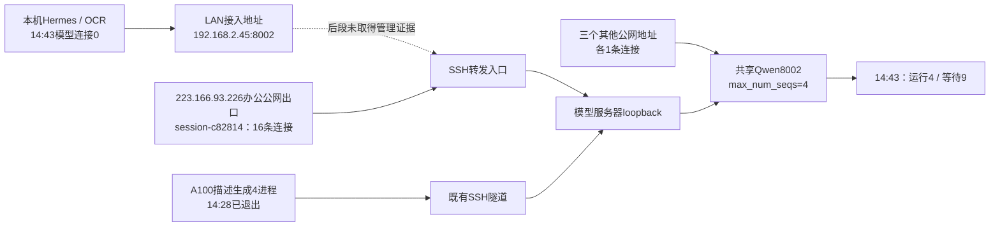

# 千问实时负载与连接来源核对

2026-10-15，时间均为北京时间（+08:00），用户可见时间到分钟。此次只读采集指标、连接、进程及调用元数据，不提交推理、不修改配置、不停止任务。

**服务当前确实繁忙，但不能再将持续排队主要归因于本机五角色。** 14:43同时核验：共享千问运行4、等待9，本机模型连接0。14:41服务器的19条8002连接中，16条loopback客户端连接均属于同一个SSH会话，来源公网地址为`223.166.93.226`；另有三个公网地址各一条连接。这个公网出口与此前确认的本机出口一致，但可能由同一办公室多台机器共用，不能据此将16条连接认定为这台开发机、五角色或用户的全部任务。

## 负载实测

| 时点或窗口 | 实测 |
|---|---|
| 13:56首样本 | 运行4，等待12，KV约2.17% |
| 14:15—14:18连续19个样本 | 运行3—4，均值3.95；等待12—17，均值15.53 |
| 上述窗口KV / 抢占增量 | KV 2.95%—3.80%；新增抢占0 |
| 上述窗口完成 / 生成吞吐 | 197.22秒完成34个请求，约10.34个/分钟；平均生成65.61 token/秒 |
| 上述窗口服务端平均耗时 | 总耗时133.95秒，其中排队90.48秒，约67.6% |
| 上述窗口首token平均耗时 | 97.57秒；该指标样本35个，与完成请求34个不是同一群体 |
| 14:41服务器复核 | 运行4、等待10，等待原因全部为`capacity`，KV约2.34% |
| 14:43本机与服务同次复核 | **运行4、等待9，KV约2.32%；本机千问连接0** |

平均排队已经约1分30秒，是当前响应慢的直接证据。排队P95只能定位在60—120秒直方图桶，不能伪造精确P95。上述窗口统计按首尾累计计数差计算，不使用一个月日志累计量冒充每分钟速率；它也不是全天负载。

实际启动参数仍为`max_num_seqs=4`、TP4、`max_model_len=1010000`，启用分块prefill与前缀缓存。等待原因指向容量，KV没有接近饱和。不过低KV并不等于算力空闲：14:26—14:27补采中，Qwen使用的GPU 4—7瞬时利用率在0%、100%、99%间变化，不能写成恒0或恒100%。GPU 3还有独立负载，不能混入该模型的TP4使用量。

窗口内缓存输入比例约86.5%，高于零但低于此前另一个工作窗口的98.6%；工作负载不同，不能直接归因为系统提示漂移或声称性能退化。平均prefill约4.25秒、decode约36.65秒；这些阶段统计不强制相加，也不能用客户端响应总耗时冒充纯排队。

证据：[连续指标汇总](evidence/metrics-summary.json)、[原始19样本](evidence/metrics-samples.jsonl)、[14:43同次快照](evidence/latest-local-and-load.json)、[服务参数及早期连接](evidence/server-sources.json)、[GPU补采](evidence/server-gpu-samples.json)。

收尾同次快照（**2026-10-15 15:29 +08:00**）：运行 **4**、等待 **12**、KV约 **3.53%**；本机千问连接 **0** 条。见[收尾快照](evidence/final-local-and-load.json)。这是独立的收尾时点，不混入上述19样本均值或14:41连接计数。

## 当前服务器连接归类

以下计数全部来自**14:41同一服务器快照**。只数模型端口8002的accepted连接，不把loopback两端重复相加，不把SSH管理连接和GET指标采样算作推理。

| 来源类别 | 连接数 | 可确认的归属 | 尚不能确认的内容 |
|---|---:|---|---|
| `127.0.0.1`转发客户端 | **16** | 客户端socket均属于`session-c82814.scope`；登录会话`Name=sysadmin`、`RemoteHost=223.166.93.226`、`Leader=4188304` | 公网出口后的具体机器、应用及任务；不能直接认定为本机Hermes |
| `61.171.204.81`直连 | 1 | 服务器外部公网客户端 | 未确认应用或是否正在推理 |
| `103.151.173.210`直连 | 1 | 服务器外部公网客户端 | 未确认应用或是否正在推理 |
| `36.43.180.172`直连 | 1 | 服务器外部公网客户端 | 未确认应用或是否正在推理 |
| 合计 | **19** | 16条来自同一办公公网出口的SSH会话，3条外部直连 | **连接比例不等于请求、token或GPU时间比例** |

无需sudo即可通过`ss --cgroup -ntpe`读取socket的cgroup，再用`loginctl show-session`核对来源。关键是看loopback的**客户端一侧：临时端口→8002**；模型服务的accepted一侧统一属于`session-c69.scope`，不能拿模型自身的cgroup给所有调用者归类。

14:48补核：`session-c82814`建立于**2026-10-12 04:45 +08:00**，服务为`sshd`，cgroup仅有两个SSH进程`4188304/4188375`，没有Python或远程业务进程。因此这里可归类为**长期SSH隧道接入**，而不是这台服务器内直接启动的Python任务。读取`SSH_CONNECTION`及该SSH控制连接的来源端口被现有权限限制，不能进一步匹配公网出口后的具体客户端。

此前仅凭`ss -p`和`/proc/<sshd>/fd`因权限不足无法继续，本次用cgroup将未知缩小到一个SSH会话。仍没有贯通任务/request ID，不能进一步虚构应用归属。本机现存`ssh llm-server`是一个终端管理连接，没有观察到`-L`参数；它与上述公网出口相同，不足以证明它就是这条转发会话。

证据：[14:41逐连接及SSH会话映射](evidence/server-end.json)、[长期SSH会话进程核验](evidence/server-end-attribution.json)、[本机SSH路由参数白名单](evidence/local-ssh-routing.json)。

## 已知应用来源及时间变化

| 应用 | 曾观察到的实际连接 / 调用 | 后续状态及本次判断 |
|---|---|---|
| 本机OCR代码审查 | 14:04唯一模型连接：`opencodereview` PID1034366→`192.168.2.45:8002`；对应TASK-12S-F、run `1fe96fde…`，审查`ingest_service.py` | 14:19触发65分钟硬截止，原状态`HARD_DEADLINE`、门禁`NOT_EVALUATED`；14:20及14:43本机模型连接0。不能当作持续的当前负载 |
| 本机Hermes定时协调者 | 13:20—14:20窗口有13个已完成Qwen请求，最后结束13:54 | 有历史负载，14:20后没有本次采样可确认的模型连接 |
| 本机Hermes群协调者 | 同一13:20—14:20窗口有9个已完成Qwen请求，最后结束13:52 | 不因两入口同时出现就认定业务重复；也不能用这些过去请求解释14:43在途队列 |
| 本机执行者 / 测试者 | 上述窗口未见新Qwen调用 | 不能拿会话存在、巡检脚本存在当作持续推理 |
| 本机一个新飞书私聊 | 13:57新会话使用DeepSeek云模型 | 不消耗本次8002槽位；全局默认仍为Qwen，不能声称五角色全部切云 |
| A100自建数据流水线 | 14:06—14:09有4条连接，来自`phase3/description_gen_llm.py`，worker PID464021—464024，父PID464019、监督PID464018，13:16启动 | 14:28原进程已退出、客户端连接0。曾是明确来源，不能仍按4条计入当前；退出本身不证明业务成功 |
| 处理机水雾及场景proxy | 已知水雾任务约13:36由用户停止；14:34容器TCP/FD交叉检查模型连接0 | proxy服务存在不等于推理；数据库残留RUNNING不能当作GPU占用 |
| 当前剩余转发来源 | 14:41仍有上述16条同SSH会话连接 | 来自办公公网出口，但尚未定位该出口后的应用；不能全塞进本机五角色、A100或水雾任务 |

本机请求统计采用证据文件冻结的**13:20—14:20窗口**。早期14:14回看60分钟曾得到39次，14:20回看60分钟得到22次，是滑动窗口边界不同，不是突然减少17次调用。累计客户端API耗时可在不同入口重叠，不能相加当成GPU时间。

证据：[本机进程与Hermes/OCR元数据](evidence/local-sources.json)、[A100及处理机](evidence/forwarding-sources.json)。

## 实际链路与未定位部分

这里需要纠正主机名称歧义：`a100-wzd`实际地址为`214.28.24.6`，它的8002是loopback SSH监听；LLM服务器实际网卡为`36.152.27.114`及`10.4.10.53`。**`192.168.2.45`不在这两台机器的网卡上**，它是另一个接入实体，不能继续称为LLM服务器的LAN网卡。本机已绕开18002旧双跳入口，但这不证明LAN接入之后没有转发。本轮没有改任何既有模型地址。

## 下一步应针对哪里

1. **先查LAN接入机及`session-c82814`后面的应用。** 当前证据已经排除把剩余连接直接归于本机五角色的做法；无需继续削减执行者、测试者或汇报来猜测减负。若该会话是统一接入隧道，需在接入机用只读socket/PID映射确认各客户端，再与源机器的任务对应。
2. **保留按应用的请求身份。** 后续来源计量需要贯通应用、角色、任务与服务端request ID；只记录元数据，不记录完整提示词或凭据。TCP、HTTP访问记录及模型完成计数继续分别报告。
3. **容量调整另行小步验证。** 当前排队证据充分，但低KV不能证明升并发必然提速。可在既有质量条件下评估4→6；本次不修改参数、不承诺同比吞吐收益。

本轮不是改动实施。没有关闭聊天入口、改巡检周期或降低测试/审查门禁。诊断GET不占用模型推理槽位；日志中GET metrics/models/health均不计作推理请求。访问日志的流式HTTP200可能在响应头发出时登记，不能拿它当推理完成。
