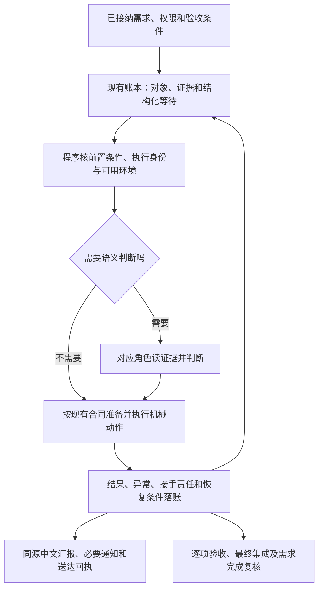

# 角色协作流程整体审计与自动化改进建议

当前机制已经能自动派单、测试、审查和接续，但**正常流程的自动化明显强于异常恢复，还不足以稳定无人值守**。主要缺口是：等待条件不够精确，异常接手没有统一覆盖，模型仍承担不少机械参数管理，版本发布和实际采用缺少完整的一致性证明。

本次基于近三天账本、运行日志、模型请求记录、当前源码及现场修复记录进行审计。**本报告列出的新建议尚未实施；本次未修改运行时代码或业务状态。** 不把历史故障重复算成当前缺陷，也不把正确的质量门禁算成故障。

## 一、范围与证据口径

- 主要统计窗口：**2026-10-31 00:00 至 2026-11-02 11:56:21，UTC+08:00**，对应账本采集最高事件号 19503。这里是三自然日截至采集时点，不是完整 72 小时。
- 最新状态补查：**11 月 2 日 12:50:33，UTC+08:00**，在单个只读事务内采集，最高事件号 19601。补查只更新现场状态，不混入前面的统计分母。
- 为便于对照历史日志，全文采用 UTC+08:00；当前 IDE 环境标注的 Asia/Tokyo 为 UTC+09:00。
- 代码对象：`hermes-role-runtime` 的 `feature/role-workflow-v3` 分支，Git 提交为 `6447ca7`，工作区包含此前多轮未提交修复。当前插件版本为 **0.17.18**，审查入口为 **1.7.1**。审计针对工作区实际源码，不只针对 Git 提交。
- 初次账本采集各查询独立执行，不是统一长事务；模型计时库与物理请求库覆盖不同，不相加。日志存在轮转，主日志最早仅覆盖到 10 月 31 日约 20:00；不同日志可能重复收录同一错误。
- 代码、统计和时间关联只能证明相应层面的事实，不能单凭它们认定某一请求的排队、网络或数据库锁是根因。

证据入口：[账本统计](evidence/ledger.json)、[运行与模型统计](evidence/telemetry.json)、[最新状态](evidence/current-state-supplement.json)、[源码快照索引](evidence/code-snapshot.json)、[证据说明](evidence/README.md)。

后续专项：[数据库容量与缩减方案](DATABASE-STORAGE-ASSESSMENT.md)、[Token消耗与前轮优化效果复核](TOKEN-EFFICIENCY-REVIEW.md)。Token专项另采至13:55，保留与本报告原统计窗口的区别，不混用分母。

## 二、先纠正当前现场判断

截至 12:50 的补查，此前“分批结果回报”的补审已经完成七个批次；前三批复用完整结果，后四批补齐。原生服务于 **12:25:57** 结束，完整报告登记事件为 **19549**。随后协调者登记审查未通过（**19568**），并作出返修决定（**19587**）；当前该任务已经进入**第三轮开发**。

“异步对账队列”的第二轮候选也已交付（**19588**），当前处于审查阶段。Foundation 其余任务仍有前置依赖；下游 Spray 的最后一项保留原开发状态，不能仅凭这一阶段字段宣称已经恢复执行。

这说明：**此前审查中断已恢复到收齐结果并作出裁决，当前这条线的等待已经转成真实返修。** 完整报告不等于审查通过，返修也不等于协调机制再次卡死。

证据：[补审原生状态](evidence/review-state.json)、[最新账本状态](evidence/current-state-supplement.json)。原生状态文件采于 12:48，当时保留“等待裁决”；随后账本已有裁决。判断时应以各证据的时间和层次区分，不能拿较早服务文件覆盖较晚业务事实。

## 三、哪些问题已修复，不能再次列为当前根因

| 用户看到的现象 | 已确认的历史原因 | 当前处理及仍需区分的边界 |
|---|---|---|
| 说“两个都批”以后一直没有生效 | 原生入口未识别这类短答复；切换需求后，上游责任没有形成安全接续链 | 0.17.15 已登记原消息、关联问题并实际调度至前置需求。用户答复、语义处理、候选批准、合入分别留证，不把答复直接变成通过 |
| 需要裁决却没有通知 | 自由文本“等用户”不生成正式问题；夜间抑制后未重建未决提醒 | 已增加正式问题、持久通知及分级提醒；仍需持续观察真实送达，口头“已上报”不能替代回执 |
| 汇报句子被截断、堆英文 | 首段提取和本地字符截断；多个出口只约束格式，未约束可读性 | 0.17.15/16 已修渲染并统一人工查询、后台及回退出口。后续应验真实报告，不能把旧截图当新版本仍失败的证据 |
| 审查没有收齐结果 | 请求超时后留下失败、未启动批次；恢复入口及跨版本兼容曾不完整 | 0.17.17 已补关联原动作的限次串行恢复，现场七批现已完整结束。恢复后仍须真实裁决 |
| 反复说本机没有 Docker/MySQL | 开发者隔离环境看不到宿主接口；旧受管入口仅覆盖特定补验 | 0.17.18 已打通普通候选、最终集成、旧补验的本地 MySQL 8.4。环境冒烟通过不代表 Foundation 专用验收通过 |
| 账本每页写入大量重复正文 | 旧工作输入直接保存大正文 | 已改为不可变引用；本窗口工作输入结果最大约 4.3 KB。历史大体积尚未归档，属于另一问题 |

修复记录：[接续与通知](../../../hermes-role-runtime/COORDINATION-FLOW-REPAIR-20261102.md)、[报告语言](../../../hermes-role-runtime/REPORT-LANGUAGE-REPAIR-20261102.md)、[审查恢复](../../../hermes-role-runtime/REVIEW-RECOVERY-REPAIR-20261102.md)、[本地 MySQL](../../../hermes-role-runtime/LOCAL-MYSQL-ENVIRONMENT-REPAIR-20261102.md)。这些记录中的多轮测试存在交叉覆盖，不合计为唯一用例数。

12:48 的加载回执为已激活，所列 **75 个源码哈希全部匹配**，激活辅助文件也匹配。因此没有证据把本次所有问题归结为“修了但没部署”。不过这一回执仍不等于每个在途进程都已实际采用全部新行为，见问题六。

## 四、三天数据说明了什么

| 观察 | 结果 | 正确解释 |
|---|---:|---|
| 候选交付 / 测试发布 / 候选裁决 / 合入 / 需求完成 | 15 / 16 / 17 / 3 / 1 | 有实际推进；这些事件不是同一批对象的一对一漏斗，不能相除算成功率 |
| 协调者执行绑定 | 663 次 | 其中 19 次时间窗关联到本次选取的业务转换；其余未关联不能直接叫空转，仍可能包含分析、读证据和等待处理 |
| 协调者物理主请求成功记录 | 3148 条 | 与执行次数、另一计时库的请求数属于不同口径，不相加 |
| 协调者本地完成请求耗时 | 中位约 30 秒，95 分位约 135 秒，最长约 1034 秒 | 存在长尾，尚不能全部归因为模型排队；需要分阶段计时 |
| 会话预算采样 | 825 份，其中 71 份达到检查点阈值 | 显示长会话与接续成本；不能证明全由重复读材料造成 |
| 新建工作单的结构化接续记忆 | 36 份中 0 份采用 | 功能已存在，但没有被实际采用；自由文本检查点仍在使用 |
| 未发行事件水位拒绝 | 39 次 | 工具使用与参数准备有改进空间；不应解除未读确认保护 |
| 日志中的余额不足代码 | 93 处提及 | 未按请求去重，不是 93 起独立故障 |
| 数据库体积 | 约 3.18 GB | 后续专项核查确认命令历史表占98.35%，主要为旧输入正文；[构成与缩减方案](DATABASE-STORAGE-ASSESSMENT.md)。附件总体积仍未完整采集 |

通知方面，本窗口已发送状态短报 90 条、协调进展 61 条、时段总结 30 条及内部升级 7 条；截至主快照，没有本窗口新增且仍处于待发送或送达未知的记录。全历史还有 **15 条旧时段总结送达未知**，最晚来自 10 月 29 日，不能写成“这三天丢了 15 条消息”，也不能直接自动重发。

SQL 日志也需要纠偏：54 处操作错误中，50 处为字段不存在、1 处为表不存在。按同一日志条目重新核查，51 处字段/表错误里 **44 处包含临时 `<string>` 脚本栈**，支持模型临时查询误猜结构这一解释；不能把全部错误说成运行时数据库迁移坏了。旧采集文件里的邻近栈帧不是因果调用栈。此次也没有足够证据认定普遍 SQLite 锁竞争；抽查事件统计约 0.006 秒、命令时间统计约 1.65 秒，不能泛化为所有查询都快或都慢。

## 五、当前仍需修复的八类机制问题

### 1. 等待对象不够精确，读取了新事件容易被当作取得了进展

**判定：代码确认的机制局限；反复恢复规模有日志支持，具体无效调用比例未知。优先级 P1。**

当前准入将同一需求游标之后的大部分非机械事件视为相关事件，没有统一按“本工作单到底在等哪个前置对象”筛选。重复恢复退避主要判断确认水位有没有推进；确认读过新事件与任务前置条件真正变化并不是一回事。自由文本等待另有十五分钟复核，以及协调者仓库分支、版本或由脏变干净时的唤醒。

这能避免永远沉睡，但也会让不改变本任务条件的活动触发模型重读、重报、再保存等待。协调者 663 次执行、C 的单个工作单恢复 61 次是需要追查的信号，不是这些调用都无效的证明。

**建议：** 在现有账本和调度器中增加结构化等待条件，记录等待对象、所需状态/证据、负责角色、下次核查时间和解除断言。程序先核条件，只将相关变化、到期核查或明确异常交给模型。保留旧文本兼容和定期兜底，分别记录“读输入进展”与“业务进展”。

**验收：** 无关任务产生事件时，不重复启动处于等待的模型；目标前置真正完成时，现有调度器在下一正常调度周期发现；人工暂停、撤权、未知外部动作仍阻止推进。不能为降低恢复次数自动确认未读事件。

代码：[准入过滤](/home/wang/work/hermes-role-runtime/business_ledger.py:481)、[退避](/home/wang/work/hermes-role-runtime/workflow_resumption.py:5)、[等待复核](/home/wang/work/hermes-role-runtime/workflow_wait.py:23)。

### 2. 异常接手按入口分别实现，新测试入口尚未完整接齐

**判定：两处代码集成遗漏已确认；尚无证据证明已因此在线重复测试或漏处理。优先级 P1，优先实施。**

第一处是本轮新增的普通候选 MySQL 验证入口：重复验证判断对旧补验和最终集成会提取稳定的环境身份，但没有同时覆盖新增的普通候选类型。临时数据库实例信息因此可能被当成真实环境修复，导致不同验证入口的重复执行控制不一致。此前验证过的“同命令重放不重新建库”仍有效；缺的是另一层一致性覆盖。

第二处是环境准备失败和结果无法核验的异常移交：现有持久异常登记和接手流程主要针对旧 MySQL 补验。普通候选没有同等自动登记；最终集成会记录测试事实，但这不等于环境准备阶段失败也有同样的异常接手链。数据库初始化又在外层生命周期中，不能只检查内层测试执行器。

这是此前扩展 MySQL 入口时配套集成没有覆盖完整，应作为本轮维护遗留明确修复。**不意味着本地 MySQL 环境修复整体无效。**

**建议：** 复用现有验证异常与环境生命周期机制，统一稳定环境身份、错误分类、原始证据、接手责任、复核期限和恢复条件。区分“命令未开始”“环境准备失败”“执行状态未知”“真实测试失败”，给出各自下一合法动作。新增入口同步验证，不另建平行异常账本。

**验收：** 普通候选、最终集成、旧补验都覆盖准备失败、结果缺失、并发请求、重复请求和进程中断；同一未改变的失败前置不能被当成已修复；真实候选或环境变化可以在原规则内重新验证。未知状态先对账，不能直接重跑。资源清理失败须可见并有接手记录，不能只靠正常退出时的清理代码。

代码：[稳定环境身份](/home/wang/work/hermes-role-runtime/workflow_verification_retry.py:7)、[环境失败移交](/home/wang/work/hermes-role-runtime/delivery_evidence.py:430)、[结果移交](/home/wang/work/hermes-role-runtime/delivery_evidence.py:521)、[异常机制适用范围](/home/wang/work/hermes-role-runtime/workflow_verification_exceptions.py:77)、[数据库生命周期](/home/wang/work/hermes-role-runtime/workflow_supplemental.py:385)。

### 3. 工具合同虽已存在，模型仍需管理太多机械参数

**判定：使用问题已发生，接口封装及采用仍有优化空间。优先级 P1。**

本窗口出现 39 次未发行水位拒绝、3 次检查点控制字段嵌套错误，以及多次翻页参数错误。日志中的临时 SQL 字段错误也说明，模型还在用猜测数据库结构的方式补取事实。

目前已经有工具参数合同、决策上下文、动作准备及部分参数草稿，不能说“没有接口”。问题是机械字段仍由模型拼装，既有入口没有覆盖或约束住所有常用路径。

**建议：** 沿现有动作准备接口补齐原生分页回执、稳定对象引用和可执行参数草稿；让模型主要填写业务判断、原因和必要语义。常见诊断提供有版本的只读视图，减少临时 SQL。水位仍只能覆盖已发行、已读取的输入，不能由程序假装模型已读或已裁决。

**验收：** 固定场景回放中，正确读取与准备后不再因模型猜水位或嵌套字段失败；旧页、未读页、错误角色、错误候选仍拒绝。准备后的事实一旦变化，执行前仍重新核验。正常流程不依赖角色自行查询内部数据库表。

代码：[动作准备及语义边界](/home/wang/work/hermes-role-runtime/workflow_decision_context.py:205)、[准备参数](/home/wang/work/hermes-role-runtime/workflow_decision_context.py:321)、[参数合同](/home/wang/work/hermes-role-runtime/workflow_contracts.py:98)。

### 4. 接续记忆有实现但没有采用，旧文字容易反复变成当前判断

**判定：采用缺口已确认；其耗时占比未测定。优先级 P1。**

窗口中新建的 36 份工作单全部没有结构化接续记忆。现有文本检查点可以保存工作，但不利于明确区分“历史判断”“本轮已核事实”和“下一步只需补核什么”。之前反复复制“等用户”的现象正说明，旧叙述一旦脱离当前事实，会持续影响接续。

**建议：** 在现有检查点中默认准备简短的接续记录：已做动作及结果引用、依赖版本、未解决条件、下一处文件/接口和下一合法动作。模型负责补充必要语义；程序负责标记已变化的候选、授权、环境和证据。优先为长期协调工作及跨会话开发接入。

**验收：** 会话退出后能定位未完成步骤；候选、环境、授权、原证据任一变化都会使相关历史结论失效。重复读材料耗时有前后对比。现有记忆检查始终不把历史结论自动认证为当前事实，这个保守设计应保留。

代码：[结构化记忆](/home/wang/work/hermes-role-runtime/workflow_work_memory.py:1)、[检查点校验](/home/wang/work/hermes-role-runtime/business_ledger.py:1172)。

### 5. 模型可用性与业务恢复之间缺少统一观测和故障处理

**判定：长尾和供应错误已观察到；统一健康闭环不足是当前代码范围内的判断。优先级 P1。**

模型路由的云端就绪判断主要确认密钥存在，本地选择主要看运行/等待指标。它们不能代表余额、服务实际可用性或某条请求的完成能力。此次看到余额不足代码反复出现，以及单请求超过十分钟的耗时长尾，但没有足够请求级关联解释每次为何慢。

**建议：** 将供应错误、退避状态、请求身份和等待中的业务动作关联起来，区分排队、生成、工具、服务收集、待裁决各段耗时。持续故障应暂停无意义重试、保留上下文，并由既有维护通知通道接手。仅在原有授权及模型策略允许时选择已有路线。

**验收：** 用隔离的假提供方和可控时间模拟余额不足、连接失败、慢响应、恢复及撤权，验证不会反复提交同一副作用，也不会把模型失败记成业务失败。审查目前固定本地的合同保持；不能用自动换模型、增加额度、延长超时来代替恢复机制。

代码：[路由选择](/home/wang/work/hermes-role-runtime/model_routing.py:36)、[就绪检查](/home/wang/work/hermes-role-runtime/model_routing.py:103)、[审查固定模型路线](/home/wang/work/hermes-role-runtime/model_routing.py:135)。

### 6. 发布回执、版本登记和实际采用不是同一件事

**判定：元数据漂移及回执文件覆盖方式已确认；未证明权限或所有进程采用错误。优先级 P1。**

当前激活回执的 75 个源码哈希全部匹配，说明相应源码确已激活。但角色池仍登记旧版本：协调者技能 1.23.0、开发者 1.13.0、测试者 1.12.2、报告样式 1.12.0、插件 0.12.0；磁盘实际已分别为 1.23.4、1.13.2、1.12.4、1.13.5 和 0.17.18。需要明确这些字段到底是绑定时快照还是当前采用版本。

此外，插件注册时各进程写同一个激活回执文件，后启动的短进程可能覆盖主服务回执；大量修复仍在未提交工作区，单靠 Git 提交无法重建当前运行版本。审查入口升级时曾遗漏旧冻结格式的兼容，也已在现场发生并修复，说明发布必须覆盖在途材料。

**建议：** 发布生成不可变清单，包含源码哈希、插件/技能/合同版本和兼容范围；各进程分别记录启动身份、加载版本及未来调用采用情况，由汇总视图展示。区分登记版本、已加载版本和已实际执行版本。将本轮维护修改按可审查批次收口，保留其他工作区改动。

**验收：** 能回答“某次执行用了哪版代码和技能”，短进程不覆盖主服务证明；旧冻结材料跨版本接续有回归；回退不会遗失在途证据或改变已发生的业务结果。哈希匹配、热加载成功与真实采用分别展示。

证据：[加载核验](evidence/deployment.json)、[版本登记对比](evidence/versions.json)。代码：[共享激活回执](/home/wang/work/hermes-role-runtime/__init__.py:1129)。

### 7. 容量采样存在长期漏扫，历史存储尚未形成归档还原闭环

**判定：采样机制缺陷与历史容量债已确认；未证明因此已发生数据库锁故障。优先级 P2。**

数据库约 3.18 GB。附件扫描每轮共享 4096 个条目预算，始终从输入页目录开始；这次前两个目录就占用了绝大部分预算，后续目录反复显示零但标记未完成。源码未保存轮转游标，因此后部目录存在长期得不到扫描的可能。

**后续专项补查（13:35 起，UTC+08:00）：** 命令历史表占3.123 GB，其中503条大于等于1 MB的旧工作输入正文合计2.859 GB；空闲页仅约78 KB，快速结构检查通过。大头是实际历史内容而非大量空洞，三条样本已确认跨页重复事件正文。应在备份副本中验证无损去重/压缩和命令读回，不能直接删除历史或指望单纯整理文件。详见[容量专项核查](DATABASE-STORAGE-ASSESSMENT.md)。此补查不改变前面三天的统计窗口。

现在给出的总量是下界，不能说测试执行、服务或数据库会话目录不占空间。新的工作输入正文写放大已经改善，应把“新增数据控制”和“历史数据归档”分开处理。

**建议：** 每目录公平配额加增量游标，展示完整度和最老未扫时间；在引用关系可追溯的前提下制定历史归档策略，先完成一致备份、附件哈希和还原演练，再处理历史体积。不得在线直接删除证据或执行压缩来制造容量改善。

**验收：** 固定目录树在有限轮次内全部被覆盖；中断后扫描可继续；数据库及所有引用附件可恢复并重放关键查询。新写入体积、历史容量、扫描不完整分别报警。

代码：[容量采样](/home/wang/work/hermes-role-runtime/workflow_capacity.py:5)。证据：[当前容量](evidence/capacity.json)。

### 8. 环境能力、专用用例与整条业务链的验收还需前移

**判定：当前业务验证缺口明确；完整场景覆盖的充分性尚未取得证据。优先级 P1。**

MySQL 8.4 已有可用受管入口，迁移和隔离并发冒烟通过；测试 NAS 路径也通过只读预检。但这些不能替代 Foundation 当前固定候选的专用升级/回滚、并发抢占及文件存储验收。反复到交付末尾才发现缺环境、缺映射或缺用例，会把已完成开发变成长期补验。

现有机制已有分阶段依赖、逐项验收覆盖、最终集成及需求完成复核，也已有隔离接续生命周期测试。不能说这些都不存在。需要补强的是：把近三天实际暴露的跨需求、跨会话、跨版本、异常中断组合成可持续回放的完整场景，并记录采用证据。

**建议：** 接纳任务时就冻结“每项验收条件—用例—环境能力—负责角色—证据格式”的映射。明确哪些测试可在普通本地环境跑、哪些必须真实 MySQL/NAS；缺用例与缺环境分别落账。沿现有最终验收机制收口，不再叠加另一套通过标准。

**验收：** 专用用例在对应固定候选上真实执行；跳过、未执行、失败不混成通过。整链回放覆盖下节场景，环境冒烟不能向真实需求发布业务通过，最终完成仍逐项核验。

代码：[集成测试事实](/home/wang/work/hermes-role-runtime/workflow_completion.py:280)、[逐项交付](/home/wang/work/hermes-role-runtime/workflow_completion.py:298)、[环境入口](/home/wang/work/hermes-role-runtime/workflow_local_environment.py:1)。

## 六、整体自动化应如何组织

不建议另建一套调度系统，也不建议继续把规则全部加进提示词。应沿当前账本、工具合同、调度器、验证执行器、服务观察器和发件箱，把同一条责任链补齐：

分工应明确：

- **程序处理确定性的事：** 精确定位对象、分页与水位、环境准备、依赖判断、动作身份、结果收集、退避、通知去重和证据索引。
- **模型处理需要理解的事：** 理解需求、分析代码和证据、判断缺陷、决定返修及逐项验收。不让模型靠反复念规则维持机械一致性。
- **用户处理真实权限边界：** 新范围、预算或原合同要求的外部发布等事项。已授权范围内的普通派单和异常恢复，不再反复让用户选择实现细节。

异常应统一经过“发现 → 保留原证据 → 明确负责方 → 在合同内恢复或升级 → 核验恢复结果 → 关闭异常”。通知已发送不等于负责人已处理；模型回合结束不等于任务完成；环境可用不等于验收通过。

## 七、建议实施顺序与整链验收

| 批次 | 做什么 | 完成标志 |
|---|---|---|
| 第一批：补齐当前恢复链 | 问题二的环境身份和三入口异常移交；问题三的高频参数准备；补关键阶段计时 | 三类测试入口出现异常后都有责任和下一动作，同一未改变失败前置不被重复执行 |
| 第二批：减少无意义恢复 | 结构化等待、精确事件关联、读输入与业务进展分开计量；启用已有接续记忆 | 无关变化不唤醒，相关结果不漏接，长会话恢复能直达未完成步骤 |
| 第三批：稳定长时间运行 | 模型健康退避、每进程版本清单、在途兼容；容量公平采样和归档还原演练 | 故障可观测可交接，发布可追溯可恢复，容量不是长期下界 |
| 贯穿各批：完成证据闭环 | 环境/用例映射前移，把现场故障固化为整链回放 | 单元回归、隔离整链、真实原生采用分别有证据，不互相替代 |

整链回放至少包含：

1. 原生用户短答复到达，协调者已有执行或正在切换需求；消息只处理一次，保留来源并最终走到合法动作。
2. 下游等待上游，安全停放后自动接续前置，最终验收后返回；人工暂停、撤权和显式新选择优先。
3. 审查部分完成后中断，关联原动作补齐，完整证据后作出通过或返修判断；历史失败不删除。
4. 普通候选、最终集成和旧补验分别出现环境准备失败、执行未知和清理失败，均能持久移交。
5. 依赖尚未满足时发生无关事件，不启动重复模型；依赖真正满足后不需用户再催。
6. 模型供应暂时不可用后恢复，不重复执行已冻结动作；模型策略、额度和审查规则不自行变化。
7. 热加载发生在旧会话或旧冻结材料在途期间，采用版本可追溯，兼容失败有明确处置。
8. 夜间抑制、白天待办提醒和送达未知分别处理；未知不自动重放，解决后的问题不继续催用户。
9. 多会话接续不把旧授权、旧候选、旧环境判断当新事实。
10. 最终集成发现真实代码问题后，返回原负责者返修，再重新验证并收口；环境缺口不冒充代码失败或通过。

这些测试应使用隔离账本、临时仓库、假提供方和可控时间；真实数据库验证使用受管独占环境。合成测试事实明确标记，不写入真实需求的验收记录。已有相关测试可复用，只补缺失组合，不为文档审计重跑昂贵业务测试。

## 八、如何衡量自动化是否真正改善

以下是建议新增的指标和验收目标，不是当前已经达到的性能承诺：

| 指标 | 统计方式 / 目标 |
|---|---|
| 异常责任覆盖 | 每个持久异常均有负责方、下一动作、复核时间及关闭证据；隔离场景覆盖率 100% |
| 相关结果到可执行接续的延迟 | 分别统计服务结束、收集、角色准入、模型判断和动作提交，不把它们混成一个“卡住时长” |
| 无条件变化时的模型恢复 | 固定回放中，无相关变化且未到复核期限时不重复启动；线上先建立基线再定降低目标 |
| 重复副作用 | 同一冻结动作重复输入不重复启动服务、测试、合入或发消息；未知执行先对账 |
| 人工介入原因 | 区分真实新增授权、业务歧义、环境故障、流程故障；普通恢复不额外制造用户审批 |
| 报告质量 | 保留七区；先说做成什么、卡在哪里、谁处理、下一步；无句中截断；事实带采集时间和可追溯证据 |
| 版本与采用 | 每次执行可定位发布清单及实际进程版本；磁盘、已加载、已执行不混称 |
| 容量可见性与可恢复性 | 附件在有限轮次内完整覆盖；归档能还原数据库及全部引用附件 |

当前应先补异常接手和精确等待，再优化恢复成本及运行保障。持续增加轮询、通知或提示词，不能单独解决这条责任链的问题。
